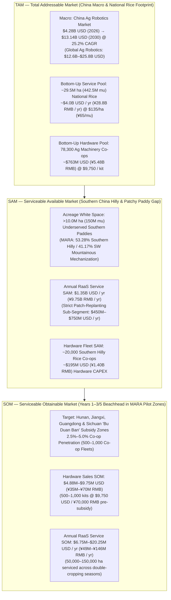

# Antenna — exploratory TAM / SAM / SOM scenario model (not validated)

> [!CAUTION]
> **Research integrity review — 7 November 2026.** The numerical market funnel, competitor prices, mechanisation subgroup percentages, subsidy assumptions, unit-cost estimates, uptake, and payback below are **unverified scenario inputs** from the original contributor research—not independently established national/regional facts or an approved forecast. Do **not** quote the figures in a pitch, use them to establish Antenna's impact, or copy them into a hardware specification. The independently sourced and corrected evidence is in [Southern China evidence audit](docs/COMMERCIALIZATION_CHINA.md), with current **rescue-first** scope in [PRODUCT](docs/PRODUCT.md). Preserve this file for the assumptions and calculations to investigate, not as the repository's market truth. In particular, the simulated peer maps, scripted docking test, PDoA/ground-speed hardware, and farm economics are distinct evidence levels.
>

> [!NOTE]
> **Repository Context & Provenance:** This research synthesizes the technical architecture and market parameters from the local Git repository (`AgentVerse_Kinematic_Quintet` on branch `docs/commercialization-research-southern-china`)—specifically [COMMERCIALIZATION_CHINA.md](docs/COMMERCIALIZATION_CHINA.md), [PRODUCT.md](docs/PRODUCT.md), [ANTENNA_RF_SUBSYSTEM.md](docs/ANTENNA_RF_SUBSYSTEM.md), and [IMMOBILIZATION_SCENARIOS.md](docs/IMMOBILIZATION_SCENARIOS.md)—combined with external data from China's **Ministry of Agriculture and Rural Affairs (MARA / 农业农村部)** and global agricultural robotics market reports.
> 
> **Contract guardrail:** These are proposed scenario parameters and assertions requiring source-level re-verification, not necessarily external data with validated denominators. [PRODUCT](docs/PRODUCT.md) is the authoritative current simulation scope and rescue-first direction.

---

## 1. Historical scenario framing (not verified market evidence)

**Antenna** is a cooperative multi-agent rice robotics platform (Scout + Planter + Rescue/Relay topology) engineered for **stand-gap mapping, precision patch replanting, and mud-immobilization recovery**.

While rice tillage (`94%–99%`) and harvesting (`83%–96%`) are heavily mechanized in China, **rice planting and stand establishment in Southern China's hilly and deep-mud paddies remains the #1 unsolved mechanization bottleneck** (`41.17%–53.28%` mechanized per MARA data, leaving **`>10 million hectares`** underserved):

1. **Why Heavy OEMs Fail ([COMMERCIALIZATION_CHINA.md](docs/COMMERCIALIZATION_CHINA.md#L7-L21)):** Ride-on transplanters (Kubota NW8S, Yanmar YR8D; `700–1,000 kg`, `\$25,000–\$45,000`) breach fragile Southern mud pans (*Lannitian* / 烂泥田 with `15–50 cm` sinkage), get immobilized (*陷车*), and cannot turn inside irregular `<0.15 ha` (*1–2 mu*) hillside terraces (*Bazhangtian* / 巴掌田).
2. **Why Agricultural Drones Fail ([PRODUCT.md](docs/PRODUCT.md#L7-L13)):** Aerial broadcast seeding (DJI Agras T50/T60, XAG P100 Pro; `\$15,000–\$25,000`) suffers from **`15%–30%` patchy emergence gaps** due to water pooling, micro-topography, typhoon lodging, and golden apple snail (*福寿螺*) predation, and cannot perform contact soil probing or sub-surface gap replanting.
3. **How Antenna Captures This White Space ([ANTENNA_RF_SUBSYSTEM.md](docs/ANTENNA_RF_SUBSYSTEM.md#L7-L56)):** Ultra-lightweight rovers (`<35–50 kg`, `<10–15 kPa` ground pressure) fuse **Dual Qorvo `DWM3000` UWB ranging/PDoA**, **Infineon `BGT60TR13C` 60GHz Doppler radar** (200 Hz true ground speed vs. wheel-slip gating), **`VL53L8CX` ToF + row whiskers**, and **Sub-1GHz Wi-Fi HaLow** mesh to scout soil firmness/moisture *before* committing the planter, avoiding soft-mud traps ([IMMOBILIZATION_SCENARIOS.md](docs/IMMOBILIZATION_SCENARIOS.md#L9-L21)) and selectively replanting only viable emergence gaps.

---

## 2. TAM / SAM / SOM Funnel Overview

To provide a rigorous commercial narrative for both hardware sales and recurring service models, the market is sized across two complementary lenses:
- **Lens 1: Agronomic Operations & RaaS Value Pool** (Annual Robotics-as-a-Service / 农业社会化托管 fee volume across addressable rice acreage).
- **Lens 2: Cooperative Hardware Fleet CAPEX** (Direct sales of 2-to-4 unit **Antenna** kits to China's `78,300` MARA-registered Agricultural Machinery Specialized Cooperatives / 农机专业合作社).

---

## 3. Detailed Breakdown & Calculations

### A. TAM — Total Addressable Market

| Valuation Method | Scope & Underlying Data | Formula / Calculation | TAM Valuation (USD & RMB) |
| :--- | :--- | :--- | :--- |
| **1. Top-Down (Macro Industry)** | **China Agricultural Robotics Market** ([COMMERCIALIZATION_CHINA.md](docs/COMMERCIALIZATION_CHINA.md#L27)) within the `\$12.6B–\$25.8B` global ag-robotics market. | Direct industry benchmark (MarketsandMarkets, 25.2% CAGR through 2030). | **`\$4.28B USD`** (2025/2026) **`\$13.14B USD`** (2030 Forecast) |
| **2. Bottom-Up (National Rice RaaS Pool)** | All rice cultivation in China (`~29.5M ha` / `442.5M mu`) priced at target socialized service rate ([COMMERCIALIZATION_CHINA.md](docs/COMMERCIALIZATION_CHINA.md#L71)). | $\text{TAM}_{\text{RaaS}} = 29.5\text{M ha} \times \$135\text{/ha}$ *(or $442.5\text{M mu} \times ¥65\text{ RMB/mu}$)* | **`\$3.98B USD / year`** (`~¥28.76B RMB / year`) |
| **3. Bottom-Up (National Co-op Hardware Pool)** | Equipping China's **78,300 MARA-registered Agricultural Machinery Specialized Cooperatives** (*农机专业合作社*) with 1 cooperative multi-robot kit (`\$7,000–\$12,500 USD`, midpoint `\$9,750`). | $\text{TAM}_{\text{HW}} = 78,300\text{ co-ops} \times \$9,750\text{/kit}$ *(or $78,300 \times ¥70,000\text{ RMB}$)* | **`\$763.4M USD`** (`~¥5.48B RMB`) |

---

### B. SAM — Serviceable Available Market

The **SAM** narrows the national rice footprint to **Southern China's fragmented, muddy, and direct-seeded paddies** where heavy 700+ kg transplanters and aerial drones fail:

1. **Geographic & Terrain Filter ([COMMERCIALIZATION_CHINA.md](docs/COMMERCIALIZATION_CHINA.md#L28-L44)):**
   - Southern China represents **`>65%` (`~19.2M ha` / `~288M mu`)** of national rice acreage (Yangtze River Basin, Southeast hilly provinces, Pearl River Delta, and Southwest China: Hunan, Jiangxi, Guangdong, Guangxi, Sichuan, Yunnan, Guizhou).
   - Per MARA statistics, planting mechanization lags at **`53.28%` in Southern low-relief hilly areas** and **`41.17%` in Southwestern hilly/mountainous areas**, leaving **`>10 million hectares` (`150 million mu`)** without viable ground-robotic planting/replanting automation.
2. **Agronomic Sub-Segment Filter ([PRODUCT.md](docs/PRODUCT.md#L7-L14)):**
   - Within Southern China, farmers who use broadcast or drone direct-seeding to bypass manual transplanting face **`15%–30%` patchy emergence gaps** from water pooling, *Lannitian* mud variations, and golden apple snails (*福寿螺*).

| SAM Segment | Addressable Base | Unit Economics Assumption | SAM Valuation (USD & RMB) |
| :--- | :--- | :--- | :--- |
| **1. Southern Underserved Rice Establishment (RaaS Annual Pool)** | **`10.0M ha`** (`150M mu`) unmechanized / hilly & muddy Southern paddies ([COMMERCIALIZATION_CHINA.md](docs/COMMERCIALIZATION_CHINA.md#L38)). | Service fee of **`¥50–¥80 RMB/mu`** (`\$105–\$165 USD/ha`, midpoint **`\$135/ha`** / **`¥65/mu`**), undercutting manual labor (`¥150–¥220 RMB/mu`). | **`\$1.35B USD / year`** (`~¥9.75B RMB / year`) |
| **2. Strict Patch-Replanting Sub-Segment (Core P0 Mission SAM)** | **`~6.5M ha`** (`~97.5M mu`) of Southern direct-seeded / broadcast paddies requiring post-emergence stand-gap scouting and targeted replanting. | Targeted scout + patch-replant fee of **`¥35–¥50 RMB/mu`** (`\$75–\$105 USD/ha`, midpoint **`\$90/ha`**), saving seed waste and preserving yield. | **`\$585M USD / year`** (`~¥4.21B RMB / year`) *(Range: `\$450M–\$750M/yr`)* |
| **3. Southern Hilly Cooperative Hardware CAPEX** | **`~20,000` cooperatives** (`~25.5%` of China's `78,300` ag-machinery co-ops located in Southern hilly / *Lannitian* rice districts). | **`\$9,750 USD`** (`¥70,000 RMB`) pre-subsidy per 2-to-4 unit **Antenna** kit ([COMMERCIALIZATION_CHINA.md](docs/COMMERCIALIZATION_CHINA.md#L70)). | **`\$195.0M USD`** (`~¥1.40B RMB`) |

---

### C. SOM — Serviceable Obtainable Market (3–5 Year Beachhead)

The **SOM** defines our realistic 3-to-5 year capture strategy anchored in **MARA's "Hilly and Mountainous Weak-Link Agricultural Machinery" (丘陵山区农机补短板)** pilot zones ([COMMERCIALIZATION_CHINA.md](docs/COMMERCIALIZATION_CHINA.md#L63-L72)):

- **Geographic Beachhead:** Top double-cropping hilly rice provinces—**Hunan, Jiangxi, Guangdong, and Sichuan**—where MARA provides **`30%–40%` direct purchase subsidies**, reducing the net cost of an **Antenna** cooperative kit from `¥70,000 RMB` (`\$9,750 USD`) to **`~¥42,000–¥49,000 RMB` (`~\$5,850–\$6,800 USD`)**.
- **Single-Kit Seasonal Capacity:**
  - In Southern China's double-cropping calendar (Early Rice + Late Rice), each 2-to-4 unit **Antenna** swarm operates across two `15–20 day` establishment/replanting windows (`30–40 operational days/year`).
  - Coverage rate: `~3.5–4.0 ha/day` (`52–60 mu/day`) $\implies$ **`100–150 ha/year` (`1,500–2,250 mu/year`) per kit**.
- **Target Market Share:** Capturing **`2.5% to 5.0%`** of the `20,000` Southern hilly rice cooperatives (**`500 to 1,000` deployed cooperative fleets**; equivalent to **`0.5%–1.5%`** of the `10M ha` Southern acreage gap).

| Revenue Stream (Year 3–5 Target) | Conservative Case (500 Kits / 2.5% Co-op Share) | Base/Target Case (1,000 Kits / 5.0% Co-op Share) | Calculation Basis |
| :--- | :--- | :--- | :--- |
| **1. Hardware Fleet Sales (CAPEX)** | **`\$4.88M USD`** (`¥35.0M RMB`) | **`\$9.75M USD`** (`¥70.0M RMB`) | `500–1,000` kits $\times$ `\$9,750 USD` (`¥70,000 RMB`) average pre-subsidy kit price. |
| **2. Annual RaaS Gross Service Volume (GMV)** | **`\$6.75M USD / yr`** (`¥48.8M RMB / yr`) | **`\$20.25M USD / yr`** (`¥146.3M RMB / yr`) | `50,000–150,000 ha/yr` (`100–150 ha/kit/yr`) $\times$ `\$135 USD/ha` (`¥65 RMB/mu`). |
| **3. Platform SaaS, Telemetry & Maintenance (20% Take-Rate on RaaS + Spares)** | **`\$1.35M USD / yr`** (`¥9.8M RMB / yr`) | **`\$4.05M USD / yr`** (`¥29.3M RMB / yr`) | `20%` recurring software/map-analytics/consumables revenue share from cooperative RaaS operations. |
| **Total Combined SOM (Gross Ecosystem Value)** | **`\$11.63M USD`** (`~¥83.8M RMB`) | **`\$30.00M USD`** (`~¥216.3M RMB`) | Hardware CAPEX + Annual RaaS Service Volume. |
| **Total Direct Company Revenue SOM (Hardware + 20% SaaS/Spares Take-Rate)** | **`\$6.23M USD / yr`** (`~¥44.8M RMB / yr`) | **`\$13.80M USD / yr`** (`~¥99.3M RMB / yr`) | Direct hardware revenue + recurring high-margin software/consumables. |

---

## 4. Buyer Unit Economics: Why Village Cooperatives Adopt Antenna

A critical requirement of the **20% Relevance and Impact** rubric ([PRODUCT.md](docs/PRODUCT.md#L77)) is demonstrating why a named human beneficiary—**Village Agricultural Machinery Cooperatives (农机专业合作社) and Direct-Seeded Rice Operators**—will economically choose **Antenna** over manual labor or heavy machinery:

$$\text{Payback Period} = \frac{\text{Net Hardware CAPEX (Post-Subsidy)}}{\text{Annual Net Service Margin}} = \frac{¥45,500\text{ RMB}}{(1,800\text{ mu/yr}) \times (¥65 - ¥18)\text{ RMB/mu}} \approx 0.54\text{ years (1–2 cropping seasons)}$$

| Metric | Manual Replanting Labor (Baseline) | Heavy OEM Transplanter (Kubota NW8S) | **Antenna Cooperative Kit (2–4 Rovers)** |
| :--- | :--- | :--- | :--- |
| **Upfront CAPEX (Pre-Subsidy)** | `¥0` (Pure OPEX, severe labor shortage; avg. farmer age `55–60+`) | `¥210,000–¥320,000 RMB` (`\$30,000–\$45,000 USD`) | **`¥50,000–¥90,000 RMB`** (`\$7,000–\$12,500 USD`; midpoint `¥70,000`) |
| **Net CAPEX After 35% MARA Subsidy** | N/A | `~¥150,000–¥220,000 RMB` | **`~¥32,500–¥58,500 RMB`** (`~\$4,500–\$8,100 USD`) |
| **Cost per Mu to Farmer** | `¥150–¥220 RMB/mu` (`¥200–¥350/day` peak wages) | `¥70–¥100 RMB/mu` *(inaccessible in `<0.15 ha` / deep mud plots)* | **`¥50–¥80 RMB/mu`** (`\$105–\$165 USD/ha`) — **55%–70% cheaper than manual labor** |
| **Immobilization & Crop Trampling Risk** | High heat stress; human foot trampling in established stands | **Severe (`700–1,000 kg`):** breaches *Lannitian* mud pans (`>30 cm` sinkage) | **Ultra-low (`<35–50 kg`, `<15 kPa`):** 200 Hz Doppler radar + UWB slip gating ([IMMOBILIZATION_SCENARIOS.md](docs/IMMOBILIZATION_SCENARIOS.md)); `<3%` NJTG crop damage |
| **Cooperative Payback Period** | N/A | `3–5 years` (idle outside 15-day transplanting window; stuck in Southern terraces) | **`<1 year` (`1–2 cropping seasons` at `1,500–2,250 mu/year`)** |

---

## 5. Historical, unverified slide draft — do not use in a pitch

> [!TIP]
> **Archived example only; all figures require verification before any external use. How the original draft proposed presenting this in the 5-Minute Pitch & 1-Page Technical PDF ([DEMO.md](docs/DEMO.md#L64-L73)):**
> Use the concise 3-bullet summary below to connect your live `≤60s` simulation episode directly to the commercial market opportunity without overclaiming field results:

- **TAM (`\$4.28B` China Ag-Robotics / `\$4.0B` National Rice Establishment Service Pool):** China cultivates `29.5M ha` (`442.5M mu`) of rice across `78,300` agricultural machinery cooperatives, within an agricultural robotics market growing at `25.2%` CAGR to `\$13.14B` by 2030.
- **SAM (`\$1.35B/yr` Southern Hilly Service Gap | `\$585M/yr` Patch-Replanting | `\$195M` Co-op Hardware):** Over `65%` of China's rice is in the South, where MARA data shows planting mechanization drops to `41.2%–53.3%` across **`>10M ha`** of fragmented terraces (*Bazhangtian*) and deep mud pans (*Lannitian*), while drone broadcast seeding leaves `15%–30%` emergence gaps.
- **SOM (`\$11.6M–\$30.0M` Combined Ecosystem Value / `500–1,000` Cooperative Fleets in Years 3–5):** Targeting a `2.5%–5%` share of Southern hilly machinery cooperatives in Hunan, Jiangxi, and Guangdong under MARA's `30%–40%` *"Bu Duan Ban"* subsidy catalog (`\$9,750` kit price, `<1 year` cooperative payback at `¥50–¥80 RMB/mu` service rates).
