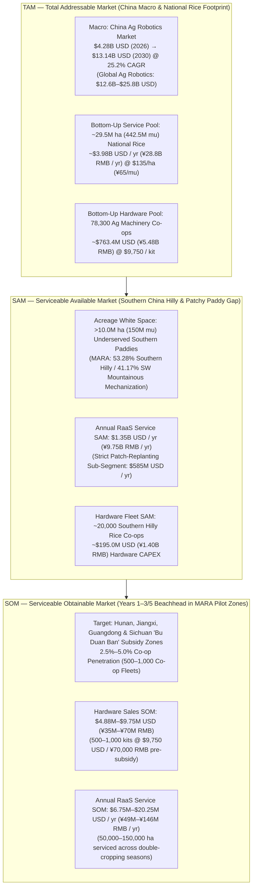

# Commercial Rice Robotics Landscape & Southern China Commercialization Criteria

**Status & Scope Qualification (7 November 2026):** This document compiles external market statistics, commercial competitor benchmarks, and post-hackathon commercialization requirements for Southern China to support the **Relevance and Impact (20%)** narrative and pitch preparation ([EVENT](EVENT.md), [DEMO](DEMO.md)). All market figures and competitor specifications are external industry/government citations, **not** measurements from our hackathon simulation. For the canonical weekend simulation scope, refer to [PRODUCT](PRODUCT.md).

---

## 1. Commercially Deployed Rice Farming Robots (Competitor Comparison Matrix)

| Robot / Product | Manufacturer & HQ | Farming Stage | Autonomy & Tech Stack | Est. Price Tier (USD) | Target Farm Profile | Key Limitation in Fragmented / Muddy Paddies |
| :--- | :--- | :--- | :--- | :--- | :--- | :--- |
| **Agri Robo NW Series** (e.g., NW8S) | **Kubota** (Japan) | Transplanting & Fertilizing | Level 4 (Unmanned in-field); RTK-GNSS + IMU + obstacle sonar | \$30,000–\$45,000 | Consolidated plains & large co-ops (Japan / NE China) | **High weight (700–1,000 kg) & single-season CAPEX:** Breaches soft Southern mud pans (*Lannitian*); requires manual seedling reload on field edges. |
| **YR-D / Auto-Transplanter** (YR8D) | **Yanmar** (Japan) | Transplanting | Level 2–3 (Linear & Auto-turn assist); RTK-GNSS + IMU | \$25,000–\$40,000 | Mid-to-large commercial rice farms | **Requires onboard human operator:** Reduces steering fatigue but does not resolve rural labor shortages or soft-mud sinking. |
| **Smart Transplanters** (NP80 / DRP) | **Iseki** (Japan) & **Daedong** (S. Korea) | Transplanting | Level 2–3; RTK-GPS + Vision AI row tracking | \$20,000–\$35,000 | Regional commercial farms | **Closed OEM ecosystems & large turning radius:** Difficult to maneuver across <0.15 ha (*1–2 mu*) irregular hilly terraces. |
| **AT2 / AG1 Autosteer Kit** | **FJDynamics** (Singapore / China) | Retrofits (Transplanting / Tillage) | Level 2 Auto-steer retrofit ($\pm 2.5\text{ cm}$ BeiDou/RTK-GNSS) | \$3,000–\$6,000 | Cost-conscious farms upgrading legacy tractors/transplanters | **Blind AB-line steering:** Automates steering wheel only; cannot sense localized soil failure, adapt task allocation, or operate unmanned. |
| **Aigamo Robot** (IGAM2) | **New Green** & **Iseki** (Japan) | Organic Weeding (Flooded Paddy) | Autonomous floating; Solar + GPS + underside rubber brushes (~6 kg) | \$1,700–\$2,500 | Small-to-mid organic flooded paddies (~1.5 ha/unit) | **Preventative turbidity only:** Stirs mud to block sunlight; cannot uproot established weeds, plant seeds, or operate in drained/patchy stands. |
| **MoonDino** | **ArvaTec** (Italy) | Mechanical Weeding (Paddy & Dry-Seeded) | Autonomous 4WD; Solar + RTK-GNSS seed-map tracking | \$15,000–\$25,000 | European (Po Valley) & large organic paddies | **Requires pre-mapped RTK seed coordinates:** Cannot dynamically scout unmapped emergence gaps or recover from deep mud immobilization. |
| **WeedMan** (SJ800) / **Raku-to-ru** | **Orec** / **Kubota** (Japan) | Mechanical Weeding | Human-driven ride-on (Level 0–1); rotary tines | \$8,000–\$15,000 | Small-to-mid organic farms | **100% manual operation:** High operator heat stress and risk of trampling healthy crop stands during turning. |
| **Agras Series** (T50 / T60) | **DJI Agriculture** (China) | Direct Seeding, Spraying, Fertilizing | Autonomous 3D flight paths; BeiDou RTK + Phased Array Radar + Binocular Vision | \$15,000–\$25,000 | Smallholders (via service teams) to mega-farms | **Aerial broadcast constraints:** Surface-broadcast seeds suffer from uneven root anchorage (typhoon lodging) and snail predation; cannot perform contact soil probing or precision sub-surface patch planting; requires human battery/payload swap every 10–15 min. |
| **P100 Pro / P150** | **XAG** (China) | Direct Seeding, Spraying, Mapping | Autonomous flight; 4D imaging radar + BeiDou RTK | \$15,000–\$23,000 | Asia-Pacific & Chinese agricultural service co-ops | Same aerial contact limitation as DJI: cannot perform ground-level mechanical intervention, physical probe sampling, or sub-canopy work. |
| **Agri Robo Combine (DR/WR)** & **YH Series** | **Kubota** & **Yanmar** (Japan) | Harvesting | Level 3–4; RTK-GNSS, auto header height, yield mapping | \$80,000–\$130,000+ | Consolidated agribusinesses | **3–5 ton chassis:** Severe soil compaction and frequent immobilization in wet Southern paddies. |

---

## 2. Southern China Market Valuation & The Mechanization Gap

### Macro Market Size
- **China Agricultural Robotics Market:** Valued at approximately **\$4.28 billion USD (2025/2026)** and projected to reach **\$13.14 billion USD by 2030** at a **25.2% CAGR** (MarketsandMarkets).
- **Rice Cultivation Footprint:** China cultivates ~29–30 million hectares (~440 million *mu*) of rice annually. Over **65% of national rice acreage** lies in Southern China (Yangtze River Basin, Southeast hilly provinces, Pearl River Delta, and Southwest China: Hunan, Jiangxi, Guangdong, Guangxi, Sichuan, Yunnan, Guizhou).
- **Rural Labor Economics:** The average Chinese rice farmer is over **55–60 years old**, with peak seasonal agricultural wages in Southern provinces reaching **¥200–¥350 RMB (\$28–\$50 USD) per person-day**.

### The Exact Bottleneck: MARA Southern Hilly Mechanization Data
According to statistics from China's **Ministry of Agriculture and Rural Affairs (MARA / 农业农村部)** on rice production stages in Southern hilly and mountainous regions:
- **Rice Tillage / Plowing (机耕):** **~94.05%–99.43%** mechanized (solved via lightweight micro-tillers).
- **Rice Harvesting (机收):** **~83.25%–96.43%** mechanized (solved via compact tracked harvesters).
- **Rice Planting / Transplanting & Stand Establishment (机插秧 / 机播) — The Unsolved Gap:**
  - **Southern Low-Relief Hilly Region (南方浅丘区):** Only **53.28%** mechanized (~11.67 percentage points below the national average).
  - **Southwestern Hilly & Mountainous Region (西南丘陵山区):** Only **41.17%** mechanized (~23.78 percentage points below the national average).
- **White Space:** Over **10 million hectares** of Southern Chinese rice paddies lack effective planting/replanting automation because legacy 700+ kg transplanters cannot handle Southern field conditions.

### Why Existing Machines Fail in Southern China
1. **"Lannitian" (烂泥田 — Deep, Variable Mud Pans):** Continuous double-cropping and high water tables create soft, uneven hardpans where mud sinkage depths vary from **15 cm to >50 cm** within a single plot. Heavy machinery breaks through the plow pan and gets immobilized (*陷车*).
2. **"Bazhangtian" (巴掌田 — Fragmented, Palm-Sized Terraces):** Plots frequently measure **<0.15 ha (1–2 mu)** with irregular curved borders, narrow **30–50 cm earthen bunds (田埂)**, and vertical terrace drops that heavy ride-on transplanters cannot traverse.
3. **Patchy Direct-Seeded Stands:** Because mechanical transplanting is difficult in hilly plots, many Southern farmers resort to broadcast or drone direct-seeding, which suffers from **15%–30% uneven emergence gaps** caused by micro-topography, water pooling, and golden apple snails (*福寿螺*)—creating an acute need for **targeted stand-gap scouting and precision replanting**.

---

## 3. TAM / SAM / SOM Market Sizing (Top-Down & Bottom-Up Analysis)

To ground **Antenna** across both **Robotics-as-a-Service (RaaS / 农业社会化托管)** and **Direct Cooperative Hardware Sales (CAPEX)**, the market is sized using two complementary lenses based on MARA statistics (**78,300 Agricultural Machinery Specialized Cooperatives / 农机专业合作社** nationwide):



### A. TAM — Total Addressable Market

| Valuation Method | Scope & Underlying Data | Formula / Calculation | TAM Valuation (USD & RMB) |
| :--- | :--- | :--- | :--- |
| **1. Top-Down (Macro Industry)** | **China Agricultural Robotics Market** within the \$12.6B–\$25.8B global ag-robotics market. | Direct industry benchmark (MarketsandMarkets, 25.2% CAGR through 2030). | **\$4.28B USD** (2025/2026)<br>**\$13.14B USD** (2030 Forecast) |
| **2. Bottom-Up (National Rice RaaS Pool)** | All rice cultivation in China (~29.5M ha / 442.5M *mu*) priced at target socialized service rate. | $\text{TAM}_{\text{RaaS}} = 29.5\text{M ha} \times \$135\text{/ha}$<br>*(or $442.5\text{M mu} \times ¥65\text{ RMB/mu}$)* | **\$3.98B USD / year**<br>(~¥28.76B RMB / year) |
| **3. Bottom-Up (National Co-op Hardware Pool)** | Equipping China's **78,300 MARA-registered Agricultural Machinery Specialized Cooperatives** (*农机专业合作社*) with 1 cooperative multi-robot kit (\$7,000–\$12,500 USD, midpoint \$9,750). | $\text{TAM}_{\text{HW}} = 78,300\text{ co-ops} \times \$9,750\text{/kit}$<br>*(or $78,300 \times ¥70,000\text{ RMB}$)* | **\$763.4M USD**<br>(~¥5.48B RMB) |

### B. SAM — Serviceable Available Market

The **SAM** narrows the national rice footprint to **Southern China's fragmented, muddy, and direct-seeded paddies** where heavy 700+ kg transplanters and aerial drones fail ([PRODUCT](PRODUCT.md), [IMMOBILIZATION_SCENARIOS](IMMOBILIZATION_SCENARIOS.md)):

| SAM Segment | Addressable Base | Unit Economics Assumption | SAM Valuation (USD & RMB) |
| :--- | :--- | :--- | :--- |
| **1. Southern Underserved Rice Establishment (RaaS Annual Pool)** | **10.0M ha** (150M *mu*) unmechanized / hilly & muddy Southern paddies (MARA mechanization gap). | Service fee of **¥50–¥80 RMB/mu** (\$105–\$165 USD/ha, midpoint **\$135/ha** / **¥65/mu**), undercutting manual labor (¥150–¥220 RMB/mu). | **\$1.35B USD / year**<br>(~¥9.75B RMB / year) |
| **2. Strict Patch-Replanting Sub-Segment (Core P0 Mission SAM)** | **~6.5M ha** (~97.5M *mu*) of Southern direct-seeded / broadcast paddies requiring post-emergence stand-gap scouting and targeted replanting. | Targeted scout + patch-replant fee of **¥35–¥50 RMB/mu** (\$75–\$105 USD/ha, midpoint **\$90/ha**), saving seed waste and preserving yield. | **\$585.0M USD / year**<br>(~¥4.21B RMB / year)<br>*(Range: \$450M–\$750M/yr)* |
| **3. Southern Hilly Cooperative Hardware CAPEX** | **~20,000 cooperatives** (~25.5% of China's 78,300 ag-machinery co-ops located in Southern hilly / *Lannitian* rice districts). | **\$9,750 USD** (¥70,000 RMB) pre-subsidy per 2-to-4 unit **Antenna** kit. | **\$195.0M USD**<br>(~¥1.40B RMB) |

### C. SOM — Serviceable Obtainable Market (3–5 Year Beachhead)

The **SOM** targets MARA **"Hilly and Mountainous Weak-Link Agricultural Machinery" (丘陵山区农机补短板)** pilot zones in **Hunan, Jiangxi, Guangdong, and Sichuan**, capturing **2.5% to 5.0%** of Southern hilly rice cooperatives (**500 to 1,000 deployed fleets**). In Southern China's double-cropping calendar (Early Rice + Late Rice, ~30–40 operational days/year at 3.5–4.0 ha/day), each kit services **100–150 ha/year (1,500–2,250 mu/year)**:

| Revenue Stream (Year 3–5 Target) | Conservative Case (500 Kits / 2.5% Share) | Base/Target Case (1,000 Kits / 5.0% Share) | Calculation Basis |
| :--- | :--- | :--- | :--- |
| **1. Hardware Fleet Sales (CAPEX)** | **\$4.88M USD** (¥35.0M RMB) | **\$9.75M USD** (¥70.0M RMB) | 500–1,000 kits $\times$ \$9,750 USD (¥70,000 RMB) average pre-subsidy kit price. |
| **2. Annual RaaS Gross Service Volume (GMV)** | **\$6.75M USD / yr** (¥48.8M RMB / yr) | **\$20.25M USD / yr** (¥146.3M RMB / yr) | 50,000–150,000 ha/yr (100–150 ha/kit/yr) $\times$ \$135 USD/ha (¥65 RMB/mu). |
| **3. Platform SaaS, Telemetry & Spares (20% Take-Rate)** | **\$1.35M USD / yr** (¥9.8M RMB / yr) | **\$4.05M USD / yr** (¥29.3M RMB / yr) | 20% recurring software/map-analytics/consumables share from cooperative RaaS operations. |
| **Total Combined SOM (Gross Ecosystem Value)** | **\$11.63M USD** (~¥83.8M RMB) | **\$30.00M USD** (~¥216.3M RMB) | Hardware CAPEX + Annual RaaS Service Volume. |
| **Total Direct Company Revenue SOM** | **\$6.23M USD / yr** (~¥44.8M RMB / yr) | **\$13.80M USD / yr** (~¥99.3M RMB / yr) | Direct hardware revenue + 20% recurring SaaS/consumables take-rate. |

### D. Cooperative Buyer ROI & Payback Period

$$\text{Payback Period} = \frac{\text{Net Hardware CAPEX (Post-35\% Subsidy)}}{\text{Annual Net Service Margin}} = \frac{¥45,500\text{ RMB}}{(1,800\text{ mu/yr}) \times (¥65 - ¥18)\text{ RMB/mu}} \approx 0.54\text{ years (1–2 cropping seasons)}$$

---

## 4. Commercialization Requirements & Criteria for Southern China

For an autonomous multi-agent rice robotics system to be commercialized in Southern China, it must satisfy five operational, technical, and regulatory gates:

### A. Physical & Terrain Engineering Criteria
1. **Mass & Ground Pressure:** Individual robots must weigh **<35–50 kg** (portable by two operators across narrow 30 cm bunds without ramps) and exert **<10–15 kPa** ground pressure to avoid breaching fragile plow pans.
2. **Mud & Water Trafficability:** Capable of operating in **15–35 cm mud sinkage** or drained/intermittently irrigated (*AWD*) soil lanes, with active slip/immobilization detection (comparing commanded velocity against actual displacement/odometry).
3. **Environmental Sealing:** Minimum **IP67 / IP68** protection against mud ingress, acidic red soils (pH 4.5–6.0), chemical fertilizers, and **35°C–42°C / >85% RH** heat during the summer double-cropping rush (*双抢*).
4. **Compact Kinematics:** Turning radius **<0.8 m** to navigate irregular plot corners without trampling established rice hills.

### B. Navigation, Sensing & Agentic Architecture Criteria
1. **Indigenous BeiDou (BDS-3) RTK Compatibility:** Must integrate domestic **BeiDou-3 RTK** positioning ($\pm 2\text{ cm}$ accuracy)—over 2 million Chinese agricultural machines use BDS terminals, and BeiDou compatibility is mandatory for national smart-ag subsidies.
2. **Offline Edge Control & Local Mesh:** Mountain valleys in Southern/Southwestern China suffer from cellular dead zones and water-surface multi-path GNSS interference. Safety-critical control, local obstacle avoidance, and robot-to-robot state sharing must run over local edge compute and local RF mesh (e.g., LoRa / Wi-Fi HaLow / 2.4 GHz) without requiring cloud LLM calls on every control tick.
3. **Risk-Aware Multi-Objective Planning:** Must explicitly trade off **agronomic benefit** (filling high-value emergence gaps), **crop protection** (never trampling established healthy rice stands), **route energy**, and **immobilization/recovery risk**.

### C. Regulatory & Subsidy Criteria
1. **MARA "Bu Duan Ban" (农机补短板) Catalog Eligibility:** Must align with MARA's priority **"Hilly and Mountainous Weak-Link Agricultural Machinery" (丘陵山区农机补短板)** directory to unlock **30%–40% direct purchase subsidies** for buyers.
2. **NJTG Appraisal Standards:** Must pass provincial Agricultural Machinery Testing and Appraisal (*农机试验鉴定*) thresholds:
   - Seedling/crop trampling damage rate (*伤秧率*): **<3%**
   - Missed target placement rate (*漏播/漏插率*): **<5%**
3. **Geospatial Data Compliance:** High-resolution field maps must remain on local/domestic edge storage in compliance with China's Surveying and Mapping Law.

### D. Unit Economics & Go-To-Market Criteria
1. **Hardware CAPEX Target:** Complete 2-to-4 unit cooperative kit priced at **¥50,000–¥90,000 RMB (\$7,000–\$12,500 USD)** pre-subsidy (~¥35,000–¥60,000 RMB post-subsidy), matching the capital budget of village-level Agricultural Machinery Cooperatives (*农机专业合作社*).
2. **RaaS (Agricultural Socialized Service / 农业社会化托管) Rate:** Operational cost must support a service fee of **¥50–¥80 RMB per mu (\$105–\$165 USD/ha)**, undercutting manual transplanting/replanting labor (¥150–¥220 RMB/mu).

---

## 5. Reusable Agent Prompt (Pitch, Strategy & Parameter Grounding)

Copy the prompt block below into any pitch-generation, documentation, or scenario-design agent when framing the commercial trajectory of the project:

```markdown
# ROLE & CONTEXT
You are the Commercialization and Domain Strategy Agent for our autonomous multi-agent rice farming robotics project (developed for the UCL AI Society AgentVerse 2026 Hackathon).
- **Hackathon Core Proof (Antenna / `rice.v1`):** Two cooperative ground robots (a Scout sampling local soil/stand indicators and a Planter physically releasing seed proxies into viable stand gaps) sharing an uncertainty-aware field map, coordinating safe non-overlapping routes, and adapting to mid-episode terrain/obstacle surprises without hidden ground-truth leakage.
- **Long-Term Commercial Vision (Antenna):** Scaling the Scout–Planter–Rescue multi-agent architecture to solve the #1 mechanization bottleneck in Southern China's flooded and hilly rice paddies.

# VERIFIED MARKET STATS TO CITE
1. **TAM / SAM / SOM Market Sizing:**
   - **TAM ($4.28B China Ag-Robotics / $3.98B National Rice Service Pool / $763.4M Co-op Hardware):** China cultivates ~29.5M ha (442.5M mu) of rice across 78,300 MARA-registered agricultural machinery cooperatives, within a market growing at 25.2% CAGR to $13.14B by 2030.
   - **SAM ($1.35B/yr Southern Hilly RaaS Pool | $585M/yr Patch-Replanting | $195M Southern Co-op Hardware):** Over 10M ha of Southern paddies lack effective ground planting automation (~20,000 Southern hilly co-ops), and direct-seeded plots (~6.5M ha) require stand-gap scouting and targeted replanting.
   - **SOM ($11.63M–$30.00M Combined Ecosystem Value / $6.23M–$13.80M Direct Revenue in Years 3–5):** Capturing 2.5%–5.0% of Southern hilly machinery cooperatives (500–1,000 fleets in Hunan, Jiangxi, Guangdong, Sichuan) under MARA's 30%–40% subsidy catalog (<1 year cooperative payback at ¥50–¥80 RMB/mu service rates).
2. **The Southern China Bottleneck (MARA Data):** While rice tillage (~99%) and harvesting (~83%–96%) are heavily mechanized in Southern China, **mechanical rice planting/transplanting is stuck at 53.28% in Southern hilly areas and 41.17% in Southwestern mountainous areas**—leaving >10 million hectares underserved.
3. **Why Legacy Robots Fail:**
   - *Heavy OEMs (Kubota Agri-Robo, Yanmar YR8D — $25k–$45k, 700–1,000 kg):* Break through soft Southern mud pans (*Lannitian* / 烂泥田, 15–50 cm mud depth), get immobilized, and cannot fit on fragmented <0.15 ha (*1–2 mu*) terraces (*Bazhangtian* / 巴掌田).
   - *Agricultural Drones (DJI Agras, XAG — $15k–$25k):* Broadcast seeding leads to 15%–30% patchy emergence gaps, weak root anchorage in typhoons, and snail predation; drones cannot perform physical soil probing or sub-surface gap replanting.
   - *Single-Purpose Weeders/Retrofits (Aigamo, MoonDino, FJDynamics):* Lack multi-agent hazard sharing, selective gap replanting, and fault-tolerant task reallocation.

# HOW OUR ARCHITECTURE SOLVES THE GAP
1. **Scout-Before-Commit (Preventing Immobilization & Seed Waste):** Lightweight Scouts (<35–50 kg, <15 kPa ground pressure) probe local soil firmness/moisture and stand gaps first, updating a shared belief map so Planters avoid soft-mud traps and only expend seeds where establishment benefit is positive.
2. **Mid-Episode Adaptation & Task Reallocation:** When an unexpected terrain hazard, blocked lane, or unsuitable soil reading occurs mid-mission, the coordinator dynamically replans routes, reallocates targets, or evaluates whether recovery/abstention is preferable to trampling healthy crops.
3. **China Commercialization Readiness:** Designed around domestic BeiDou (BDS-3) RTK + offline local edge control (for mountain valleys with poor connectivity) and targeted at MARA's 30%–40% "Hilly Machinery Short-Board" (丘陵山区农机补短板) subsidy catalog for Agricultural Cooperatives (农机合作社).

# GUARDRAILS (STRICT COMPLIANCE WITH REPO CONTRACT)
- Always distinguish **external market/MARA citations and post-hackathon hardware targets** from **what our weekend simulation actually executes and measures**.
- Never claim field-validated rice yield improvements, real mud continuum physics, or live hardware tests unless physically executed and verified.
```
