# P1 — Making Offline Intelligence Reliable: Research & Proposed Specification

> **Document Status:** **RESEARCH & PROPOSED DESIGN — NOT YET IMPLEMENTED.**  
> **Source Baseline Audited:** `main` at `326771d` (7 November 2026), covering [`src/ricebot/agent/planner.py`](../src/ricebot/agent/planner.py), [`src/ricebot/agent/rescue.py`](../src/ricebot/agent/rescue.py), [`src/ricebot/agent/mycelial_swarm.py`](../src/ricebot/agent/mycelial_swarm.py), [`src/ricebot/control.py`](../src/ricebot/control.py), [`src/ricebot/robot/rovers.py`](../src/ricebot/robot/rovers.py), and [`src/ricebot/mujoco_sim/adapter.py`](../src/ricebot/mujoco_sim/adapter.py).  
> **Intended Handoff:** Actionable research and mathematical specification for **Agent C** (Sensing / Peer Information / Outages) and **Agent D** (Fleet Agent / Offline Triage / Recovery State Machine), coordinated with **Agent A** (Contracts) per [`docs/FIVE-AGENT-RECONCILIATION.md`](FIVE-AGENT-RECONCILIATION.md) and [`docs/SWARM_EDGE_PLAN.md`](SWARM_EDGE_PLAN.md).

---

## 1. Executive Summary & P1 Checklist

This document specifies the research, mathematical formulations, state machines, data structures, and verification tests required to complete **P1 — Make offline intelligence reliable**:

- [ ] **6. Improve the mathematical rescue optimiser** — Replace arbitrary fixed weights where possible with calibrated costs, uncertainty, and hard safety constraints.
- [ ] **7. Implement complete offline recovery decisions** — Investigate, self-recover, rescue, defer, or escalate without an LLM.
- [ ] **8. Repair decentralised coordination** — Remove exact peer-pose leakage and ensure local maps, task bids, and gossip work during partial outages.
- [ ] **9. Test complete communication loss** — Verify behaviour before, during, and after a rescue, including safe continuation or abort.

---

## 2. Forensic Audit of Current `main` (`326771d`)

| P1 Item | Audited Files on `main` | Current Gaps & Vulnerabilities Identified (To Be Repaired) |
| :--- | :--- | :--- |
| **Item 6: Mathematical Rescue Optimiser** | [`src/ricebot/agent/planner.py`](../src/ricebot/agent/planner.py) [`src/ricebot/agent/rescue.py`](../src/ricebot/agent/rescue.py) [`src/ricebot/agent/mycelial_swarm.py`](../src/ricebot/agent/mycelial_swarm.py) | 1. **Magic-weight linear sums:** Both `CooperativeSwarmPlanner.evaluate_rescue_worth` (`planner.py`) and `RescueEngine.evaluate` (`rescue.py` lines 886–932) linearly combine incompatible units: `0.95 * seeds_needed`, `0.55` (binary offline flag), `0.35` (base/shard value), `1.45` (active planting cost), `0.08 * rescue_dist`, and heuristic `hazard_risk`. 2. **Bekker–Wong physics disconnected from triage gate:** [`evaluate_bekker_terramechanics`](../src/ricebot/robot/rovers.py) already computes physical forces in Newtons (`drawbar_pull_margin_n`, `required_rescue_pull_n`, `belly_clearance_m`), but `evaluate_rescue_worth` does not enforce a physical force-margin or non-entrapment chance constraint. 3. **Unreachable `ABANDON_ESCALATE` in `mycelial_swarm.py`:** In `DecentralizedMycelialRuntime.decide`, `hazard_risk = min(0.65, 0.25 + 0.15 * dist_m)` is a pure function of distance capped at `0.65` while `saved_benefit >= 0.70`, and the verdict branch only selects between `RESCUE_NOW` and `DEFER_RESCUE`. |
| **Item 7: Complete Offline Recovery Decisions** | [`src/ricebot/agent/planner.py`](../src/ricebot/agent/planner.py) [`src/ricebot/agent/rescue.py`](../src/ricebot/agent/rescue.py) [`src/ricebot/contracts.py`](../src/ricebot/contracts.py) | 1. **Duplicate/diverged enums & missing state transitions:** `planner.py` defines a 4-state `RescueVerdict` (`HEALTHY`, `RESCUE_NOW`, `DEFER_RESCUE`, `ABANDON_ESCALATE`), whereas `rescue.py` defines a separate 6-state `RescueVerdict` adding `SELF_RECOVER` and `INVESTIGATE_PERIMETER`. 2. **False-positive sensor-dropout stranding in `rescue.py`:** While `planner.py` was repaired to ignore `front_range_m is None`, `RescueEngine.detect_stranded_robots` in `rescue.py` (lines 502, 522) still flags `sensor_fault = robot.front_range_m is None` as `stranded`. 3. **No closed-loop `RecoveryFeedback` monitoring:** [`ObservationFrame.recovery_feedback`](../src/ricebot/contracts.py) is emitted by [`adapter.py`](../src/ricebot/mujoco_sim/adapter.py) during latching and extraction, but neither `planner.py` nor `mycelial_swarm.py` reads `frame.recovery_feedback` to monitor progress, escalate to dynamic yaw-shear ("Ant Wiggle"), or trigger a mid-tow safe abort. |
| **Item 8: Repair Decentralised Coordination** | [`src/ricebot/agent/mycelial_swarm.py`](../src/ricebot/agent/mycelial_swarm.py) | 1. **Omniscient global `peer_poses` leakage:** `DecentralizedMycelialRuntime.decide` constructs `peer_poses = {r.robot_id: r.pose for r in frame.robots}` and passes exact global poses to every robot's `process_local_sensors`, `integrate_lidar_hit`, `TaskMode.RESCUE` heading controller, and peer repulsion—even when `comm_mode="isolated"` or `link_ok=False`. 2. **God-view memory diffing:** Before sending a gossip packet, `sender_node` directly reads `receiver_node.local_map.seen_sample_ids`, `receiver_node.local_map.slam.cells`, and `receiver_node.local_map.planted_sites` in Python memory. 3. **Global bid sorting & non-expiring conflict set:** `all_connected_bids` sorts bids across all nodes in a single global list, and `self._negotiated_conflicts` never expires. |
| **Item 9: Test Complete Comms Loss** | [`src/ricebot/agent/mycelial_swarm.py`](../src/ricebot/agent/mycelial_swarm.py) [`src/ricebot/control.py`](../src/ricebot/control.py) | 1. **Radio loss freezes decentralized wheels:** `DecentralizedRobotNode.compute_local_command` (`mycelial_swarm.py` line 603) halts wheel motion whenever `not obs.link_ok`, conflating inter-robot radio loss with an onboard actuator fault. 2. **Mid-rescue blackout drops active rescue:** `DecentralizedMycelialRuntime.decide` requires `r.robot_id in reachable_peers.get(stranded_id)` on every tick (`mycelial_swarm.py` line 1055), and `LocalController.command` requires `robot.link_ok` (`control.py` line 85). If comms drop *while* a helper is approaching or cam-latched to a victim, the helper immediately drops `TaskMode.RESCUE` mid-pull. |

---

## 3. Item 6 Proposal — Calibrated Mathematical Rescue Optimiser with Uncertainty & Hard Safety Constraints

### 3.1 Architectural Design: Lexicographic Safety Gate + Unified Agronomic Currency

Hard physical safety limits must never be linearly traded off against seed inventory counts. We propose replacing the heuristic weighted sum with a **two-stage Chance-Constrained / Lexicographic Optimiser**:

1. **Stage I — Hard Safety & Terramechanics Feasibility Gate ($\mathcal{F}_{\text{safe}} \in \{\text{PASS}, \text{VETO}, \text{UNCERTAIN}\}$):** Enforces zero crop incursion, helper non-entrapment, and positive 8-wheel tandem drawbar extraction margin in Newtons using [`evaluate_bekker_terramechanics`](../src/ricebot/robot/rovers.py) evaluated over the robot's Gaussian belief distribution $(\mu_M, \sigma_M, \mu_F, \sigma_F)$.
2. **Stage II — Counterfactual Expected Viable Seeds Optimiser ($\Delta \mathbb{E}[Y_{\text{viable}}]$):** Evaluates all feasible actions in a **single calibrated physical currency**—expected viable stand-gaps planted within the remaining episode time horizon $T_{\text{rem}} = T_{\text{horizon}} - t$.

### 3.2 Stage I: Uncertainty-Propagated Bekker–Wong Hard Safety Constraints

Let stranded victim $v$ be at estimated pose $\hat{\mathbf{x}}_v = (\hat{x}_v, \hat{y}_v, \hat{\psi}_v)$ and candidate helper $h$ at $\mathbf{x}_h$. To engage the rigid cam-latch, helper $h$ must drive its front docking cone to the victim's rear docking apron:

$$\mathbf{x}_{\text{apron}} = \begin{bmatrix} \hat{x}_v - L_{\text{couple}} \cos\hat{\psi}_v \\ \hat{y}_v - L_{\text{couple}} \sin\hat{\psi}_v \end{bmatrix}, \quad L_{\text{couple}} = 0.285\text{ m}$$

From the decision-making robot's local belief map ([`LocalMycelialMap`](../src/ricebot/agent/mycelial_swarm.py) or [`evaluate_continuous_belief_field`](../src/ricebot/agent/mycelial_swarm.py)), let the posterior soil moisture and firmness at $\mathbf{x}_{\text{apron}}$ have mean and standard deviation $(\mu_M, \sigma_M)$ and $(\mu_F, \sigma_F)$. For a specified maximum second-casualty risk budget $\delta \in (0, 0.10]$ (e.g., $\delta = 0.05 \implies \beta = \Phi^{-1}(1-\delta) = 1.645$), define the **pessimistic** (worst-case soft/wet) and **optimistic** (best-case firm/dry) confidence bounds:

$$M_{\text{UCB}} = \text{clip}(\mu_M + \beta \sigma_M, \; 0.05, \; 0.98), \quad F_{\text{LCB}} = \text{clip}(\mu_F - \beta \sigma_F, \; 0.05, \; 0.98)$$

$$M_{\text{LCB}} = \text{clip}(\mu_M - \beta \sigma_M, \; 0.05, \; 0.98), \quad F_{\text{UCB}} = \text{clip}(\mu_F + \beta \sigma_F, \; 0.05, \; 0.98)$$

Evaluating [`evaluate_bekker_terramechanics`](../src/ricebot/robot/rovers.py) at these bounds yields four hard constraints:

1. **Constraint C1 — Zero Protected-Crop Incursion ($C_{\text{crop}} = 0$):**
   For every protected stand $s \in \mathcal{S}_{\text{protected}}$ (`permitted == False`), the swept approach corridor $\Gamma(\mathbf{x}_h, \mathbf{x}_{\text{apron}})$ must satisfy:
   $$\min_{\mathbf{p} \in \Gamma(\mathbf{x}_h, \mathbf{x}_{\text{apron}})} \|\mathbf{p} - \mathbf{c}_s\|_2 \ge r_{\text{no-go}, s} + b_{\text{half-width}} + \beta \sigma_{\text{pose}, v}$$

2. **Constraint C2 — Helper Non-Entrapment Chance Constraint ($\mathbb{P}(\text{helper bellies out}) \le \delta$):**
   Let $\texttt{sink}_{h,\text{pess}} = \texttt{evaluate\_bekker\_terramechanics}(\texttt{helper\_spec}, \text{moisture}=M_{\text{UCB}}, \text{firmness}=F_{\text{LCB}})$. Require:
   $$\texttt{sink}_{h,\text{pess}}.\texttt{bellied\_out} = \text{False} \quad \text{and} \quad \texttt{sink}_{h,\text{pess}}.\texttt{belly\_clearance\_m} \ge 0.006\text{ m}$$

3. **Constraint C3 — Positive Tandem Extraction Force Margin (in Newtons):**
   When helper $h$ engages the cam-latch and applies pitch-lift $\theta_{\text{pitch}} \in [0.08, 0.15]\text{ rad}$, vertical prying unloads victim belly suction by factor $\eta_{\text{lift}} \approx 0.65$. The net 8-wheel tandem drawbar pull margin (in Newtons) at the pessimistic bound $(M_{\text{UCB}}, F_{\text{LCB}})$ is:
   $$F_{\text{tandem}}^{\text{LCB}} = \texttt{sink}_{h,\text{pess}}.\texttt{drawbar\_pull\_margin\_n} - (1 - \eta_{\text{lift}}) \cdot \texttt{sink}_{v,\text{pess}}.\texttt{required\_rescue\_pull\_n}$$
   Hard extraction feasibility requires $F_{\text{tandem}}^{\text{LCB}} \ge F_{\text{margin},\min}$ (e.g., $2.0\text{ N}$).

4. **Constraint C4 — Attitude & Rollover Stability Envelope:**
   $$\max(|\text{pitch}_h|, |\text{roll}_h|) \le 0.30\text{ rad} \quad \text{and} \quad \max(|\text{pitch}_v|, |\text{roll}_v|) \le \theta_{\text{rollover\_abort}} = 0.50\text{ rad}$$

#### Uncertainty-Driven Branching Between `RESCUE_NOW`, `INVESTIGATE`, and `ABANDON_ESCALATE`
Comparing pessimistic margin $F_{\text{tandem}}^{\text{LCB}}$ and optimistic margin $F_{\text{tandem}}^{\text{UCB}}$ (evaluated at $M_{\text{LCB}}, F_{\text{UCB}}$) eliminates arbitrary trap-probability thresholds:
- **Provably Safe ($F_{\text{tandem}}^{\text{LCB}} \ge F_{\text{margin},\min}$ and C1, C2, C4 hold):** Proceed to Stage II (`RESCUE_NOW` vs. `DEFER_RESCUE`).
- **Provably Unsafe ($F_{\text{tandem}}^{\text{UCB}} < F_{\text{margin},\min}$ or C1/C4 violated):** Even under optimistic soil assumptions, extraction will fail or trap the helper $\implies$ **immediate `ABANDON_ESCALATE`**.
- **Epistemically Uncertain ($F_{\text{tandem}}^{\text{LCB}} < F_{\text{margin},\min} \le F_{\text{tandem}}^{\text{UCB}}$):** The terrain around the victim has high uncertainty ($\sigma_M, \sigma_F$ large because the site is unprobed) $\implies$ **`INVESTIGATE`** (dispatch helper to a safe perimeter standoff distance $r_{\text{standoff}} = 0.27\text{ m}$ to collect a location-gated `SoilSample` before entering the mud basin).

### 3.3 Stage II: Counterfactual Expected Viable Seeds Objective ($\Delta \mathbb{E}[Y_{\text{viable}}]$)

When Stage I passes, we evaluate candidate strategies in calibrated units of **Expected Viable Seeds Planted** over the remaining episode time $T_{\text{rem}} = T_{\text{horizon}} - t$:

1. **Physics-Calibrated Durations (Seconds):**
   - Effective traversal speed: $v_{\text{eff}} = v_{\text{nom}} \cdot \texttt{sink}_{h}.\texttt{speed\_penalty\_factor}$.
   - Expected rescue duration:
     $$\hat{\tau}_{\text{rescue}}(h, v) = \frac{d_{\text{SLAM}}(\mathbf{x}_h, \mathbf{x}_{\text{apron}})}{v_{\text{eff}}} + \frac{|\Delta\psi_{\text{dock}}|}{\omega_{\text{nom}}} + \frac{d_{\text{extract}}}{v_{\text{pull}} \cdot \hat{P}_{\text{extract}}} + \tau_{\text{backoff}}$$
     where $d_{\text{extract}} = 0.18\text{ m}$, $\tau_{\text{backoff}} = 0.8\text{ s}$, and $\hat{P}_{\text{extract}} = \Phi\!\left(F_{\text{tandem}}^{\text{mean}} / \max(1.0, \sigma_{F_{\text{tandem}}})\right)$.

2. **Expected Remaining Viable Stand Gaps ($\bar{G}_{\text{rem}}$):**
   Summing the Gaussian eligibility probability across all unplanted permitted sites $s \in \mathcal{S}_{\text{rem}}$:
   $$\bar{G}_{\text{rem}} = \sum_{s \in \mathcal{S}_{\text{rem}}} \mathbb{P}(G_s \ge 0.60)\,\mathbb{P}(M_s \in [0.25, 0.80])\,\mathbb{P}(F_s \in [0.20, 0.90])$$

3. **Counterfactual Yield Comparison:**
   - **No Rescue ($\mathbb{E}[Y_{\text{no\_rescue}}]$):** Healthy fleet $H$ with total seeds $S_H = \sum_{r \in H} \text{seeds}_r$ and parallel planting capacity $C_H(T_{\text{rem}}) = |H| \cdot \lfloor T_{\text{rem}} / \bar{\tau}_{\text{plant}} \rfloor$:
     $$\mathbb{E}[Y_{\text{no\_rescue}}] = \min\!\left(\bar{G}_{\text{rem}}, \; S_H, \; C_H(T_{\text{rem}})\right)$$
   - **Immediate Rescue ($\mathbb{E}[Y_{\text{rescue\_now}}]$):** Helper $h$ spends $\hat{\tau}_{\text{rescue}}$, recovering $\text{seeds}_v$, $+1$ active rover for $T_{\text{post}} = \max(0, T_{\text{rem}} - \hat{\tau}_{\text{rescue}})$, and unshared local soil samples $\mathcal{S}_v \setminus \mathcal{S}_h$ (saving $\tau_{\text{info}} = |\mathcal{S}_v \setminus \mathcal{S}_h| \cdot \bar{\tau}_{\text{sample}}$ of scouting time):
     $$\mathbb{E}[Y_{\text{rescue\_now}}] = \hat{P}_{\text{extract}} \cdot \min\!\left(\bar{G}_{\text{rem}}, \; S_H + \text{seeds}_v, \; C_{H \cup \{v\}}(T_{\text{post}} + \tau_{\text{info}})\right) + (1 - \hat{P}_{\text{extract}})\,\mathbb{E}[Y_{\text{no\_rescue}}(T_{\text{post}})]$$
   - **Deferred Rescue ($\mathbb{E}[Y_{\text{defer}}]$):** If helper $h$ has an active confirmed `PLANT` target $s^*$ requiring $\tau_{\text{plant}}(h, s^*) < \hat{\tau}_{\text{rescue}}$ and slack time $T_{\text{rem}} > \tau_{\text{plant}}(h, s^*) + \hat{\tau}_{\text{rescue}} + \bar{\tau}_{\text{plant}}$, banking the guaranteed seed at $s^*$ before diverting to rescue $v$ dominates diverting immediately.

---

## 4. Item 7 Proposal — Complete Offline Recovery Decisions Without an LLM

### 4.1 Unified 6-State `RescueVerdict` & Hierarchical Finite-State Automaton

To reconcile `planner.py` and `rescue.py`, we standardise on one canonical `RescueVerdict` enum:
- `HEALTHY = "healthy"`
- `SELF_RECOVER = "self_recover"`
- `INVESTIGATE = "investigate"` (aliased with `INVESTIGATE_PERIMETER` for backward compatibility)
- `RESCUE_NOW = "rescue_now"`
- `DEFER_RESCUE = "defer_rescue"`
- `ABANDON_ESCALATE = "abandon_escalate"`

```mermaid
stateDiagram-v2
    [*] --> HEALTHY
    HEALTHY --> SELF_RECOVER: Commanded motion mismatch (slip > 0.85 for K ticks)\nAND shallow sinkage (h_belly > -8mm)\nAND self_attempts < 2
    HEALTHY --> TRIAGE_EVAL: Deep belly-out (h_belly <= -8mm)
    
    SELF_RECOVER --> HEALTHY: Displacement >= 0.025m within 2 ticks
    SELF_RECOVER --> TRIAGE_EVAL: 2 ticks elapsed with disp < 0.02m\nOR |pitch/roll| > 0.25 rad\n(Latch self_recovery_exhausted; cut wheels to HOLD)

    state TRIAGE_EVAL {
        [*] --> CheckBekkerBounds
        CheckBekkerBounds --> ABANDON_ESCALATE: F_tandem_UCB < F_min OR Crop/Rollover Veto
        CheckBekkerBounds --> INVESTIGATE: F_tandem_LCB < F_min <= F_tandem_UCB\nOR peer silent/overdue
        CheckBekkerBounds --> CompareCounterfactualYield: F_tandem_LCB >= F_min
        CompareCounterfactualYield --> DEFER_RESCUE: Helper finishing nearby PLANT\nwith positive horizon slack
        CompareCounterfactualYield --> RESCUE_NOW: E[Y_rescue_now] > E[Y_no_rescue]
        CompareCounterfactualYield --> ABANDON_ESCALATE: Healthy fleet sufficient alone
    }

    INVESTIGATE --> TRIAGE_EVAL: Standoff SoilSample ingested at r=0.27m\nOR silent peer observed via UWB/LiDAR
    DEFER_RESCUE --> RESCUE_NOW: Active PLANT seed contact verified
    
    state RESCUE_NOW {
        [*] --> Phase1_Approach
        Phase1_Approach --> Phase2_LatchAndLift: dock_dist <= 22mm & latch_rad >= 0.30
        Phase2_LatchAndLift --> Phase3_StraightPull: eq_active == 1 & pitch_lift = 0.12 rad
        Phase3_StraightPull --> Phase3b_AntWiggle: Pull stalled (disp < 0.02m after 0.4s)
        Phase3_StraightPull --> Phase4_UnlatchBackoff: RecoveryFeedback(disp >= 0.18m)
        Phase3b_AntWiggle --> Phase4_UnlatchBackoff: RecoveryFeedback(disp >= 0.18m)
        Phase1_Approach --> SAFE_ABORT: Helper slip > 0.70 OR obstacle blocks funnel
        Phase3_StraightPull --> SAFE_ABORT: Stall > 1.0s OR |pitch/roll| > 0.30 rad
        Phase3b_AntWiggle --> SAFE_ABORT: Stall > 1.0s OR |pitch/roll| > 0.30 rad
    }

    Phase4_UnlatchBackoff --> HEALTHY: Separation > 0.36m verified
    SAFE_ABORT --> ABANDON_ESCALATE: Unlatch (latch=0, pitch=0), reverse 8 ticks,\nrecord unrecoverable_mud in LocalSlamGrid
```

### 4.2 Guard Conditions & Closed-Loop Execution Rules

1. **Negative Control on `front_range_m is None` (Repairing `rescue.py` line 502):**
   - `RescueEngine.detect_stranded_robots` must **never** add a robot to `stranded` solely because `front_range_m is None`. A missing rangefinder reading triggers a local zero-velocity safety hold (`SENSOR_DROPOUT`), not a physical towing dispatch.
2. **Bounded `SELF_RECOVER` with Anti-Digging Cutoff:**
   - Executed locally by the immobilized robot for at most `MAX_SELF_RECOVERY_TICKS = 2` (`0.2–0.4 s`) using `MechanicalRescueTechnique.SELF_OSCILLATE_DIBBER` (`dibber_m = -0.050 m` + reverse grouser pulse).
   - If displacement after 2 ticks is `< 0.02 m` or `abs(pitch_rad) > 0.25`, the robot latches `self_recovery_exhausted = True`, zeroes wheel velocity (`TaskMode.HOLD`), and requests peer triage.
3. **Standoff `INVESTIGATE` Waypoint Ring:**
   - When `RescueVerdict.INVESTIGATE` is chosen, the helper navigates to a perimeter point at distance $r_{\text{standoff}} = 0.27\text{ m}$ from the site/victim center (outside `trap_radius_m = 0.24 m`, inside `probe_radius_m = 0.28 m`) to sample soil moisture/firmness safely without entering the mud trap.
4. **Closed-Loop `RecoveryFeedback` Ingestion (`monitor -> escalate -> abort`):**
   - On every tick, the planner inspects `frame.recovery_feedback`:
     - If `rf.latched and not rf.extracted` and `rf.victim_displacement_m < 0.02` after `0.4 s`, escalate technique from `DIRECT_PRY_AND_PULL` to `DYNAMIC_YAW_SHEAR_AND_PITCH_PUMP` ("Ant Wiggle") and update `ResidualRecoveryLearner` with the zero-displacement observation.
     - If `rf.victim_displacement_m < 0.02` after `1.0 s` or helper attitude/slip violates bounds, command immediate unlatch (`latch_rad = 0.0, dock_pitch_rad = 0.0`), reverse backoff, and transition to `ABANDON_ESCALATE`.

---

## 5. Item 8 Proposal — Repairing Decentralised Coordination (`mycelial_swarm.py`)

### 5.1 Four Concrete Refactorings to Eliminate Global State Leakage

1. **Remove Global `peer_poses` (`mycelial_swarm.py` line 810) $\to$ Per-Node `PeerBeliefTable`:**
   - Delete `peer_poses = {r.robot_id: r.pose for r in frame.robots}`.
   - Each `DecentralizedRobotNode` maintains `self.peer_beliefs: dict[str, PeerBeliefState]`, updated **only** when a `MycelialGossipPacket` arrives from a reachable peer over an open link (carrying `sender_pose`, `sender_speed_m_s`, `target_site_id`, `mode`, `seeds_remaining`, `state_version`).
   - During partial or total communication outages ($\Delta t = t - t_{\text{last\_rx}} > 0$), node $i$ dead-reckons peer $j$'s pose along its last announced intent vector with growing uncertainty radius $r_{\text{unc}}(\Delta t) = \min(1.50, 0.08 + 0.30\,\Delta t)$.
   - **Onboard LiDAR Dynamic-Peer Filtering (`integrate_lidar_hit`):** Instead of checking global `peer_poses`, compare `obs.front_range_m` against local UWB distance measurements `obs.peer_distances` ($\lvert d_{\text{lidar}} - d_{\text{uwb}}(j)\rvert \le 0.28\text{ m}$) or dead-reckoned peer bounds.

2. **Remove God-View Memory Diffing (`mycelial_swarm.py` lines 865–875) $\to$ Per-Peer Watermark Ledgers & CvRDT Merge:**
   - `sender_node` must never read `receiver_node.local_map`.
   - Instead, each node tracks `self.peer_watermarks: dict[str, tuple[int, int]]` recording the last `(sample_version, slam_version)` acknowledged by each peer in prior received packets.
   - When link $(i, j)$ is open and `self.local_map.state_version > self.peer_watermarks[j]`, node $i$ sends all samples and SLAM hazard cells created since that watermark.
   - Upon receipt, state merges via **Conflict-Free Replicated Data Types (CvRDTs)**:
     - `seen_sample_ids`: Grow-Only Set (G-Set) union; Gaussian precision updates are applied iff `sample_id not in seen_sample_ids`.
     - `LocalSlamGrid.cells`: Point-wise maximum log-odds $\ell_i(c) \leftarrow \max(\ell_i(c), \ell_{\text{pkt}}(c))$.
     - `planted_sites` & `attempted_sites`: G-Set union.

3. **Remove Global `all_connected_bids` (`mycelial_swarm.py` lines 969–983) $\to$ TTL-Leased Local CBBA (`peer_bid_cache`):**
   - Each node resolves task assignments using **only** its own `compute_task_bids(obs)` and non-expired entries in `self.peer_bid_cache: dict[str, tuple[TaskBidProposal, float]]` (`lease_expires_at_s = pkt.sent_at_s + 2.5`).
   - Delete the non-expiring `self._negotiated_conflicts` set; replace with epoch-stamped bid leases so nodes re-negotiate cleanly whenever beliefs change or links reconnect after a partial outage.

4. **Remove `not obs.link_ok` Wheel Freeze in Decentralised Mode (`mycelial_swarm.py` line 603):**
   - In `DecentralizedRobotNode.compute_local_command`, remove `or not obs.link_ok` from the zero-velocity guard. When a rover's radio link drops (`link_ok=False`), it must stop transmitting/receiving packets while continuing to navigate, sample, and plant using its onboard sensors and private `LocalMycelialMap`.

---

## 6. Item 9 Proposal — Testing Complete Communication Loss (Before, During, and After Rescue)

### 6.1 Persistent Onboard `ActiveRescueCommitment` (Fixing Mid-Rescue Blackout Drops)

To prevent a helper from dropping `TaskMode.RESCUE` when radio communication fails mid-approach or mid-tow (`mycelial_swarm.py` line 1055 and `control.py` line 85):
- Each node stores `self.active_rescue: ActiveRescueCommitment | None` containing `(target_robot_id, rendezvous_site_id, target_last_pose, committed_at_s, latched, max_displacement_m)`.
- Once latched onto a rescue commitment, the helper **continues executing the rescue state machine using local sensors (`front_range_m`, `peer_distances`, IMU `pitch_rad`/`roll_rad`, and `RecoveryFeedback`) regardless of `link_ok`**, until either:
  1. **Safe Continuation to Completion:** `RecoveryFeedback(extracted=True)` (`victim_displacement_m >= 0.18 m`), followed by an 8-tick separation backoff (`inter_dist > 0.36 m`), OR
  2. **Deterministic Safe Abort:** Approach timeout (`> 8.0 s`), helper slip exceedance (`s_h > 0.70`), IMU tilt exceedance (`> 0.30 rad`), or latched tow stall (`victim_displacement_m < 0.02 m` after `250` substeps), which commands `latch_rad = 0.0, dock_pitch_rad = 0.0`, backs out to firm soil, and marks the cell as `unrecoverable_mud`.

### 6.2 Four Required Comms-Loss Verification Tests

| Test Case | Comms Blackout Window | Physical Scenario & Phase Tested | Required Assertions |
| :--- | :--- | :--- | :--- |
| **1. `test_comms_loss_before_rescue`** | $t \in [0.0, \infty)\text{ s}$ (`comm_mode="isolated"`) | `scout` gets bogged at `patch_a` while completely isolated (zero SOS packets sent). | `scout` tries 2-tick `SELF_RECOVER` then holds; `planter` detects overdue/stationary peer via local UWB range / LiDAR during patrol, runs local `INVESTIGATE` $\to$ `RESCUE_NOW`, extracts `scout`, and plants viable gaps with `total_gossip_packets == 0`. |
| **2. `test_comms_loss_during_approach`** | $t \in [1.5, \infty)\text{ s}$ (cuts after SOS, before latch) | `scout` sends SOS at $t=1.2\text{ s}$; total blackout begins at $t=1.5\text{ s}$ while `planter` is $0.85\text{ m}$ away. | **Sub-case A (Firm lane):** `planter` retains `ActiveRescueCommitment`, dead-reckons to `scout`, latches, and extracts ($\Delta d \ge 0.18\text{ m}$). **Sub-case B (Quicksand lane):** `planter` detects high slip / soft perimeter locally during blackout and safely aborts (`secondary_casualty == False`). |
| **3. `test_comms_loss_during_latched_tow`** | $t \in [t_{\text{latch}}, \infty)\text{ s}$ (cuts while cam-latched) | Total blackout injected at the exact tick `RecoveryFeedback(latched=True)` becomes active. | **Sub-case A (Recoverable):** `planter` completes reverse tow under blackout, unlatches at $\ge 0.18\text{ m}$, and backs off cleanly. **Sub-case B (Pinned stall):** Under simulated anchor stall ($\Delta d < 0.02\text{ m}$ for 250 substeps), `planter` unlatches (`latch_rad = 0.0`), backs clear, and transitions to `ABANDON_ESCALATE`. |
| **4. `test_comms_loss_after_rescue`** | $t \in [t_{\text{latch}}, 9.0]\text{ s}$ (dead through unlatch & post-rescue) | Extraction and unlatch complete at $t \approx 4.5\text{ s}$ during total blackout; link reopens at $t = 9.0\text{ s}$. | Upon unlatch with dead radio, extracted `scout` blacklists `trap_site_id` and selects far sector (`patch_d`) while `planter` takes main row (`patch_b`/`patch_c`); `peer_collision_steps == 0`; when link reopens at $t=9.0\text{ s}$, CvRDT gossip merges `planted_sites` with zero duplicate drops. |
