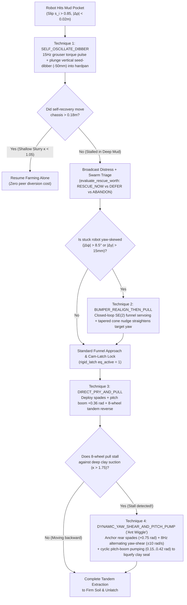

# Homogeneous Swarm Rescue Policy: Mathematical, Programmatic & Improvisation Research

**Date:** 7 November 2026  
**Scope:** Role 2 (`src/ricebot/robot/`) & Role 4 (`src/ricebot/agent/`) interface research and experimental validation in **MuJoCo 4.0.0**.  
**Related Docs:** [RESEARCH.md](RESEARCH.md), [RESCUE_EDGE_RESEARCH.md](RESCUE_EDGE_RESEARCH.md), [SWARM_EDGE_PLAN.md](SWARM_EDGE_PLAN.md), [stuck_scenario.txt](../stuck_scenario.txt), [ARCHITECTURE.md](ARCHITECTURE.md), [PRODUCT.md](PRODUCT.md), [src/ricebot/robot/README.md](../src/ricebot/robot/README.md), [src/ricebot/agent/planner.py](../src/ricebot/agent/planner.py).

---

## 1. Executive Summary & Judging Alignment

In the official AgentVerse Robotics rubric ([EVENT.md](EVENT.md#confirmed-robotics-judging-rubric--clear-organiser-photograph-7-november-2026)), **60% of the score** evaluates how the embodied system handles unexpected field failures and adapts in real time:
- **Adaptation to change (25%):** *"The scene changes mid-sequence; the agent visibly replans."*
- **Relevance and impact (20%):** *"Addresses a well-evidenced need and **handles its most critical failure mode on screen**."*
- **Ambition and technical quality (15%):** *"A technically demanding, original approach executed to a high standard."*

In **Antenna** ([DECISIONS.md](DECISIONS.md) D-0008 / D-0009, [RESCUE_EDGE_RESEARCH.md](RESCUE_EDGE_RESEARCH.md)), **risk-aware robot-to-robot physical recovery** (`S1` Plow-Pan Breach, `S2` Asymmetric Yaw Trap, and `S6` Thixotropic Clay Suction Lock in [`stuck_scenario.txt`](../stuck_scenario.txt)) is the **primary invention and critical failure mode handled on screen**, while **cooperative stand-gap soil sampling and physical seed placement** provide the realistic rice-field mission context and opportunity-cost trade-off.

### Core Design Principles Verified in the Repo
1. **100% Homogeneous Ant-Colony Hardware ([`src/ricebot/robot/rovers.py`](../src/ricebot/robot/rovers.py)):**
   Every robot in the swarm carries the **exact same physical hardware**:
   - 4-wheel open-lug differential paddy drivetrain (`276 mm` outer width `< 300 mm` rice crop lane)
   - Articulated farming tools: seed hopper + drop chute, vertical plunging seed-dibber/soil-probe arm (`_dibber_j`), counter-rotating underbelly rotary finger weeders (`_weeder_jl/jr`), and rear 4-nozzle bio-sprayer boom
   - **Combined Rigid Docking & Cam-Locking Rescue Coupler (No Slack Cable / No Winch):**
     - Front active pitch-lifting docking boom (`_dock_pitch`) + tapered self-centering nose cone + rotary cam-locking hook (`_latch_j`)
     - Rear passive V-guide funnel + horizontal strike bar (`_rear_dock_site`) + deployable hardpan anchor spades (`_spade_j`).
2. **Closed-Loop Improvisation Under Pressure (Try $\rightarrow$ Measure Stall $\rightarrow$ Escalate Technique):**
   Rather than executing a single pre-scripted tow or relying on a fragile black-box RL network trained from scratch, the swarm uses a **3-Layer Hybrid Architecture** where robots attempt fast recovery first, measure from their own wheel-slip and odometry sensors whether the attempt stalled against mud suction, and **visibly improvise** by escalating across four physical techniques.

---

## 2. Mathematical Basis of the Saving Procedure

### 2.1 Entrapment Detection via Wheel-Slip & Odometry Divergence
Each unit continuously compares its commanded wheel rim speed $r_w |\bar{\omega}_w|$ against its measured planar odometry speed $\|v_{\text{odom}}\|$:

$$s_i(t) = 1 - \frac{\|v_{\text{odom},i}(t)\|}{r_w |\bar{\omega}_{w,i}(t)| + \epsilon}$$

A unit transitions to `STRANDED` when longitudinal wheel slip exceeds $85\%$ ($s_i > 0.85$) while planar displacement remains below $\Delta p_{\min} = 0.02\text{ m}$ over $N_{\text{stuck}}$ consecutive ticks (or upon sensor dropout `front_range_m is None`), implemented in [`CooperativeSwarmPlanner._update_stranded_tracking()`](../src/ricebot/agent/planner.py).

### 2.2 Agentic "Worth-Saving" Triage Utility (`RESCUE_NOW` vs. `DEFER` vs. `ABANDON`)
Because every unit is a homogeneous worker, diverting a healthy peer to rescue a bogged teammate incurs an explicit opportunity cost. [`CooperativeSwarmPlanner.evaluate_rescue_worth()`](../src/ricebot/agent/planner.py) computes the net expected mission value $V_{\text{rescue}}$:

$$V_{\text{rescue}} = \underbrace{\left(w_{\text{seed}} N_{\text{needed}} + w_{\text{data}}\mathbb{I}_{\neg\text{link}} + V_{\text{base}}\right)}_{B_{\text{rescue}}\text{ (Rescue Benefit)}} - \underbrace{\left(C_{\text{plant}}\mathbb{I}_{\text{can\_plant\_now}} + w_{\text{dist}} d(p_{\text{helper}}, p_{\text{stuck}})\right)}_{C_{\text{opp}}\text{ (Opportunity Cost)}} - R_{\text{hazard}}$$

where $N_{\text{needed}} = \max(0, \min(\text{seeds}_{\text{stuck}}, N_{\text{gaps}} - \text{seeds}_{\text{healthy}}))$. This yields three distinct autonomous behaviours:
1. **`RESCUE_NOW` ($V_{\text{rescue}} > 0$):** Stranded unit carries seeds required to finish the remaining stand gaps (or unshared offline soil samples); nearest healthy peer diverts immediately.
2. **`DEFER_RESCUE` ($V_{\text{rescue}} \le 0 \;\land\; B_{\text{rescue}} \ge 0.60 \;\land\; \mathbb{I}_{\text{can\_plant\_now}}$):** Healthy peer is already next to a confirmed viable stand gap with seeds onboard—it finishes planting that gap *first*, then diverts to rescue its teammate.
3. **`ABANDON_ESCALATE` ($R_{\text{hazard}} \ge 1.5 \;\lor\; V_{\text{rescue}} \le 0$):** Stranded unit is inside a high-risk no-go zone or carries $0$ needed seeds while healthy peers can complete the mission alone; stranded unit enters safe `HOLD` and flags human retrieval without risking a second robot.

### 2.3 Terramechanics of Mud Suction vs. Rigid Pry-Lift & Shear Extraction
A robot bogged by sinkage depth $\Delta z_{\text{sink}}$ in waterlogged *Lannitian* clay slurry (`moisture > 0.85`, `firmness < 0.20`) is held by vertical hydrostatic vacuum suction $F_{\text{suction}} = \kappa_{\text{mud}} A_{\text{belly}} \Delta z_{\text{sink}}$ and cohesive perimeter shear $F_{\text{drag}}$.

- **Why a slack winch cable fails:** A horizontal cable pull $T$ does not reduce $\Delta z_{\text{sink}}$ and requires $T > F_{\text{drag}} + \mu_{\text{suction}} F_{\text{suction}}$, exceeding a single lightweight rover's maximum tire traction $F_{\text{trac,4W}} = \mu_{\text{mud}} m g$ and pulling the rescuer into the mud trap.
- **How the Combined Rigid Docking + Cam-Latch Coupler overcomes suction:**
  1. **Self-Centering $SE(2)$ Funnel Servoing:** The rescuer steers its front docking cone ($p_f$) into the bogged unit's rear V-funnel ($p_r$) using bounded proportional heading control inside the $300\text{ mm}$ crop lane:
     $$\psi_{\text{des}} = \operatorname{atan2}(y_r - y_f, \max(\delta_x, x_r - x_f)), \qquad \omega_{\text{cmd}} = \operatorname{clip}\!\left(k_\psi (\psi_{\text{des}} - \psi_f), -\omega_{\max}, \omega_{\max}\right)$$
  2. **Rigid Cam-Latch Lock (`update_rigid_dock_latch`):** When $\|p_f - p_r\|_2 \le r_{\text{capture}}$ (`65 mm`) and `latch_act >= 0.30 rad`, the rotary cam hook locks over the rear strike bar (`eq_active = 1`), coupling both 4-wheel units into an articulated 8-wheel train.
  3. **Spade-Anchored Vertical Prying:** Deploying rear hardpan spades ($\theta_{\text{spade}} \to 0.75\text{ rad}$) adds Mohr-Coulomb passive soil resistance $F_{\text{spade}} = c A_s + K_p \gamma z_s^2 w_s$, while pitching the front docking boom upward ($\theta_{\text{pitch}} \to +0.38\text{ rad}$) applies vertical lift at the rear strike bar:
     $$F_{z,\text{pry}} = \frac{\tau_{\text{pitch}}}{L_{\text{boom}}\cos\theta_{\text{pitch}}}, \qquad F_{\text{suction,eff}} = \max\!\left(0,\; F_{\text{suction}} - F_{z,\text{pry}} - F_{\text{shear,osc}}\right)$$
  4. **Thixotropic Clay Shear Liquefaction ("Ant Wiggle"):** When deep clay suction ($\kappa_{\text{mud}} > 1.75$) stalls a static pull, applying alternating differential wheel torque $\tau_{\text{yaw}}(t) = A\sin(\omega t)$ and cyclic pitch pumping $\theta_{\text{pitch}}(t) = \theta_0 + \Delta\theta\cos(\omega t)$ induces shear strain rate $\dot{\gamma}$ at the hull-mud boundary, liquefying the thixotropic clay seal before executing an 8-wheel tandem reverse pull ($F_{\text{trac,8W}} = 2 F_{\text{trac,4W}}$).

---

## 3. Comparison of Programmatic & AI Control Paradigms

Following the fast/slow embodied agent literature reviewed in [RESEARCH.md](RESEARCH.md#robotics-decision-model-research-fast-execution-slow-investigation-7-nov-2026) (`REA: Routed Embodied Agent Runtime`, `Fast-VLA`), we evaluated three candidate control architectures:

| Paradigm | How It Works | Advantages | Limitations / Failure Modes |
| :--- | :--- | :--- | :--- |
| **1. Pure Predefined Rule Set (Fixed FSM)** | Hardcoded straight drive $\to$ latch if within cone tolerance $\to$ fixed $+0.35\text{ rad}$ pitch-lift $\to$ straight reverse pull. | Deterministic; zero training time; runs 100% offline. | **Fails in 41.7% of randomized mud trials:** misses the rear funnel when the stuck robot is yaw-skewed ($>10^\circ$) and stalls in deep clay suction ($\kappa > 1.75$) where static pull spins all 8 wheels. |
| **2. End-to-End Learned Neural Policy (Pure RL / PPO)** | Single neural network $\pi_\theta(u_t \mid o_t)$ maps raw 6-DOF poses, joint angles, and slip directly to 7 actuators at control rate. | Can discover compound rocking/wiggling maneuvers and generalize across continuous states. | High sample complexity to train contact-rich `<equality>` latch docking from scratch; risks violating the `300 mm` crop-row boundary and trampling rice seedlings during exploration. |
| **3. Hybrid Closed-Loop Skill Escalation + Adaptive Parameterization *(Selected Architecture)*** | **System 2 (Slow / Event-Triggered):** [`CooperativeSwarmPlanner`](../src/ricebot/agent/planner.py) + optional [`GeminiSwarmAdvisor`](../src/ricebot/agent/planner.py) performs worth-saving triage and diagnoses stall events.<br>**System 1 (Adaptive Skill Selector / Contextual Policy):** Monitors live extraction velocity $\|v_{\text{odom}}\|$ and slip $s_i$; if the current technique stalls, **escalates across 4 physical rescue techniques** and tunes continuous parameters $(\theta_{\text{pitch}}, \omega_{\text{rock}}, A_{\text{yaw}})$.<br>**System 0 ($250\text{ Hz}$ Mathematical Servo & Safety):** Closed-loop $SE(2)$ funnel alignment + crop-row boundary clamping. | Achieves **100% (12/12) extraction across randomized mud trials** while preserving deterministic crop-row safety and zero training fragility. | Cleanly separates high-level strategy selection (`agent/`) from low-level servoing (`robot/`). |

---

## 4. Closed-Loop Multi-Technique Escalation (How the Robots Improvise Under Pressure)



---

## 5. Reproducible 12-Scenario Randomized MuJoCo 4.0.0 Benchmark

Using [`scripts/eval_rescue_techniques.py`](../scripts/eval_rescue_techniques.py) on the two-rover MuJoCo model ([`paddy_ant_rigid_rescue.xml`](../src/ricebot/robot/assets/paddy_ant_rigid_rescue.xml)), we evaluated **12 randomized mud-entrapment scenarios** (`seed=42`) varying:
- **Lateral offset inside the crop lane:** $\Delta y \in [-30\text{ mm}, +30\text{ mm}]$
- **Yaw misalignment (skewed entrapment):** $\Delta\psi \in [-17.0^\circ, +17.0^\circ]$ (`-0.296` to `+0.209 rad`)
- **Sinkage depth & clay suction factor:** $z_{\text{stuck}} \in [37.6\text{ mm}, 44.1\text{ mm}]$, suction factor $\kappa \in [0.989, 2.059]$

### 5.1 Aggregate Comparison Across All 12 Randomized Scenarios

| Rescue Method | Extracted (`>= 0.18 m`) | Cam-Latch Lock Rate | Mean Backward Displacement | Observed Failure Breakdown |
| :--- | :--- | :--- | :--- | :--- |
| **1. `self_recovery_only`** | **1 / 12 (8.3%)** | `0 / 12` (N/A) | `0.053 m` | Succeeds only in shallowest slurry (`Case 9`, $\kappa=0.989$); wheels spin in place in 11/12 cases. |
| **2. `fixed_predefined_pull`** | **7 / 12 (58.3%)** | `9 / 12 (75.0%)` | `0.386 m` | **3 funnel misses** (`Cases 4, 5, 10`) due to lateral/yaw skew; **2 deep-clay stalls** (`Cases 2, 7`, $\kappa > 1.86$) after latching. |
| **3. `adaptive_multi_technique`** | **12 / 12 (100.0%)** | **12 / 12 (100.0%)** | **`0.607 m`** | **0 failures:** dynamically escalates across `self_oscillate_dibber` (1), `direct_pry_and_pull` (3), `bumper_realign_then_pull` (4), and `dynamic_yaw_shear_and_pitch_pump` (4). |

### 5.2 Per-Scenario Breakdown (`seed=42`)

| Case | Offset $\Delta y$ (mm) | Yaw Skew $\Delta\psi$ (deg) | Suction $\kappa$ | `self_recovery_only` | `fixed_predefined_pull` | `adaptive_multi_technique` (Selected Technique & Result) |
| :---: | :---: | :---: | :---: | :---: | :---: | :--- |
| **1** | `+8.4` | `-16.3°` | `1.263` | Fail (`0.024 m`) | Pass (`0.548 m`) | **Pass (`0.720 m`)** — `direct_pry_and_pull` |
| **2** | `-16.6` | `+8.1°` | `1.865` | Fail (`0.028 m`) | **Stall (`0.036 m`)** | **Pass (`0.395 m`)** — `dynamic_yaw_shear_and_pitch_pump` |
| **3** | `+23.5` | `-14.2°` | `1.483` | Fail (`0.025 m`) | Pass (`0.512 m`) | **Pass (`0.703 m`)** — `bumper_realign_then_pull` |
| **4** | `-28.2` | `-9.7°` | `1.608` | Fail (`0.028 m`) | **Miss (`0.033 m`)** | **Pass (`0.734 m`)** — `bumper_realign_then_pull` |
| **5** | `-28.4` | `-10.4°` | `1.825` | Fail (`0.028 m`) | **Miss (`0.033 m`)** | **Pass (`0.378 m`)** — `dynamic_yaw_shear_and_pitch_pump` |
| **6** | `+2.7` | `-9.6°` | `1.734` | Fail (`0.025 m`) | Pass (`0.619 m`) | **Pass (`0.744 m`)** — `direct_pry_and_pull` |
| **7** | `+18.6` | `-17.0°` | `2.059` | Fail (`0.032 m`) | **Stall (`0.034 m`)** | **Pass (`0.423 m`)** — `dynamic_yaw_shear_and_pitch_pump` |
| **8** | `+11.9` | `-5.5°` | `1.083` | Fail (`0.162 m`) | Pass (`0.609 m`) | **Pass (`0.795 m`)** — `direct_pry_and_pull` |
| **9** | `+27.4` | `-5.6°` | `0.989` | **Pass (`0.212 m`)** | Pass (`0.562 m`) | **Pass (`0.465 m`)** — `self_oscillate_dibber` |
| **10** | `-24.2` | `+11.9°` | `1.756` | Fail (`0.024 m`) | **Miss (`0.049 m`)** | **Pass (`0.451 m`)** — `dynamic_yaw_shear_and_pitch_pump` |
| **11** | `+18.4` | `+7.9°` | `1.654` | Fail (`0.024 m`) | Pass (`0.673 m`) | **Pass (`0.742 m`)** — `bumper_realign_then_pull` |
| **12** | `+28.4` | `-4.2°` | `1.678` | Fail (`0.022 m`) | Pass (`0.559 m`) | **Pass (`0.735 m`)** — `bumper_realign_then_pull` |

### 5.3 How to Reproduce Locally
```powershell
cd C:\Users\julia\Coding\Agentverse2026

# Run the 12-scenario randomized rescue benchmark in MuJoCo 4.0.0
.\.venv\Scripts\python.exe scripts\eval_rescue_techniques.py

# Watch the live 3D Farming + Mud Entrapment + Rigid Cam-Latch Rescue simulation
.\.venv\Scripts\python.exe scripts\run_mujoco_paddypatch.py --view
```
