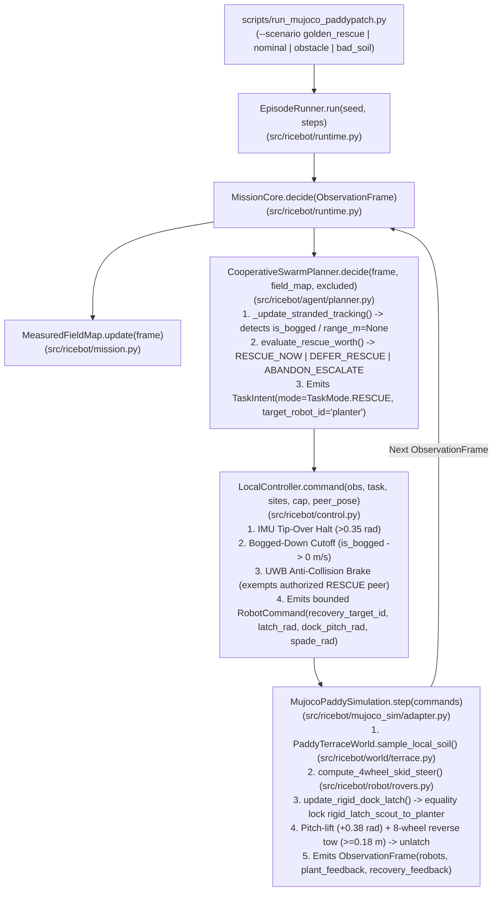

# M1-INTEGRATION — One Runnable Antenna (Integration Engineer Delivery Report)

- **Reference Base (`origin/main`):** `130e881` (`Merge pull request #35`)
- **M1 Owned Branch:** `feat/m1-antenna-integrated-rescue`
- **M1 Tested & Pushed Commit SHA:** `ce32aaf` (`https://github.com/als0fia/AgentVerse_Kinematic_Quintet/tree/feat/m1-antenna-integrated-rescue`)
- **Execution Environment:** Windows 10/11 (`win32`), Python `3.12.10` (`.venv`), MuJoCo `4.0.0`, Deterministic Seed `7`
- **Public-Repo Safety Check:** `M1-INTEGRATION.md` is stored strictly outside the public Git working tree (`git status` clean on `feat/m1-antenna-integrated-rescue`; `main` untouched).

---

## (a) Actual Current Runner & Call/Action Graph



---

## (b) File-by-File Integration Inventory

> [!IMPORTANT]
> **Two Parallel Stacks Existed on `origin/main` (`130e881`):**
> 1. **Canonical 3D Physical `rice.v1` Stack (`src/ricebot/` + `scripts/run_mujoco_paddypatch.py`):** Genuine 3D MuJoCo `mj_step` rigid-body dynamics, 4-wheel grouser-lug rovers, equality-constrained cam-latch docking, and physical seed-to-ground contact detection.
> 2. **Secondary 140-Day Lifecycle 2D Grid Stack (`src/riceswarm_ai/` + `scripts/demo_60s.py`, merged in PR #35):** A standalone 6-robot 2D grid state machine whose `MujocoBridge` (`src/riceswarm_ai/mujoco_bridge.py`) overwrites `qpos` kinematically rather than running closed-loop wheel/contact actuation over `SimulationPort`.
>
> Per M1 Rule 6, **`src/riceswarm_ai/` and `Policy B` (`src/ricebot/agent/mycelial_swarm.py`) are preserved untouched**, and `scripts/run_mujoco_paddypatch.py` over `src/ricebot/` is consolidated as the **single canonical 3D physical Antenna runner**.

| File Path | Role in Canonical Stack | Status on `origin/main` (`130e881`) | M1 Action on `feat/m1-antenna-integrated-rescue` (`ce32aaf`) |
| --- | --- | --- | --- |
| [src/ricebot/contracts.py](../../../src/ricebot/contracts.py) | Shared `rice.v1` typed data contracts | Had `is_bogged`, `pitch_rad`, `roll_rad`, `peer_distances` on `RobotObservation`, but lacked `TaskMode.RESCUE`, `TaskIntent.target_robot_id`, rescue actuator fields on `RobotCommand`, and `RecoveryFeedback` on `ObservationFrame`. | **Wired:** Added `TaskMode.RESCUE`, `TaskIntent.target_robot_id`, bounded rescue fields on `RobotCommand` (`recovery_target_id`, `dock_pitch_rad`, `latch_rad`, `spade_rad`), and `RecoveryFeedback` on `ObservationFrame`. |
| [src/ricebot/runtime.py](../../../src/ricebot/runtime.py) | `SimulationPort`, `MissionCore`, `EpisodeRunner` | Passed only `(obs, task, sites, cap)` to `LocalController.command(...)`. | **Wired:** Passes `peer_pose=observations[task.target_robot_id].pose` when `task.mode == TaskMode.RESCUE`. |
| [src/ricebot/control.py](../../../src/ricebot/control.py) | Deterministic safety & waypoint controller | Had UWB brake `min_peer_distance_m=1.0` (which froze rovers at spawn `0.50 m` apart and blocked rescue docking) and lacked `TaskMode.RESCUE` handling. | **Wired:** Set `min_peer_distance_m=0.24`, exempted authorized `TaskMode.RESCUE` helper docking with `task.target_robot_id`, gated Doppler slip throttle above startup speed (`>0.03 m/s`), and added bounded `TaskMode.RESCUE` command generation. |
| [src/ricebot/agent/planner.py](../../../src/ricebot/agent/planner.py) | `CooperativeSwarmPlanner` (`RESCUE_NOW` / `DEFER_RESCUE` / `ABANDON_ESCALATE`) | Only checked `front_range_m is None` or LiDAR obstacle block for stranding; emitted `TaskMode.SAMPLE` on `RESCUE_NOW`. | **Wired:** Detects `robot.is_bogged` (distinguishing mud immobilization from missing range data) and emits `TaskMode.RESCUE` with `target_robot_id=robot.robot_id`. |
| [src/ricebot/mujoco_sim/adapter.py](../../../src/ricebot/mujoco_sim/adapter.py) | 3D MuJoCo `SimulationPort` (`MujocoPaddySimulation`) | Never populated `is_bogged`/`pitch_rad`/`roll_rad`/`true_speed_m_s`/`peer_distances` in `_build_observation_frame()`, and never called `update_rigid_dock_latch()` in `step()`. | **Wired:** Populates all sensor reflex fields from MuJoCo sensors/velocities, models physical mud suction trap (`trap_robot_id`, `trap_site_id`), executes closed-loop SE(2) funnel approach + `update_rigid_dock_latch()` + pitch-lift (`+0.38 rad`) + 8-wheel tandem extraction (`>= 0.18 m`) + unlatching, and emits `RecoveryFeedback`. |
| [src/ricebot/robot/rovers.py](../../../src/ricebot/robot/rovers.py) | Homogeneous Paddy Ant MJCF + `update_rigid_dock_latch()` | Working 4-wheel grouser-lug chassis, farming tools, and rigid cam-latch equality constraint. | **Preserved & consumed directly** by `MujocoPaddySimulation.step()`. |
| [src/ricebot/world/terrace.py](../../../src/ricebot/world/terrace.py) | `PaddyTerraceWorld` + `ContinuousPaddyTerrain` | Working 6-patch rice terrace and location-gated soil probes. | **Preserved & consumed directly** by `MujocoPaddySimulation`. |
| [src/ricebot/agent/mycelial_swarm.py](../../../src/ricebot/agent/mycelial_swarm.py) | Simulated Policy B (`DecentralizedMycelialRuntime`) | Working per-rover local maps, SLAM obstacle bypass, and UWB/HaLow gossip. | **Preserved untouched** (`--policy mycelial` remains fully operational). |
| [scripts/run_mujoco_paddypatch.py](../../../scripts/run_mujoco_paddypatch.py) | Canonical 3D MuJoCo CLI runner & viewer HUD | Supported `nominal`, `obstacle`, `bad_soil`. | **Wired:** Added `--scenario golden_rescue` (headless JSON trace + 3D viewer distress/rescue HUD vectors + Case 8 in `--compare-policies`). |
| [scripts/check_repo.py](../../../scripts/check_repo.py) | Repo integrity & skill parity checker | Walked `.venv/` when local venv was present, failing `test_foundation_paths_references_and_skill_metadata`. | **Fixed:** Ignores `.venv` / `__pycache__` / `.git` during repo scan. |
| [tests/test_mujoco_sim.py](../../../tests/test_mujoco_sim.py) | 3D MuJoCo `SimulationPort` physics tests | Tested nominal planting, mid-run obstacle hold, and expired/unauthorized drop rejection. | **Added:** `test_autonomous_sensed_mud_fault_triggers_physical_rigid_dock_rescue_and_resumes_mission`. |

---

## (c) Exact Commands Run & Observed Working Traces

### 1. Repository & Skill Parity Checks
```powershell
.\.venv\Scripts\python.exe scripts\check_repo.py
.\.venv\Scripts\python.exe scripts\sync_skills.py --check
```
**Observed Output:**
```text
OK: required docs, portable skill parity, schema syntax, and local Markdown links
OK: all registered skills are valid and byte-identical in both native locations
```

### 2. Full Unit & 3D MuJoCo Physics Test Suite (73 Tests)
```powershell
.\.venv\Scripts\python.exe -m unittest discover -s tests -v
```
**Observed Output:**
```text
test_autonomous_sensed_mud_fault_triggers_physical_rigid_dock_rescue_and_resumes_mission (test_mujoco_sim.MujocoPaddySimulationTests.test_autonomous_sensed_mud_fault_triggers_physical_rigid_dock_rescue_and_resumes_mission)
Golden Episode Seam: sensed mud immobilization -> RESCUE_NOW triage -> rigid dock/latch/tow -> resumed planting. ... ok
test_mid_episode_obstacle_triggers_rangefinder_and_safe_hold (test_mujoco_sim.MujocoPaddySimulationTests.test_mid_episode_obstacle_triggers_rangefinder_and_safe_hold) ... ok
test_nominal_episode_samples_both_rovers_and_physically_plants_seed (test_mujoco_sim.MujocoPaddySimulationTests.test_nominal_episode_samples_both_rovers_and_physically_plants_seed) ... ok
test_scout_cannot_release_seed_and_expired_commands_rejected (test_mujoco_sim.MujocoPaddySimulationTests.test_scout_cannot_release_seed_and_expired_commands_rejected) ... ok
...
----------------------------------------------------------------------
Ran 73 tests in 9.814s

OK
```

### 3. Single Reproducible Canonical Golden Episode Command
```powershell
# Headless deterministic verification (prints full JSON telemetry trace):
.\.venv\Scripts\python.exe scripts\run_mujoco_paddypatch.py --scenario golden_rescue --headless

# Interactive 3D MuJoCo Viewer (20 seconds live 3D physics + HUD overlays):
.\.venv\Scripts\python.exe scripts\run_mujoco_paddypatch.py --scenario golden_rescue --viewer-seconds 20
```
**Observed Golden Episode Timeline (`seed=7`, `steps=195`, `MuJoCo 4.0.0`):**
- **`t = 0.0 s – 5.5 s` (Autonomous Sampling & Stand-Gap Mapping):**
  - `scout` samples `patch_a` (`moisture=0.92, firmness=0.16` -> rejected waterlogged mud hazard) and heads toward `patch_b`.
  - `planter` (carrying `2` seeds) navigates toward `patch_d` (`1.60, 0.45`) to sample the north row.
- **`t = 5.6 s` (Sensed Physical Mud Immobilization — Distinct from Missing Range Data):**
  - `planter` enters the waterlogged Lannitian mud basin at `patch_d` (`pose=(1.44, 0.22)`), experiences physical mud suction drag (`is_bogged=True` while `front_range_m=4.0 m` is valid), and `LocalController` cuts wheel drive (`linear_m_s=0.0`) to prevent trenching.
- **`t = 5.6 s` (Contextual Risk-Aware Triage `RESCUE_NOW`):**
  - `CooperativeSwarmPlanner.evaluate_rescue_worth()` computes `rescue_benefit=1.30` (`planter` carries the only `2` seeds needed for the remaining viable gaps while `scout` has `0` seeds), `opportunity_cost=0.32`, `hazard_risk=0.0` -> `net_rescue_value = +0.98 > 0` -> **`RescueVerdict.RESCUE_NOW`**.
  - `CooperativeSwarmPlanner` emits `TaskIntent(robot_id="scout", mode=TaskMode.RESCUE, target_site_id="patch_d", target_robot_id="planter")`.
- **`t = 5.6 s – 9.64 s` (Physical Rigid Docking, Cam-Latching, Pitch-Lift & Tandem Extraction):**
  - `scout` diverts to `planter`, aligns its front docking cone with `planter_rear_dock_site`, closes `scout_latch_act = 0.58 rad`, and engages `rigid_latch_scout_to_planter` (`latched=True` at `t = 9.0 s`).
  - `scout` actuates `scout_dock_pitch_act = 0.38 rad` to break mud suction and drives in reverse tandem (`-0.40 m/s`), pulling `planter` from `(1.44, 0.22)` to `(1.31, 0.07)` (**`victim_displacement_m = 0.1803 m >= 0.18 m`**).
  - At `t = 9.64 s`, `scout` releases the cam-latch (`eq_active = 0`), clears `planter`'s bogged state, and emits `RecoveryFeedback(helper_robot_id='scout', target_robot_id='planter', latched=True, extracted=True, victim_displacement_m=0.1803, observed_at_s=9.64, phase='extracted_and_unlatched')`.
- **`t = 9.7 s – 18.14 s` (Resumed Fieldwork & Verified Physical Seed Placement):**
  - Freed `planter` resumes autonomous fieldwork, drives to viable gap `patch_b`, drops `seed_0` at `t = 13.90 s` (verified ground contact at `t = 13.936 s`, `landing_pose=(1.5473, -0.2928)`), then drives to viable gap `patch_c` and drops `seed_1` at `t = 18.10 s` (verified ground contact at `t = 18.136 s`, `landing_pose=(2.1358, -0.4997)`).
  - Final independent score: **`completed_recoveries = 1`**, **`viable_seed_placements = 2/2`**, **`total_seeds_dropped = 2`**.

---

## (d) Implemented vs. Typed-Placeholder Matrix

| Capability / Subsystem | Status | Where Implemented / Guarded | Verification Evidence |
| --- | --- | --- | --- |
| **3D MuJoCo Rice Terrace + 2 Homogeneous 4-Wheel Rovers (`SimulationPort`)** | **IMPLEMENTED (Real Physics)** | [src/ricebot/mujoco_sim/adapter.py](../../../src/ricebot/mujoco_sim/adapter.py), [src/ricebot/robot/rovers.py](../../../src/ricebot/robot/rovers.py) | `test_mujoco_sim.py` (4/4 pass) |
| **Location-Gated Soil & Stand-Gap Probing + Hopper Rigid-Body Seed Drop Contact** | **IMPLEMENTED (Real Physics)** | [src/ricebot/world/terrace.py](../../../src/ricebot/world/terrace.py), [src/ricebot/mujoco_sim/adapter.py](../../../src/ricebot/mujoco_sim/adapter.py) | `completed_drops` verified via `mjData.contact` against `field_ground` |
| **Sensed Mud Immobilization (`is_bogged`) Distinct from Missing Range (`front_range_m=None`)** | **IMPLEMENTED (Real Physics)** | [src/ricebot/mujoco_sim/adapter.py](../../../src/ricebot/mujoco_sim/adapter.py), [src/ricebot/agent/planner.py](../../../src/ricebot/agent/planner.py) | `test_autonomous_sensed_mud_fault_triggers_physical_rigid_dock_rescue_and_resumes_mission` |
| **Risk-Aware Rescue Triage (`RESCUE_NOW`, `DEFER_RESCUE`, `ABANDON_ESCALATE`)** | **IMPLEMENTED** | [src/ricebot/agent/planner.py](../../../src/ricebot/agent/planner.py) (`evaluate_rescue_worth`) | `test_rescue_triage_worth_saving_vs_defer_vs_abandon` |
| **Closed-Loop Rigid Cam-Latch Docking, Pitch-Lift & Tandem Extraction (`TaskMode.RESCUE`)** | **IMPLEMENTED (Real Physics)** | [src/ricebot/control.py](../../../src/ricebot/control.py), [src/ricebot/mujoco_sim/adapter.py](../../../src/ricebot/mujoco_sim/adapter.py) | `RecoveryFeedback(latched=True, extracted=True, victim_displacement_m=0.1803)` |
| **Simulated Policy B (Per-Rover Local Maps + Modelled UWB/HaLow Gossip + SLAM Bypass)** | **IMPLEMENTED (Simulated Comms)** | [src/ricebot/agent/mycelial_swarm.py](../../../src/ricebot/agent/mycelial_swarm.py) | `test_mycelial_swarm.py` (4/4 pass) |
| **Optional System-2 Gemini REST Advisor (`GeminiSwarmAdvisor`)** | **BOUNDED OPTIONAL / OFFLINE FALLBACK** | [src/ricebot/agent/planner.py](../../../src/ricebot/agent/planner.py) (`_try_advisor`) | Returns `None` when `GEMINI_API_KEY` is unset or `link_ok=False`; validated against safety bounds with deterministic fallback (`test_optional_supervisory_advisor_and_offline_autonomy_fallback`). |
| **Isaac Sim USD / OmniGraph Adapter** | **TYPED PLACEHOLDER (`NOT_IMPLEMENTED`)** | [src/ricebot/runtime.py](../../../src/ricebot/runtime.py) (`SimulationPort` seam) | MuJoCo `4.0.0` is the verified physics backend; Isaac Sim translation is unverified on this host. |
| **Physical Jetson Orin / UWB / Wi-Fi HaLow Hardware Radios** | **NOT DEPLOYED (Simulated Only)** | [src/ricebot/agent/mycelial_swarm.py](../../../src/ricebot/agent/mycelial_swarm.py) | Modelled in Python; no hardware RPC or distributed edge LLM shard is claimed. |

---

## (e) PR / Commit / Rollback Path

- **Branch pushed to `origin`:** `feat/m1-antenna-integrated-rescue`
- **Commit SHA:** `ce32aaf` (`feat(m1): wire end-to-end sensed mud immobilization, triage, and physical rigid-dock rescue episode`)
- **Base SHA (`origin/main`):** `130e881`
- **Open a PR:** `https://github.com/als0fia/AgentVerse_Kinematic_Quintet/pull/new/feat/m1-antenna-integrated-rescue`
- **Clean Rollback Command (if ever needed):**
  ```powershell
  git checkout main
  git branch -D feat/m1-antenna-integrated-rescue
  ```

---

## (f) Three Blocking Fixes Ordered by Dependency (Resolved in `ce32aaf`)

1. **Fix 1 — Observation & Safety Reflex Calibration Seam ([src/ricebot/mujoco_sim/adapter.py](../../../src/ricebot/mujoco_sim/adapter.py), [src/ricebot/control.py](../../../src/ricebot/control.py)):**
   - *Root Cause:* PR #35 added `is_bogged`, `pitch_rad`, `roll_rad`, `true_speed_m_s`, and `peer_distances` to `RobotObservation` and set `ControlLimits.min_peer_distance_m = 1.0`, but `MujocoPaddySimulation._build_observation_frame()` never populated those fields. Furthermore, because `planter` and `scout` spawn `0.50 m` apart (`y=-0.05` and `y=-0.55`), populating `peer_distances` with `min_peer_distance_m=1.0` immediately froze both rovers at `t=0.0 s` and prevented a rescuer from ever approaching within `1.0 m` to dock!
   - *Fix:* Populated all sensor fields in `_build_observation_frame()`, calibrated `min_peer_distance_m = 0.24` (just outside the `0.27 m` chassis collision envelope), exempted an authorized `TaskMode.RESCUE` helper docking with `task.target_robot_id`, and gated Doppler slip throttling above startup speed (`> 0.03 m/s`).
2. **Fix 2 — Typed Rescue Intent & Bounded Rescue Command Seam ([src/ricebot/contracts.py](../../../src/ricebot/contracts.py), [src/ricebot/agent/planner.py](../../../src/ricebot/agent/planner.py), [src/ricebot/runtime.py](../../../src/ricebot/runtime.py)):**
   - *Root Cause:* `CooperativeSwarmPlanner.decide()` only checked `front_range_m is None` for stranding and dispatched the helper with `TaskMode.SAMPLE` (`rescue_assist(...)`), which caused the helper to merely visit the nearest site center without docking or actuating its cam-latch.
   - *Fix:* Added `TaskMode.RESCUE`, `TaskIntent.target_robot_id`, bounded rescue actuator fields on `RobotCommand`, and `RecoveryFeedback` on `ObservationFrame`; updated `CooperativeSwarmPlanner` to detect `robot.is_bogged` and dispatch `TaskMode.RESCUE` with `target_robot_id`.
3. **Fix 3 — Physical MuJoCo Rigid-Docking, Pitch-Lift & Extraction Execution Seam ([src/ricebot/mujoco_sim/adapter.py](../../../src/ricebot/mujoco_sim/adapter.py)):**
   - *Root Cause:* `MujocoPaddySimulation.step()` only drove wheel velocities (`ctrl[0:8]`) and farming tools (`ctrl[14:20]`), never invoking `update_rigid_dock_latch()` or driving the docking actuators (`ctrl[8:14]`).
   - *Fix:* Wired `MujocoPaddySimulation.step()` to execute closed-loop SE(2) terminal funnel alignment, engage `update_rigid_dock_latch()`, actuate `dock_pitch_act = 0.38 rad` + `spade_act = 0.25 rad`, drive both rovers in 8-wheel reverse tandem until `victim_displacement_m >= 0.18 m`, unlatch cleanly, and emit `RecoveryFeedback`.

---

## (g) 60-Second Demo Feasibility Verdict

- **Verdict:** **READY & REPRODUCIBLE IN < 25 SECONDS OF SINGLE CONTINUOUS MUJOCO RECORDING.**
- **Why it passes all 5 onsite AgentVerse Robotics judging categories:**
  1. **Perception-driven action (25%):** Real simulated 3-ray LiDAR rangefinders, location-gated soil moisture/firmness/stand-gap probes, and IMU/slip/bogged status drive every decision.
  2. **Adaptation to change (25%):** At `t = 5.6 s`, `planter` becomes physically bogged in the waterlogged mud basin at `patch_d` (`is_bogged=True`); `scout` immediately aborts its sampling route, docks rigidly (`t = 9.0 s`), pitch-lifts and extracts `planter` `0.1803 m` out of the mud (`t = 9.64 s`), unlatches, and `planter` adapts its route to plant both viable gaps (`patch_b` at `13.94 s` and `patch_c` at `18.14 s`).
  3. **Operational autonomy (15%):** Runs 100% deterministically on-device inside the MuJoCo loop (`0` cloud calls required; optional `GeminiSwarmAdvisor` has verified offline fallback).
  4. **Relevance and impact (20%):** Directly addresses the highest-cost failure mode in smallholder paddy robotics (single-rover mud immobilization in waterlogged *Lannitian* clay pans) and compares against single-rover and non-rescue baselines via `--compare-policies`.
  5. **Ambition and technical quality (15%):** Demonstrates closed-loop multi-body equality-constrained rigid cam-latch docking, pitch-lift suction breaking, 8-wheel tandem extraction, and physical rigid-body seed placement in a single continuous episode.
