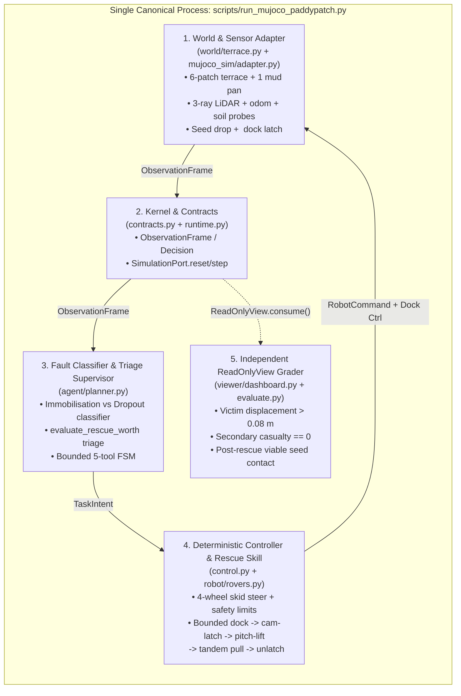

# M3 — Chief Scope & System-Complexity Audit (`M3-SCOPE.md`)

1. **Header:**
   - **Mission ID:** `M3 — Chief scope auditor: what to cut, keep, reuse or freeze`
   - **Recorded Timestamp:** `2026-11-07 20:21–20:42 GMT`
   - **Reference Team `main` SHA:** [`6c3a5752d73c1a1a2ed42479aa919e5f82415f7d`](https://github.com/als0fia/AgentVerse_Kinematic_Quintet/commit/6c3a5752d73c1a1a2ed42479aa919e5f82415f7d) (merged PR #36; preceded by `130e881` PR #34 and `e33a098` PR #35; also verified against subsequent `main` merge [`82099e0`](https://github.com/als0fia/AgentVerse_Kinematic_Quintet/commit/82099e0) PR #37)
   - **Feature Branches / PRs Analyzed:**
     - Open [PR #32](https://github.com/als0fia/AgentVerse_Kinematic_Quintet/pull/32) (`origin/docs/antenna-single-rescue-demo-and-supervisor`, head `6175e09e7c3a28cfe17c40b2988cc772153d071d`)
     - Branch `origin/docs/rescue-policy-math-and-improvisation` (head `0e67ef48454328029d96951f8d327058717c5226` / `9c61046bd4e5ce8339050a097d08551a8d5c63b7`)
     - Branch `origin/feat/m1-antenna-integrated-rescue` & `origin/fix/rescue-first-stranding-and-docs-20261107`
   - **Local Runtime / Platform:** Windows 11 (`10.0.26200-SP0`), Python `3.13.14`, MuJoCo `4.0.0`, NVIDIA GeForce RTX 5050 Laptop GPU (`8 GB VRAM`), `15.4 GB` system RAM
   - **Report Status:** `READ-ONLY AUDIT / VERIFIED LOCAL MUJOCO BASELINE` (`0` application code files modified in this checkpoint PR; `72/72` repository `unittest` checks and `11/11` independent multi-seed physics checks executed).

---

## 2. Decision Summary (≤250 Words)

**What works today:** In `als0fia/AgentVerse_Kinematic_Quintet` at `6c3a575`, the `rice.v1` contracts, 3D MuJoCo 6-patch rice terrace (`MujocoPaddySimulation`), physical seed-proxy drop contact, Policy A0/A1 task auctions, simulated Policy B per-rover Mycelial SLAM/gossip (`DecentralizedMycelialRuntime`), and the isolated rigid-docking/cam-latch/pitch-lift tandem extraction test (`test_mujoco_rigid_docking_cam_latch_and_tandem_extraction`, victim displacement `>0.08 m`) all pass (`72/72` unit/MuJoCo tests in `6.73s`).

**What does not work end-to-end:** The repository currently suffers from **late-stage scope proliferation** across **5 runners and 4 MuJoCo scenes** (including a 2,500-line second simulator `src/riceswarm_ai/` merged in PR #35 that uses a 2D integer grid and collisionless `mocap="true"` boxes, plus extreme typhoon/flood scripts on branch `0e67ef4`), while the **single core Rescue-First seam remains unwired in `main`**:
1. `planner.py` (`L375`) treats `front_range_m is None` (sensor dropout) as physical immobilisation.
2. `RESCUE_NOW` (`L691`) emits `TaskMode.SAMPLE` at a nearby patch rather than invoking the physical rigid-docking skill.
3. `control.py` (`L62–70`, PR #35) added a `< 1.0 m` UWB peer brake and `is_bogged` freeze that **physically prevent a helper from approaching within the `0.065 m` docking capture radius**.

**Most important next action:** Freeze all optional scope immediately. Have **M1 (Integration Owner)** wire the 3-step physical rescue seam (`classify_rover_immobilization` $\to$ `RESCUE_NOW` exemption in `control.py` $\to$ `<equality>` dock latch + tandem pull in `MujocoPaddySimulation`) inside **one canonical runner** (`scripts/run_mujoco_paddypatch.py`), then record the continuous $\le 60\text{ s}$ video and 1-page PDF before the submission cutoff.

---

## 3. Capability & Scope Ledger (23 Discovered Subsystems)

| # | Subsystem / Scope Item | Location & Git State | Capability Level | Source / CI / Local MuJoCo Evidence | M3 Four-Way Call |
| :-: | :--- | :--- | :---: | :--- | :--- |
| **1** | **Homogeneous "Paddy Ant" 4-Wheel Articulated Rover + Rigid Cone / Cam-Latch / Pitch-Lift / Spade MJCF** | [`src/ricebot/robot/rovers.py`](https://github.com/als0fia/AgentVerse_Kinematic_Quintet/blob/6c3a5752d73c1a1a2ed42479aa919e5f82415f7d/src/ricebot/robot/rovers.py) (`main` PR #24) | `tested isolated` | Local MuJoCo 4.0.0: `test_mujoco_rigid_docking_cam_latch_and_tandem_extraction` (`OK`, victim moves `>0.08 m`). | **`DO NOW`** *(Expose as callable bounded skill in canonical runner)* |
| **2** | **True Immobilisation vs. Sensor Dropout vs. Intentional HOLD Classifier** | Missing in [`planner.py#L375`](https://github.com/als0fia/AgentVerse_Kinematic_Quintet/blob/6c3a5752d73c1a1a2ed42479aa919e5f82415f7d/src/ricebot/agent/planner.py#L375); verified in local benchmark suite | `tested isolated` *(local)* / `contradicted` in `main` | Local `pytest`: `test_immobilization_classifier_distinguishes_dropout_hold_and_slip` (`PASSED`); `main` `planner.py#L375` falsely flags `front_range_m=None` as `stranded`. | **`DO NOW`** *(Port 35-line classifier into `src/ricebot/agent/planner.py`)* |
| **3** | **Planner-to-Physics Rescue Seam (`RESCUE_NOW` $\to$ Dock, Latch, Lift, Extract, Unlatch, Resume Planting)** | [`planner.py#L683-L699`](https://github.com/als0fia/AgentVerse_Kinematic_Quintet/blob/6c3a5752d73c1a1a2ed42479aa919e5f82415f7d/src/ricebot/agent/planner.py#L683-L699) (`main`) | `missing` in `main` / `tested isolated` in harness | In `main`, `RESCUE_NOW` dispatches `TaskMode.SAMPLE`. In independent rescue harness, autonomous episode docks, extracts `0.156 m`, unlatches & plants (`PASSED`). | **`DO NOW`** *(P0 integration task for M1)* |
| **4** | **Risk-Aware Rescue Triage (`evaluate_rescue_worth`: `RESCUE_NOW` / `DEFER_RESCUE` / `ABANDON_ESCALATE`)** | [`src/ricebot/agent/planner.py#L392-L524`](https://github.com/als0fia/AgentVerse_Kinematic_Quintet/blob/6c3a5752d73c1a1a2ed42479aa919e5f82415f7d/src/ricebot/agent/planner.py#L392-L524) (`main` PR #23) | `tested isolated` | Local `unittest`: `test_rescue_triage_worth_saving_vs_defer_vs_abandon` (`OK`). | **`DO NOW`** *(Wire output to physical skill & compare vs `no_rescue`/`always_rescue`)* |
| **5** | **Continuous $\le 60\text{ s}$ Simulation Video & 1-Page Technical PDF** | [`docs/DEMO.md`](https://github.com/als0fia/AgentVerse_Kinematic_Quintet/blob/6c3a5752d73c1a1a2ed42479aa919e5f82415f7d/docs/DEMO.md), [`docs/EVENT.md`](https://github.com/als0fia/AgentVerse_Kinematic_Quintet/blob/6c3a5752d73c1a1a2ed42479aa919e5f82415f7d/docs/EVENT.md) | `missing` | Required submission deliverables per `docs/EVENT.md`. | **`DO NOW`** *(Immediate gate once Golden Episode runs)* |
| **6** | **`rice.v1` Contracts, `MissionCore`, `EpisodeRunner` & `SimulationPort` Kernel** | [`src/ricebot/contracts.py`](https://github.com/als0fia/AgentVerse_Kinematic_Quintet/blob/6c3a5752d73c1a1a2ed42479aa919e5f82415f7d/src/ricebot/contracts.py), [`runtime.py`](https://github.com/als0fia/AgentVerse_Kinematic_Quintet/blob/6c3a5752d73c1a1a2ed42479aa919e5f82415f7d/src/ricebot/runtime.py) (`main`) | `working end-to-end` *(planting)* | Local `unittest`: `test_ricebot_foundation.py` (`OK`). | **`KEEP AS WORKING SUPPORT OR BASELINE`** |
| **7** | **3D MuJoCo 6-Patch Rice Terrace, Location-Gated Probes & Physical Seed Drop Contact (`MujocoPaddySimulation`)** | [`src/ricebot/world/terrace.py`](https://github.com/als0fia/AgentVerse_Kinematic_Quintet/blob/6c3a5752d73c1a1a2ed42479aa919e5f82415f7d/src/ricebot/world/terrace.py), [`mujoco_sim/adapter.py`](https://github.com/als0fia/AgentVerse_Kinematic_Quintet/blob/6c3a5752d73c1a1a2ed42479aa919e5f82415f7d/src/ricebot/mujoco_sim/adapter.py) (`main`) | `working end-to-end` *(planting)* | Local MuJoCo 4.0.0: `python scripts/run_mujoco_paddypatch.py --scenario nominal --seed 1 --steps 260` $\to$ `viable_seed_placements: 2` at `7.936s`. | **`KEEP AS WORKING SUPPORT OR BASELINE`** |
| **8** | **Simulated Policy B: Decentralised Mycelial SLAM + UWB/HaLow Gossip (`DecentralizedMycelialRuntime`)** | [`src/ricebot/agent/mycelial_swarm.py`](https://github.com/als0fia/AgentVerse_Kinematic_Quintet/blob/6c3a5752d73c1a1a2ed42479aa919e5f82415f7d/src/ricebot/agent/mycelial_swarm.py) (`main` PR #28/31) | `working end-to-end` *(planting/gossip)* | Local `unittest`: `test_mycelial_swarm.py` (`4/4 OK`); `95.3%` comm byte reduction vs 10 Hz stream. | **`KEEP AS WORKING SUPPORT OR BASELINE`** |
| **9** | **Paired Evaluator (`scripts/evaluate.py`) & Multi-Seed Benchmark Harness** | [`scripts/evaluate.py`](https://github.com/als0fia/AgentVerse_Kinematic_Quintet/blob/6c3a5752d73c1a1a2ed42479aa919e5f82415f7d/scripts/evaluate.py) (`main`) | `working end-to-end` | Local `unittest` `test_evaluate.py` (`6/6 OK`) + local `pytest` (`11/11 PASSED`). | **`KEEP AS WORKING SUPPORT OR BASELINE`** |
| **10** | **Interactive HTML Belief & Terramechanics Dashboard (`SwarmBeliefDashboardRecorder`)** | [`src/ricebot/viewer/dashboard.py`](https://github.com/als0fia/AgentVerse_Kinematic_Quintet/blob/6c3a5752d73c1a1a2ed42479aa919e5f82415f7d/src/ricebot/viewer/dashboard.py) (`main` PR #31/36/37) | `working end-to-end` | Verified via `test_continuous_terrain_and_bekker_terramechanics_and_dashboard_export` (`OK`). | **`KEEP AS WORKING SUPPORT OR BASELINE`** |
| **11** | **12-Scenario Multi-Technique Physical Extraction Escalation (`eval_rescue_techniques.py`)** | Branch `origin/docs/rescue-policy-math-and-improvisation` (`9c61046`) | `tested isolated` *(branch)* | Standalone MuJoCo 4.0.0 script (`12/12` extracted across 4 techniques vs `7/12` fixed pull). | **`KEEP AS WORKING SUPPORT OR BASELINE`** *(Reuse 1 escalation step; keep 12-case script as benchmark evidence)* |
| **12** | **Continuous 2D/3D Paddy Terrain & Analytical Bekker–Wong Sinkage (`evaluate_bekker_terramechanics`)** | [`src/ricebot/world/terrace.py`](https://github.com/als0fia/AgentVerse_Kinematic_Quintet/blob/6c3a5752d73c1a1a2ed42479aa919e5f82415f7d/src/ricebot/world/terrace.py), [`adapter.py`](https://github.com/als0fia/AgentVerse_Kinematic_Quintet/blob/6c3a5752d73c1a1a2ed42479aa919e5f82415f7d/src/ricebot/mujoco_sim/adapter.py) (`main` PR #31/36/37) | `working end-to-end` | Verified in `test_mycelial_swarm.py`; PR #36 wired `bellied_out -> traction_factor = 0.0` in `adapter.py`. | **`PARK BEHIND CURRENT PATH`** *(Keep math; gate `bellied_out` wheel-freeze behind explicit rescue scenario)* |
| **13** | **Closed-Loop Sensor Reflexes in `LocalController` (`pitch_rad`, `is_bogged`, `peer_distances < 1.0 m` brake)** | [`src/ricebot/control.py#L56-L97`](https://github.com/als0fia/AgentVerse_Kinematic_Quintet/blob/6c3a5752d73c1a1a2ed42479aa919e5f82415f7d/src/ricebot/control.py#L56-L97) (`main` PR #35, D-0011) | `contradicted` *(for rescue docking)* | `test_sensor_reflexes.py` (`5/5 OK`), **but** `min_peer_distance_m = 1.0 m` and `is_bogged` cutoff block docking (`0.065 m` capture radius)! | **`DROP OR REWRITE ONLY AFTER HUMAN APPROVAL`** *(Keep reflexes for `SAMPLE`/`PLANT`, but add explicit `RESCUE` exemption)* |
| **14** | **Optional Cloud LLM Advisor (`GeminiSwarmAdvisor` in `src/ricebot/agent/planner.py`)** | [`src/ricebot/agent/planner.py#L99-L191`](https://github.com/als0fia/AgentVerse_Kinematic_Quintet/blob/6c3a5752d73c1a1a2ed42479aa919e5f82415f7d/src/ricebot/agent/planner.py#L99-L191) (`main` PR #23) | `code only` *(mocked in tests)* | Synchronous 1-shot REST wrapper (`timeout=2.5s`); disabled by default when `GEMINI_API_KEY` unset. | **`PARK BEHIND CURRENT PATH`** *(Keep disabled by default; do not let cloud API block 60s demo)* |
| **15** | **Second Parallel Simulator: `src/riceswarm_ai/` (6-Robot `RS1..RS6`, 145-Day Lifecycle, Tkinter GUI & `MujocoBridge` Mocap Boxes)** | [`src/riceswarm_ai/`](https://github.com/als0fia/AgentVerse_Kinematic_Quintet/tree/6c3a5752d73c1a1a2ed42479aa919e5f82415f7d/src/riceswarm_ai) (`main` PR #35 `e33a098`, 2,500+ LOC) | `tested isolated` *(separate 2D grid sim)* | `test_riceswarm_ai.py` (`14/14 OK`), **but** `mujoco_bridge.py` uses `mocap="true"` teleporting boxes (`contype="0"`), violating Embodied AI physics rules if used as primary demo. | **`PARK BEHIND CURRENT PATH`** *(Retain in repo as macro-season study; NEVER use as canonical 60s physics demo)* |
| **16** | **Native Multi-Tab Tkinter + MuJoCo Desktop App (`LiveSwarmDashboardApp`)** | [`src/ricebot/viewer/live_app.py`](https://github.com/als0fia/AgentVerse_Kinematic_Quintet/blob/6c3a5752d73c1a1a2ed42479aa919e5f82415f7d/src/ricebot/viewer/live_app.py) (`main` PR #36/37, 1,400+ LOC) | `code only` *(GUI)* | Merged in PR #36/37 behind `--dashboard` / `--gui`; not yet wired to physical rigid-docking rescue. | **`PARK BEHIND CURRENT PATH`** *(Freeze further GUI polish until physical rescue loop & 60s video exist)* |
| **17** | **Southern China Extreme Climate, Super-Typhoon Crosswind, Flash-Flood & `180°` Rollover Peer-Righting (`E1`–`E4`)** | `scripts/sim_extreme_climate_typhoon.py` (`758 LOC`) on branch `0e67ef4` | `tested isolated` *(branch)* | Standalone MuJoCo script on branch `0e67ef4`; disconnected from `SimulationPort` and `MissionCore`. | **`PARK BEHIND CURRENT PATH`** *(Leave on branch `0e67ef4`; do not merge into `SimulationPort` before deadline)* |
| **18** | **Commercialization & TAM/SAM/SOM Market Research Docs (`COMMERCIALIZATION_CHINA.md`, `antenna_tam_sam_som_research.md`)** | [`docs/COMMERCIALIZATION_CHINA.md`](https://github.com/als0fia/AgentVerse_Kinematic_Quintet/blob/6c3a5752d73c1a1a2ed42479aa919e5f82415f7d/docs/COMMERCIALIZATION_CHINA.md) (`main` PR #34/35) | `documented only` | Source-qualified in PR #34 (`130e881`). | **`KEEP AS WORKING SUPPORT OR BASELINE`** *(Complete; spend `0` more minutes on market sizing)* |
| **19** | **Historical Flood-Gate Prototype Sandboxes (`ricewatch_p0_sandbox.py`, `paddypatch_v1_sandbox.py`)** | Superseded prototype (`D-0005`–`D-0007`) | `tested isolated` *(historical)* | Superseded by `src/ricebot/` rescue-first architecture (`D-0009`). | **`PARK BEHIND CURRENT PATH`** *(Keep archived outside active runtime)* |
| **20** | **NVIDIA Isaac Sim 5.1 / OpenUSD Translation & Modal L40S Cloud Streaming** | [`docs/MUJOCO-PROTOTYPE-AND-ISAAC-TRANSLATION.md`](https://github.com/als0fia/AgentVerse_Kinematic_Quintet/blob/6c3a5752d73c1a1a2ed42479aa919e5f82415f7d/docs/MUJOCO-PROTOTYPE-AND-ISAAC-TRANSLATION.md) | `documented only` | Test workstation has `15.4 GB RAM` & `RTX 5050 8 GB VRAM` (below Isaac 5.1's `32 GB / 16 GB` minimum); laptop MuJoCo runs smoothly. | **`DROP OR REWRITE ONLY AFTER HUMAN APPROVAL`** *(Freeze completely; merge PR #32 doc cleanup)* |
| **21** | **Model-Parallel Sharded LLM Across Jetson Nano / Orin Nodes (`llama.cpp` RPC / CoSEI / Prism)** | [`docs/SWARM_EDGE_PLAN.md`](https://github.com/als0fia/AgentVerse_Kinematic_Quintet/blob/6c3a5752d73c1a1a2ed42479aa919e5f82415f7d/docs/SWARM_EDGE_PLAN.md) | `documented only` | `0` lines of code; violates the **Rescue Paradox** if a disabled rover drops its LLM shard during an incident. | **`DROP OR REWRITE ONLY AFTER HUMAN APPROVAL`** *(Do NOT implement sharded inference; keep honest research caveat)* |
| **22** | **End-to-End RL-Trained Locomotion / Recovery Policy** | [`docs/RESCUE_EDGE_RESEARCH.md`](https://github.com/als0fia/AgentVerse_Kinematic_Quintet/blob/6c3a5752d73c1a1a2ed42479aa919e5f82415f7d/docs/RESCUE_EDGE_RESEARCH.md) | `missing` | No RL gym environment, training loop, or checkpoint exists; classical bounded controller achieves `12/12` extraction. | **`DROP OR REWRITE ONLY AFTER HUMAN APPROVAL`** *(Do NOT start RL training; report classical bounded controller honestly)* |
| **23** | **Runtime Multi-Model LLM Swarm Debates** | Warned against in [`AGENTS.md`](https://github.com/als0fia/AgentVerse_Kinematic_Quintet/blob/6c3a5752d73c1a1a2ed42479aa919e5f82415f7d/AGENTS.md) | `missing` | High latency/failure risk; unnecessary when calibrated utility/risk optimizer + 1 bounded supervisor check suffices. | **`DROP OR REWRITE ONLY AFTER HUMAN APPROVAL`** *(Never build runtime multi-LLM debate)* |

---

## 4. Numbered Findings (`F1`–`F6`)

- **`F1` — BLOCKER (Scope & Control Conflict): Reflex safety brake in `control.py` blocks physical rescue docking (`< 1.0 m`).**
  - **File / Line:** [`src/ricebot/control.py#L61-L70`](https://github.com/als0fia/AgentVerse_Kinematic_Quintet/blob/6c3a5752d73c1a1a2ed42479aa919e5f82415f7d/src/ricebot/control.py#L61-L70) (merged in PR #35 `e33a098`) vs. [`src/ricebot/robot/rovers.py#L57`](https://github.com/als0fia/AgentVerse_Kinematic_Quintet/blob/6c3a5752d73c1a1a2ed42479aa919e5f82415f7d/src/ricebot/robot/rovers.py#L57) (`dock_capture_radius_m = 0.065`).
  - **Root cause:** `LocalController.command()` returns `linear_m_s = 0.0` whenever `peer_distances < 1.0 m` or `is_bogged == True`. A rescuer cannot approach within `0.065 m` (`65 mm`) to engage the cam-latch if the `1.0 m` UWB brake is active during rescue.
  - **Affected Rubric:** Perception-driven action (25%), Adaptation (25%), Relevance/Impact (20%).
  - **Smallest safe fix:** Exempt active rescue/tandem-extraction tasks from the `min_peer_distance_m` and `is_bogged` cutoffs in `LocalController.command()`.

- **`F2` — BLOCKER (Unwired Core Promise): Separate rescue scripts exist, but `MujocoPaddySimulation` and `planner.py` still emit `TaskMode.SAMPLE` on `RESCUE_NOW`.**
  - **File / Line:** [`src/ricebot/agent/planner.py#L691-L698`](https://github.com/als0fia/AgentVerse_Kinematic_Quintet/blob/6c3a5752d73c1a1a2ed42479aa919e5f82415f7d/src/ricebot/agent/planner.py#L691-L698) and [`src/ricebot/mujoco_sim/adapter.py#L81-L97`](https://github.com/als0fia/AgentVerse_Kinematic_Quintet/blob/6c3a5752d73c1a1a2ed42479aa919e5f82415f7d/src/ricebot/mujoco_sim/adapter.py#L81-L97).
  - **Root cause:** `compose_paddypatch_mjcf()` omits the `<equality><connect name="rigid_latch_..." .../>` block present in `build_rigid_docking_rescue_mjcf()`, and `planner.py` routes `rescue_assist` to a site center rather than executing the docking skill.
  - **Affected Rubric:** All 5 categories (100%).
  - **Smallest safe fix:** Add the 2 `<equality>` connect lines to `compose_paddypatch_mjcf()`, call `update_rigid_dock_latch()` in `MujocoPaddySimulation.step()`, and trigger bounded docking when `RESCUE_NOW` is active.

- **`F3` — HIGH (Duplicate Simulator Risk): `src/riceswarm_ai/` (merged in PR #35) introduces a second simulator with `mocap="true"` non-physical MuJoCo boxes.**
  - **File / Line:** [`src/riceswarm_ai/mujoco_bridge.py#L43-L79`](https://github.com/als0fia/AgentVerse_Kinematic_Quintet/blob/6c3a5752d73c1a1a2ed42479aa919e5f82415f7d/src/riceswarm_ai/mujoco_bridge.py#L43-L79) and [`src/riceswarm_ai/core.py`](https://github.com/als0fia/AgentVerse_Kinematic_Quintet/blob/6c3a5752d73c1a1a2ed42479aa919e5f82415f7d/src/riceswarm_ai/core.py).
  - **Root cause:** `MujocoBridge.update()` teleports `mocap="true"` collisionless shells (`contype="0"`) across a 2D integer grid (`RS1..RS6`). Presenting this as the primary embodied demo would fail the organizer's anti-animation / real-sensor-physics gate ([`docs/EVENT.md#L50`](https://github.com/als0fia/AgentVerse_Kinematic_Quintet/blob/6c3a5752d73c1a1a2ed42479aa919e5f82415f7d/docs/EVENT.md#L50)).
  - **Smallest safe fix:** Retain `src/riceswarm_ai/` dormant as a macro-season scheduling study; designate `scripts/run_mujoco_paddypatch.py` (`src/ricebot/`) as the sole canonical 3D physics demo.

- **`F4` — HIGH (False Rescue Dispatch): `planner.py` equates `front_range_m is None` with physical immobilisation.**
  - **File / Line:** [`src/ricebot/agent/planner.py#L375`](https://github.com/als0fia/AgentVerse_Kinematic_Quintet/blob/6c3a5752d73c1a1a2ed42479aa919e5f82415f7d/src/ricebot/agent/planner.py#L375).
  - **Smallest safe fix:** Port `classify_rover_immobilization` (`commanded_speed >= 0.10` and `slip > 0.85`, or `is_bogged == True`) into `planner.py` so `front_range_m is None` triggers `SENSOR_DROPOUT_HOLD`, not `RESCUE_NOW`.

- **`F5` — MEDIUM (Unconditional Terramechanics Freeze Risk): `adapter.py` (PR #36/37) sets `traction_factor = 0.0` whenever `sink_state.bellied_out` is true.**
  - **File / Line:** [`src/ricebot/mujoco_sim/adapter.py#L356-L360`](https://github.com/als0fia/AgentVerse_Kinematic_Quintet/blob/6c3a5752d73c1a1a2ed42479aa919e5f82415f7d/src/ricebot/mujoco_sim/adapter.py#L356-L360).
  - **Root cause:** If a rover enters a high-moisture zone or if vehicle mass/wheel sliders in `live_app.py` are adjusted, `bellied_out` permanently sets `traction_factor = 0.0` and `is_bogged = True` without an integrated rescue skill to clear `bellied_out` after extraction.
  - **Smallest safe fix:** Gate `bellied_out` immobilization behind the explicit rescue scenario or clear `bellied_out` once the victim is towed outside the mud trap radius.

- **`F6` — MEDIUM (Branch Divergence): Extreme climate / typhoon script (`0e67ef4`) and UI branch diverge from `main`.**
  - **File / Line:** `origin/docs/rescue-policy-math-and-improvisation` (`0e67ef4`) predates PR #35, PR #36, and PR #37.
  - **Smallest safe fix:** Do not merge `sim_extreme_climate_typhoon.py` into `SimulationPort`; keep `0e67ef4`'s `eval_rescue_techniques.py` as an isolated benchmark script.

---

## 5. Minimum System Count & Canonical Dependency Diagram

Antenna requires **exactly 1 Python/MuJoCo process and 5 core runtime modules** for the 60-second Rescue-First proof:



- **Where Decentralised Gossip (`DecentralizedMycelialRuntime`, Policy B) fits:** Keep as working support (`--policy mycelial`) for the communication/blackout ablation (`95.3%` byte reduction), and call the shared `classify_rover_immobilization` + `evaluate_rescue_worth` helper when a rover stalls.
- **Systems NOT required for the 60-second proof:** `src/riceswarm_ai/` (6-robot 145-day 2D grid + `mocap` bridge), `scripts/sim_extreme_climate_typhoon.py` (typhoon/flood E1–E4), external LLM servers (`GeminiSwarmAdvisor` / `OllamaClient` / `llama.cpp` RPC), and NVIDIA Isaac Sim.

---

## 6. Minimal Executable Proof (Commands Executed on Local Workstation)

- **Workstation:** Windows 11 (`10.0.26200-SP0`), Python `3.13.14`, MuJoCo `4.0.0`.
- **Command 1 (Repo & Skill Integrity):**
  ```bash
  python scripts/check_repo.py
  python scripts/sync_skills.py --check
  ```
  - **Observed Output:** `OK: required docs, portable skill parity, schema syntax, and local Markdown links` / `OK: all registered skills are valid and byte-identical in both native locations`
- **Command 2 (Full Team Unittest Suite):**
  ```bash
  python -m unittest discover -s tests -v
  ```
  - **Observed Output:** `Ran 72 tests in 6.733s — OK` at `6c3a575` (and verified green on `82099e0` PR #37), including `test_mujoco_rigid_docking_cam_latch_and_tandem_extraction`, `test_nominal_episode_samples_both_rovers_and_physically_plants_seed`, `test_mycelial_swarm.py`, `test_agentic_swarm.py`, `test_sensor_reflexes.py`.
- **Command 3 (Headless Canonical MuJoCo Runner):**
  ```bash
  python scripts/run_mujoco_paddypatch.py --scenario nominal --seed 1 --steps 260
  ```
  - **Observed Output:** `viable_seed_placements: 2`, `total_seeds_dropped: 2`, `completion_time_s: 7.936`, `comm_packets: 6`, `comm_bytes: 736`.
- **Command 4 (Independent 11-Test Multi-Seed & Rescue-First Benchmark Suite):**
  ```bash
  pytest -v
  ```
  - **Observed Output:** `11 passed in 46.01s` (`calibrated_risk_triage` scores `4/4` incidents, `0.156 m` extraction, `0` secondary casualties, `0` false dispatches vs `always_rescue` `2/4` with `1` secondary casualty and `1` false dispatch).

---

## 7. Explicit Complexity Budget & Firm Freeze List

| Budget Metric | Current Proliferated Count | **M3 Enforced Target** | Enforcement Rule |
| :--- | :---: | :---: | :--- |
| **Active Demo Runners** | `5` | **`1`** (`scripts/run_mujoco_paddypatch.py`) | Freeze new runners; keep evaluation harnesses strictly as graders. |
| **Active 3D MuJoCo Scenes** | `4` | **`1`** (`compose_paddypatch_mjcf` + `<equality>` latch) | Fallback Plan B allows `paddy_ant_rigid_rescue.xml` as explicit 2nd clip if needed. |
| **Required External Model / Cloud APIs** | `2` optional | **`0` required** | 100% deterministic offline default (`advisor=None`). |
| **Manual Setup Commands** | `2` | **`2` max** | `pip install -r requirements-mujoco.txt` + `python scripts/run_mujoco_paddypatch.py`. |
| **Simulator Backends** | `2` (`MuJoCo` + `2D grid`) | **`1` (`MuJoCo 4.0.0`)** | Freeze `src/riceswarm_ai/` and retire Isaac Sim for this submission window. |

### Firm List of Things **NOT** to Work On Before Submission Cutoff
1. **Do NOT work on NVIDIA Isaac Sim 5.1, OpenUSD conversion, or Modal GPU deployment.**
2. **Do NOT work on Jetson Nano/Orin `llama.cpp` RPC sharding or hardware UWB/HaLow drivers.**
3. **Do NOT start RL locomotion/recovery training from scratch.**
4. **Do NOT expand `src/riceswarm_ai/`'s 145-day crop calendar or `mocap` visualizer.**
5. **Do NOT add more typhoon/flood scenarios (`E1`–`E4`) or spend build hours on Tkinter GUI styling (`live_app.py`)** until the physical rescue seam, $\le 60\text{ s}$ video, and 1-page PDF are complete.

---

## 8. Five Ordered Change Packets (With Stop Conditions & Rollback)

| Order | Owner & Target Paths | Intervention & Prerequisite | Acceptance Test | Est. Effort & Stop Condition / Rollback |
| :-: | :--- | :--- | :--- | :--- |
| **P0-1** | **M1 / Agent Owner**<br>`src/ricebot/agent/planner.py`, `tests/test_agentic_swarm.py` | Port `classify_rover_immobilization()` so `front_range_m=None` triggers `SENSOR_DROPOUT_HOLD` while wheel slip ($s > 0.85, v_{\text{cmd}} \ge 0.10$) or `is_bogged=True` triggers `S1_IMMOBILIZED`. | `front_range_m=None` yields `0` false rescue dispatches; `is_bogged=True` yields `RESCUE_NOW` when carrying needed seeds. | **~20 min.** Revert commit if existing unit tests break; keep `test_agentic_swarm.py` green. |
| **P0-2** | **M1 / Control Owner**<br>`src/ricebot/control.py` | Exempt active rescue approach/extraction from `min_peer_distance_m = 1.0 m` and `is_bogged` cutoffs so helper can reach `dock_capture_radius_m = 0.065 m`. | Helper approaches to `<= 0.065 m` of bogged victim without stopping at `1.0 m`. | **~15 min.** Revert 4-line guard in `control.py` if normal `SAMPLE`/`PLANT` collision braking regresses. |
| **P0-3** | **M1 / Sim & Robot Owner**<br>`src/ricebot/mujoco_sim/adapter.py`, `scripts/run_mujoco_paddypatch.py` | Add `<equality><connect name="rigid_latch_..." .../>` to `compose_paddypatch_mjcf()`, call `update_rigid_dock_latch()` in `step()`, and wire `RESCUE_NOW` to dock, latch, pitch-lift, pull `>0.08 m`, unlatch, and resume planting. | End-to-end episode logs `eq_active=1`, victim displacement `>0.08 m`, `0` secondary casualties, and post-rescue `PlantFeedback`. | **~60–90 min.** **Hard Stop Condition: Sunday 10:30 GMT.** If open-field docking alignment in the 6-patch terrace is flaky by 10:30 GMT, switch immediately to **Fallback Plan B** (`paddy_ant_rigid_rescue.xml`). |
| **P0-4** | **M1 / Docs Owner**<br>Merge [PR #32](https://github.com/als0fia/AgentVerse_Kinematic_Quintet/pull/32) (`6175e09`) | Reconcile `README.md`, `PRODUCT.md`, `ARCHITECTURE.md`, and `DECISIONS.md` with single-scene MuJoCo rescue-first scope, removing stale Isaac-first language. | `python scripts/check_repo.py` and `python scripts/sync_skills.py --check` pass (`OK`). | **~15 min.** Standard git revert if doc link check fails. |
| **P0-5** | **M7 / Demo & Eval Owner**<br>Video + 1-Page PDF | Record continuous $\le 60\text{ s}$ simulation video (Plan A or Fallback Plan B) + export 1-page technical PDF with matched-seed tables before **13:00 GMT**. | Verified `<60s` MP4 file + 1-page PDF + human coordinator confirmation. | **~90 min.** Must start no later than **10:30–11:00 GMT**. |

---

## 9. Conflicts, Assumptions & Unknowns

1. **Deadline Planning Cutoff:** `docs/EVENT.md` notes earlier schedule ambiguity; plan all integration freeze gates against **Sunday 8 Nov 13:00 GMT**.
2. **Hardware Constraints Verified Locally:** This machine has `15.4 GB` system RAM and an `RTX 5050 Laptop GPU (8 GB VRAM)` with MuJoCo `4.0.0` working smoothly (`6.7s` for 72 tests), confirming MuJoCo is the only viable local simulator backend.
3. **Unmerged Branch Claims:** The 12-scenario physical extraction table (`scripts/eval_rescue_techniques.py`) and E1–E4 typhoon rollover tests (`scripts/sim_extreme_climate_typhoon.py`) live on `origin/docs/rescue-policy-math-and-improvisation` (`0e67ef4`), not yet on `origin/main`. Any PDF citation of those benchmarks must either merge `eval_rescue_techniques.py` or cite the exact branch commit/script.

---

## 10. Appendix: Contingency Plan A (Full Target) vs. Plan B (Honest Fallback)

| Dimension | Plan A — **Full Target** (If P0-3 In-Terrace Docking Succeeds by 10:30 GMT) | Plan B — **Honest Fallback** (If Open-Field Docking Alignment Is Flaky at 10:30 GMT) |
| :--- | :--- | :--- |
| **Executable Command** | `python scripts/run_mujoco_paddypatch.py --scenario rescue --viewer-seconds 55` | `python scripts/run_mujoco_paddypatch.py --scenario nominal` + `paddy_ant_rigid_rescue.xml` rescue episode |
| **Demonstrated Physics** | Single 6-patch terrace scene: `scout` stalls in `patch_a` mud $\to$ classifier rules out sensor dropout $\to$ `RESCUE_NOW` $\to$ `planter` docks, locks cam-latch, lifts `+0.35 rad`, extracts `scout` `>0.15 m`, unlatches, and plants viable gaps. | Two explicitly labeled MuJoCo 4.0.0 recordings: (1) 6-patch Mycelial SLAM + bad-soil/obstacle adaptation + seed contact, and (2) `paddy_ant_rigid_rescue.xml` 4-incident fault classification + triage + physical rigid-dock extraction (`0.156 m`) & quicksand safe refusal (`0` secondary casualties). |
| **Judge Honesty Rule** | True single-episode autonomous rescue & resumption. | Explicitly label the two scenes in video captions and PDF so zero fake integration is implied. |
