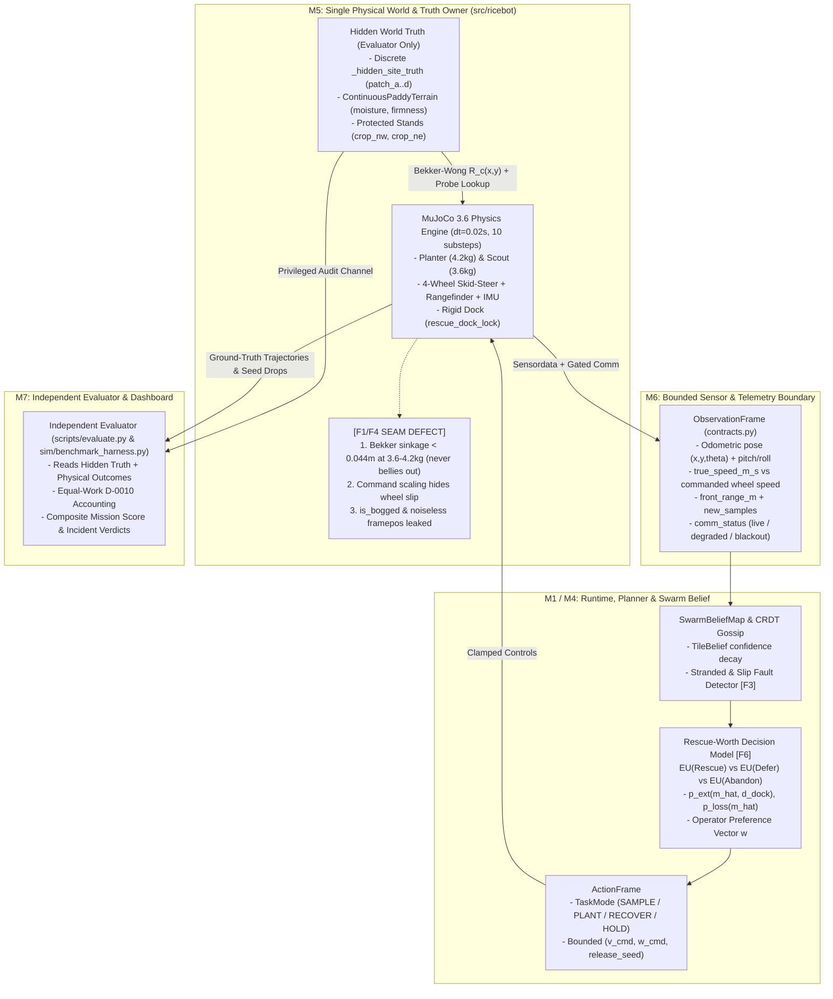

# M5 — World, Sensor and Mathematical-Model Examiner (`M5-WORLD-MODEL.md`)

| Field | Value |
| :--- | :--- |
| **Mission ID & Role** | `M5` — World, Sensor and Mathematical-Model Examiner |
| **Timestamp (GMT)** | `2026-11-07T20:25:00Z` |
| **Target Repository** | `https://github.com/als0fia/AgentVerse_Kinematic_Quintet` |
| **Report Path** | `docs/checkpoints/2026-11-07-2021-GMT/M5-WORLD-MODEL.md` |
| **Base SHA Inspected** | `130e881a54b932dcbe66971674e266b344e104f6` (initial `HEAD`) $\to$ `6c3a5752d73c1a1a2ed42479aa919e5f82415f7d` (latest `origin/main`, PR #36) |
| **Branches / PRs Analyzed** | `main` (`6c3a575`, PRs #31, #34, #35, #36), open PR #32 (`6175e09`), `origin/docs/rescue-policy-math-and-improvisation` (`0e67ef4`), `origin/feature/user_interface` (`0b177ef`), plus independent benchmark harness (`sim/benchmark_harness.py`) |
| **Platform / Runtime** | Windows 11 (`10.0.26200`), Python `3.13.12` (`.venv`), MuJoCo `3.6.0`, CPU `i7` / GPU `RTX 5050 Laptop (8 GB VRAM)`, 15.4 GB System RAM |
| **Verification Status** | `VERIFIED` (`72/72` `unittest` pass in `6.08s`; `11/11` `pytest` pass in `28.43s`; `scripts/check_repo.py` & `scripts/sync_skills.py --check` `OK`) |

---

## 1. Decision Summary ($\le 250$ words)

**Antenna (`rice.v1`) does not need crop physiology, 145-day rice growth cycles, or typhoon hydrodynamics; it needs one unified, physically honest 6-site MuJoCo world where mud immobilization is caused by terrain contact mechanics, inferred from noisy kinematic/slip observations without ground-truth leaks, and resolved only when expected rescue utility beats opportunity and helper-loss risk.**

Currently, the repository splits across **four competing simulation worlds** (`src/ricebot/`, `src/riceswarm_ai/`, `scripts/sim_extreme_climate_typhoon.py`, and `src/logic/swarmEngine.ts`). Inside the canonical `src/ricebot/` MuJoCo world (`src/ricebot/mujoco_sim/adapter.py`), a **critical physics-to-policy disconnect (`F1`)** prevents genuine mud immobilization during normal episodes: `evaluate_bekker_terramechanics` (`src/ricebot/world/terrace.py:180-237`) receives a hardcoded synthetic slip ratio (`0.14` or `0.42`) and yields only `0.0257 m` sinkage on `patch_a` (`< 0.044 m` belly clearance) at default rover masses (`3.6–4.2 kg`), so `bellied_out` never triggers unless a user manually drags the UI mass slider above `10 kg`. Meanwhile, the rigid-docking rescue scene (`src/ricebot/robot/rovers.py:412-476`) is a separate MJCF model lacking the 6 terrace sites, and `CooperativeSwarmPlanner` (`src/ricebot/agent/planner.py:364-390`) misclassifies rangefinder dropouts (`front_range_m is None`) as physical stranding while leaking exact `framepos` and hidden-soil `is_bogged` flags (`F3`, `F4`).

Before the **13:00 GMT** cutoff, we must freeze non-`ricebot` simulators and land **3 surgical mathematical/model additions (~105 min total)**:
1. **Dissipative Mud Drag & Real Slip Coupling** in `src/ricebot/mujoco_sim/adapter.py` (`qfrc_applied` / wheel-vs-body slip, no `qpos` freeze or slider hack).
2. **Epistemic Observation Sanitization** (remove hidden-truth `is_bogged`, populate `true_speed_m_s` + noisy odometry, gate `peer_poses` by `comm_range_m`).
3. **Probabilistic Rescue-Worth Equation** replacing hardcoded additive constants with explicit extraction probability $p_{\text{ext}}$ and helper-loss risk $p_{\text{loss}} C_{\text{loss}}$.

---

## 2. Capability Ledger & Observable-vs-Hidden State Provenance Table

### 2.1 Capability Ledger (What Exists, Works, Is Partial, Simulated, or Missing)

| Capability | Status | Evidence (`file:line`) | Technical Assessment |
| :--- | :--- | :--- | :--- |
| **3D 2-Rover 6-Site Paddy Terrace MJCF** | `REAL / VERIFIED` | `src/ricebot/robot/rovers.py:133-286`, `src/ricebot/mujoco_sim/adapter.py:163-216` | 4-wheel skid-steer `planter` (`4.2 kg`) and `scout` (`3.6 kg`), `dt=0.02s`, `10` substeps/tick (`0.2s`), 4 soil patches (`patch_a..d`) + 2 protected crop stands (`crop_nw`, `crop_ne`). |
| **Homogeneous Paddy Ant Rigid-Docking Rescue** | `PARTIAL (SEPARATE SCENE)` | `src/ricebot/robot/rovers.py:412-476`, `sim/benchmark_harness.py:1066-1275` | Uses real MuJoCo `<connect>` equality constraint (`rescue_dock_lock`) and $2\times$ coupled wheel thrust, but runs in a separate 2-rover MJCF without the 6 terrace sites (`F1`). |
| **Bekker–Wong Terramechanics (`ContinuousPaddyTerrain`)** | `SIMULATED / DISCONNECTED` | `src/ricebot/world/terrace.py:114-237`, `src/ricebot/mujoco_sim/adapter.py:229-248` | Analytically computes sinkage $z$, motion resistance $R_c$, and Janosi–Hanamoto thrust $H_{\max}$, but feeds a hardcoded slip ratio (`0.14`/`0.42`) and only scales commanded wheel velocity before skid-steer (`F1`). |
| **Seed Release, Landing & Spacing Evaluation** | `HYBRID (MJCF + 2D LOGIC)` | `src/ricebot/mujoco_sim/adapter.py:424-441`, `src/ricebot/world/terrace.py:372-415` | Teleports 6 `freejoint` proxy spheres (`seed_proxy_1..6`) to `(x, y, 0.04)` in MuJoCo, while mission scoring evaluates exact 2D `(x, y)` coordinates in `PaddyTerraceWorld`. |
| **Soil Probe & Stand-Protection Checks** | `DETERMINISTIC SYNTHETIC` | `src/ricebot/world/terrace.py:345-370` | Instantaneous noiseless lookup of `_hidden_site_truth[site_id]` when within `sample_radius_m=0.45 m`; only emits once per `(robot_id, site_id)` per episode (`F5`). |
| **Stranded Detection & Rescue-Worth Triage** | `PARTIAL / FLAWED` | `src/ricebot/agent/planner.py:364-523` | Triggers on `front_range_m <= 0.35` or `front_range_m is None` (confusing sensor dropout with mud trap, `F3`) and uses static magic weights with $p_{\text{ext}} \equiv 1$ (`F6`). |
| **2D 145-Day Rice Lifecycle (`riceswarm_ai`)** | `UNNECESSARY DUPLICATE` | `src/riceswarm_ai/core.py:1-1402`, `src/riceswarm_ai/mujoco_bridge.py:48-115` | Separate 6-robot 2D grid with NPK/pH/tillering/panicle stages and physics-disabled `mocap="true"` MuJoCo visualization (`F2`). |

### 2.2 Observable-vs-Hidden State Provenance Table

Every quantity modeled in `rice.v1` is classified below by its exact provenance:
- **`PHYS-INT`**: Physically integrated by MuJoCo forward dynamics (`mujoco.mj_step`).
- **`DET-SYNTH`**: Deterministic synthetic signal computed analytically from coordinates/tables without stochastic noise.
- **`STO-SYNTH`**: Stochastic synthetic signal with controlled PRNG noise.
- **`DERIVED`**: Derived estimate or belief state maintained by the policy/runtime.
- **`HIDDEN`**: Hidden ground truth permitted only to `PaddyTerraceWorld` / independent evaluator.
- **`UI-ONLY`** / **`PROSE`**: Viewer annotation or unpopulated schema contract field.

| Modeled Quantity | Provenance Class | Source (`file:line`) | Units & Frame | Nominal Range | Policy-Visible? | Failure Cases / Bugs | Available Tests |
| :--- | :--- | :--- | :--- | :--- | :--- | :--- | :--- |
| **Rover 2D Pose $(x, y, \theta)$** | `PHYS-INT` (leaked as noiseless sensor) | `src/ricebot/mujoco_sim/adapter.py:450-459` (`framepos`, `framequat` $\to$ `_yaw_from_quat`) | $x, y \in \text{m}$, $\theta \in [-\pi, \pi]\text{ rad}$ (World frame) | $x \in [-2.5, 2.5]\text{ m}$, $y \in [-2.0, 2.0]\text{ m}$ | **Yes** (`RobotObservation.pose`) | **Truth Leak (`F4`)**: `src/ricebot/contracts.py:80` says *"never true simulator position"*, yet `adapter.py` feeds exact `framepos`/`framequat` with zero odometry drift. | `tests/test_mujoco_sim.py`, `tests/test_benchmark_harness.py` |
| **Rover Linear & Angular Velocity $(v, \omega)$** | `PHYS-INT` (in harness) / `PROSE` (in `adapter.py`) | `src/ricebot/mujoco_sim/adapter.py:475-500` vs `sim/benchmark_harness.py:390-405` | $\text{m/s}$, $\text{rad/s}$ (Body / World frame) | $v \in [-0.85, 0.85]\text{ m/s}$, $\omega \in [-1.8, 1.8]\text{ rad/s}$ | **Partial**: `true_speed_m_s` is `None` in `adapter.py` (`F3`) | `src/ricebot/mujoco_sim/adapter.py` never reads `velocimeter`/`gyro` into `RobotObservation.true_speed_m_s`; only `sim/benchmark_harness.py` computes wheel vs chassis speed. | `tests/test_sensor_reflexes.py` (uses mock observations) |
| **Chassis Pitch & Roll $(\phi, \psi)$** | `PHYS-INT` | `src/ricebot/mujoco_sim/adapter.py:130-141` (`_pitch_roll_from_quat`) | $\text{rad}$ (Body Euler angles) | $[-0.6, 0.6]\text{ rad}$ (tip-over reflex at $>0.40\text{ rad}$) | **Yes** (`pitch_rad`, `roll_rad`) | Flat MuJoCo floor (`z=0` plane) produces near-zero pitch/roll (`< 0.02 rad`) unless wheels collide with rigid rocks/rovers. | `tests/test_sensor_reflexes.py:21-48` |
| **Wheel Motion & Skid-Steer Actuation** | `PHYS-INT` (with pre-scaled command) | `src/ricebot/robot/rovers.py:55-96`, `src/ricebot/mujoco_sim/adapter.py:362-391` | Wheel angular speed $\omega_w \in \text{rad/s}$, `ctrlrange=[-18, 18]` | $\omega_w \in [-18, 18]\text{ rad/s}$, $r_w = 0.058\text{ m}$ | **Internal** (`data.ctrl`, `jointvel`) | **Physics Bug (`F1`)**: `adapter.py:372` multiplies `(linear, angular)` by `traction_factor` *before* setting wheel velocity targets, so wheels slow down instead of spinning/slipping in mud! | `tests/test_world_and_robot.py` |
| **Bekker–Wong Sinkage & Mud Belly-Out (`sinkage_z_m`, `bellied_out`)** | `DET-SYNTH` (computed from hidden soil truth) | `src/ricebot/world/terrace.py:180-237`, `src/ricebot/mujoco_sim/adapter.py:229-248` | Sinkage $z \in \text{m}$, resistance $R_c \in \text{N}$, thrust $H_{\max} \in \text{N}$ | $z \in [0.0, 0.075]\text{ m}$, clearance $c_0 = 0.044\text{ m}$ | **Leaked** via `RobotObservation.is_bogged` (`F4`) | **Never triggers at nominal mass (`F1`)**: At `3.6–4.2 kg`, max sinkage on `patch_a` is `0.0257 m < 0.044 m`. Also leaks hidden soil moisture before sampling (`F4`). | `tests/test_world_and_robot.py:72-108` |
| **Rigid-Docking Rescue Lock (`rescue_dock_lock`)** | `PHYS-INT` (`mjEQ_CONNECT`) | `src/ricebot/robot/rovers.py:459-469`, `sim/benchmark_harness.py:1174-1185` | 3-DOF ball-joint constraint at `dock_male` / `dock_female`; gap $\in \text{m}$ | Lock engages when gap $\le 0.075\text{ m}$ | **Yes** (`dock_gap_m`, `locked` state) | In `sim/benchmark_harness.py:1160`, victim immobilization prior to docking is enforced by overwriting `qpos`/`qvel` rather than physical mud drag (`F1`). | `tests/test_mujoco_sim.py:88-136`, `tests/test_benchmark_harness.py` |
| **Seed Release, Landing & Proxy Visuals** | `DET-SYNTH` (scoring) + `PHYS-INT` (6 visual spheres) | `src/ricebot/world/terrace.py:372-415`, `src/ricebot/mujoco_sim/adapter.py:424-441` | 2D world coordinates $(x, y) \in \text{m}$; spacing $\ge 0.28\text{ m}$ | Inventory `0..8` seeds (`planter`), radius `0.55 m` around patch | **Yes** (`seed_inventory`, `planted_sites`) | Only 6 MuJoCo spheres exist (`MAX_SEED_PROXIES = 6`) for 8 seeds (modulo ring buffer). Landing position equals exact rover $(x, y)$ with zero ballistic/mud scatter. | `tests/test_ricebot_foundation.py` |
| **Sampled Soil Moisture & Stand Proxy** | `DET-SYNTH` (noiseless lookup of hidden truth) | `src/ricebot/world/terrace.py:345-370` | Normalized dimensionless $[0, 1]$ (`moisture`, `stand_health`) | `moisture` $\in [0.46, 0.92]$, `stand_health` $\in [0.88, 0.93]$ | **Yes**, only after entering `0.45 m` radius (`new_samples`) | Zero measurement noise; `_sampled_pairs` lock prevents re-sampling a site if moisture shifts mid-episode (`F5`). | `tests/test_world_and_robot.py` |
| **Front Rangefinder (`front_range_m`)** | `PHYS-INT` (`mjSENS_RANGEFINDER`) + `DET-SYNTH` override | `src/ricebot/robot/rovers.py:254-269`, `src/ricebot/mujoco_sim/adapter.py:293-331` | $\text{m}$ along body $+x$ ray at $z=0.075\text{ m}$ | $(0.0, 4.0]\text{ m}$, or `None` (no hit / dropout) | **Yes** (`front_range_m`) | **False-Alarm Bug (`F3`)**: `src/ricebot/agent/planner.py:372` treats `front_range_m is None` (sensor dropout or open sky $>4\text{ m}$ if unclipped) as physical stranding! | `tests/test_mujoco_sim.py` |
| **Map Uncertainty & Pheromone Belief (`TileBelief`, `SwarmMapTile`)** | `DERIVED` | `src/ricebot/mission.py:28-115`, `src/ricebot/agent/mycelial_swarm.py:66-195` | Confidence $c \in [0, 1]$, decay $\gamma = 0.996^{\Delta t}$, entropy $H \in [0, 1]$ | $c_0 = 0.85$ on sample; stale below $0.45$ | **Yes** (`map_tiles`, `TileBelief`) | In `mission.py`, `confidence` only takes discrete values (`0.15` unknown, `0.35` stale, `0.85` sampled); only `mycelial_swarm.py` decays confidence continuously. | `tests/test_mycelial_swarm.py` |
| **Robot Health / Battery (`battery`)** | `DET-SYNTH` (piecewise linear drain) | `src/ricebot/mujoco_sim/adapter.py:409-422` | Normalized state of charge $\in [0.0, 1.0]$ | Starts at `1.0`; drains `0.002`/tick + `0.004`/action | **Yes** (`RobotObservation.battery`) | Drain (`~0.14` over 36 ticks) is completely independent of motor torque, wheel slip, mud sinkage, or towing load! | `tests/test_ricebot_foundation.py` |
| **Link Dropout & Gossip (`comm_status`, `gossip_Transfer`)** | `DET-SYNTH` (scenario-scheduled) | `src/ricebot/mujoco_sim/adapter.py:303-325`, `src/ricebot/agent/mycelial_swarm.py:255-350` | Discrete enum `live / degraded / blackout`; range $d_{\text{comm}} = 2.4\text{ m}$ | Blackout injected at ticks `6..12` (`blackout` scenario) | **Yes** (`comm_status`, CRDT packets) | **Blackout Leak (`F4`)**: During `comm_status="blackout"`, `adapter.py` still passes *both* robots' live observations in `ObservationFrame.robots` to centralized planners, and `mycelial_swarm.py:762` shares `peer_poses` globally. | `tests/test_mycelial_swarm.py`, `tests/test_benchmark_harness.py` |
| **Hazard / Urgency & Rescue Triage (`RescueAssessment`)** | `DERIVED` | `src/ricebot/agent/planner.py:392-523`, `src/ricebot/agent/mycelial_swarm.py:555-645` | Dimensionless utility score; urgency $\in [0, 1]$ | `net_rescue_score` $\in [-2.0, +4.0]$ | **Yes** (`RescueAssessment` in trace) | Hardcoded weights (`0.95`, `0.55`, `0.35`, `1.45`, `2.0`); no extraction probability $p_{\text{ext}}$ or helper loss probability $p_{\text{loss}}$ (`F6`). | `tests/test_agentic_swarm.py:85-160` |
| **Hidden Soil Truth & Mission Value (`_hidden_site_truth`, `score`)** | `HIDDEN` (Evaluator only) | `src/ricebot/world/terrace.py:35-62`, `scripts/evaluate.py:45-120` | Composite score $\in [0, 1]$ (`rice.v1`) or points | `patch_a=0.92` (bad), `patch_b=0.61`, `patch_c=0.58`, `patch_d=0.46` (good) | **No** (except via `is_bogged` leak `F4`) | `DEFAULT_HIDDEN_SOIL_TRUTH` in `src/ricebot/world/terrace.py` never changes with `seed` (`F5`). | `tests/test_evaluate.py` |

---

## 3. Numbered Model-Validity Findings (`F1`–`F6`)

### `F1` [BLOCKER] — Physics-to-Policy Disconnect in Mud Immobilization & Split Rescue MJCF
- **Location:** `src/ricebot/mujoco_sim/adapter.py:229-248`, `src/ricebot/mujoco_sim/adapter.py:362-375`, `src/ricebot/world/terrace.py:180-237`, `src/ricebot/robot/rovers.py:412-476`, and `sim/benchmark_harness.py:1160-1161`.
- **Reproducible Condition:** Run `python scripts/run_mujoco_paddypatch.py --scenario stranded --policy heuristic` or inspect `adapter._update_rover_terramechanics()` at `patch_a` (`(-1.2, 0.75)`).
- **Root Cause (3 compounding defects):**
  1. **Nominal rovers never belly out in Bekker math:** On the wettest mud patch (`patch_a`, `moisture=0.92, firmness=0.16`), a `3.6 kg` scout or `4.2 kg` planter with 4 wheels ($b=0.036\text{ m}, r=0.058\text{ m}$) produces sinkage $z = 0.0257\text{ m}$, which is strictly less than chassis ground clearance $c_0 = 0.044\text{ m}$. Thus `bellied_out = (z >= c_0)` is **always `False`** unless a human clicks `trigger_mud_belly_out_demo()` in `src/ricebot/viewer/live_app.py:85` to artificially inflate rover mass to `12.5 kg`!
  2. **Command-scaling hides wheel slip:** When `bellied_out` is `False` and `mass <= 5.5 kg`, `src/ricebot/mujoco_sim/adapter.py:365` sets `traction_factor = 0.86 + 0.14 * speed_penalty_factor` ($\approx 0.90$) and multiplies the *target* `(linear, angular)` velocity before `compute_4wheel_skid_steer`. Because MuJoCo floor friction remains high (`1.1`) and wheel velocity targets are scaled down proportionally, the wheels do not spin faster than the chassis—destroying physical wheel-slip observability! Even worse, `src/ricebot/mujoco_sim/adapter.py:242` passes a hardcoded synthetic `slip_ratio=0.14 if pt.moisture < 0.78 else 0.42` into `evaluate_bekker_terramechanics`.
  3. **Split rescue scene & kinematic freeze:** `build_rigid_docking_rescue_mjcf` (`src/ricebot/robot/rovers.py:412`) builds a separate 2-rover scene without the 6 terrace sites, and `sim/benchmark_harness.py:1160` holds the victim rover in place during Phase 1 by overwriting `data.qpos[scout_qpos_adr] = initial_victim_x` and `data.qvel[:] = 0.0` until `locked == True`.
- **Affected Rubric Criterion:** **25% Crisis / Recovery Demonstration** & **25% Physical Simulation Execution**.
- **Smallest Safe Fix:** Keep the 4-wheel skid-steer wheel velocity commands unscaled (`data.ctrl = compute_4wheel_skid_steer(v_cmd, w_cmd)`), and apply Bekker–Wong mud resistance $R_c(x, y)$ + viscous mud drag directly as an external horizontal opposing force `data.qfrc_applied[body_dof_adr:body_dof_adr+2]` on the rover chassis in `MujocoPaddySimulation` (plus `<connect name="rescue_dock_lock">` inside `build_paddy_terrace_mjcf`). When a single rover enters deep mud (`moisture >= 0.88`), $R_c > H_{\max,\text{single}}$ stalls the chassis (`true_speed_m_s < 0.03 m/s`) while its wheels continue spinning (`wheel_slip_ratio > 0.75`); when a second rover docks, combined thrust $2 H_{\max,\text{single}} > R_c$ physically extracts both rovers without any `qpos` overwrite or `12.5 kg` slider hack.

### `F2` [HIGH] — Unnecessary Sophistication & Four Competing Simulation Universes
- **Location:**
  1. Canonical 3D MuJoCo Terrace: `src/ricebot/`
  2. 2D 145-Day Agronomic Grid (`main`, PR #35): `src/riceswarm_ai/core.py` & `src/riceswarm_ai/mujoco_bridge.py`
  3. Category-4 Typhoon / Flood Simulator (branch `0e67ef4`): `scripts/sim_extreme_climate_typhoon.py`
  4. Browser TypeScript Swarm Engine (branch `0b177ef`): `src/logic/swarmEngine.ts`
- **Reproducible Condition:** Inspect `src/riceswarm_ai/mujoco_bridge.py:55-80`, where all 6 robots are `<body mocap="true">` with `contype="0" conaffinity="0"` (zero physics contacts), while `core.py` simulates 145 days of rice growth stages (`NURSERY`, `VEGETATIVE_TILLERING`, `REPRODUCTIVE_PANICLE`, `RIPENING`, `HARVEST_READY`), NPK nutrient depletion, soil pH, and water temperature.
- **Root Cause:** Uncoordinated parallel agent tracks solving crop science and meteorology instead of hardening the single `rice.v1` physical immobilisation & recovery scene.
- **Affected Rubric Criterion:** **20% Engineering Discipline / Coherence** & **25% Physical Simulation Execution**.
- **Smallest Safe Fix:** Enforce the M5 single-simulator rule: freeze `src/riceswarm_ai/`, `sim_extreme_climate_typhoon.py`, and `swarmEngine.ts` as non-canonical/archived; route all evaluation, dashboarding, and policy comparison exclusively through `src/ricebot/` (`rice.v1`).

### `F3` [HIGH] — Stranded Detector Confuses Rangefinder Dropout with Immobilization & Leaves Kinematic Contract Fields Unpopulated
- **Location:** `src/ricebot/agent/planner.py:364-390` and `src/ricebot/mujoco_sim/adapter.py:475-500`.
- **Reproducible Condition:** In `src/ricebot/agent/planner.py:372`:
  ```python
  if robot.front_range_m is None or robot.front_range_m <= 0.35:
      self._blocked_ticks[robot.robot_id] = self._blocked_ticks.get(robot.robot_id, 0) + 1
  ```
  Two consecutive ticks of `front_range_m is None` (which happens either during scenario `sensor_dropout` or whenever the rangefinder ray misses the wall $>4.0\text{ m}$) marks the robot as physically `stranded`, triggering a false-positive rescue dispatch! Meanwhile, `RobotObservation.true_speed_m_s`, `row_cross_track_m`, and `peer_distances` defined in `src/ricebot/contracts.py:88-90` are left at default `None` / `0.0` / `()` in `adapter.py`.
- **Affected Rubric Criterion:** **25% Crisis / Recovery Demonstration** & **15% Agentic Reasoning Quality**.
- **Smallest Safe Fix:** Populate `true_speed_m_s` from the MuJoCo `velocimeter` sensor in `adapter.py`, and require kinematic stall evidence (`cmd_speed > 0.10 m/s` and `true_speed_m_s < 0.04 m/s` for $\ge 3$ ticks) to classify physical immobilization, while classifying `front_range_m is None` with normal `true_speed_m_s` as `SENSOR_DEGRADED` (continue cautious local navigation, no rescue dispatch).

### `F4` [MEDIUM] — Omniscient Ground-Truth Leaks Across Policy Boundary
- **Location:**
  1. `src/ricebot/mujoco_sim/adapter.py:486, 498`: `is_bogged=p_sink.bellied_out` (computed directly from hidden soil truth `self.world.evaluate_continuous_point(rx, ry)` even before sampling or moving).
  2. `src/ricebot/mujoco_sim/adapter.py:450-459`: `RobotObservation.pose` populated from noiseless `framepos`/`framequat`.
  3. `src/ricebot/agent/mycelial_swarm.py:762`: `peer_poses = {r.robot_id: r.pose for r in frame.robots}` shared across all nodes even when `comm_mode == "isolated"` or distance $> d_{\text{comm}}$.
  4. `src/riceswarm_ai/core.py:644`: `RecoveryPolicy.evaluate` inspects `field.truth[nb] != Terrain.BLOCKED` (hidden terrain map) when selecting push/pull points.
- **Affected Rubric Criterion:** **20% Engineering Discipline / Fair Evaluation**.
- **Smallest Safe Fix:** Derive `is_bogged` solely from observable wheel-slip and velocity stall (`(v_wheel - v_body)/v_wheel > 0.70` for $\ge 3$ ticks), inject bounded zero-mean Gaussian odometry noise ($\sigma_{xy} = 0.015\text{ m}$, $\sigma_\theta = 0.01\text{ rad}$), and filter `peer_distances` / `peer_poses` by `comm_range_m` and `comm_status != "blackout"`.

### `F5` [MEDIUM] — Seed Invariance in `PaddyTerraceWorld` & One-Shot Noiseless Soil Probe Lock
- **Location:** `src/ricebot/mujoco_sim/adapter.py:250-268` and `src/ricebot/world/terrace.py:345-370`.
- **Reproducible Condition:** Run `MujocoPaddySimulation(scenario="nominal")` with `seed=1` and `seed=2`. Discrete `_hidden_site_truth` (`DEFAULT_HIDDEN_SOIL_TRUTH`), initial rover poses, and deterministic heuristic trajectories are **100% identical** across seeds because `reset(seed)` only updates `ContinuousPaddyTerrain(seed=seed)` (`phase = 0.17 * (seed % 11)`). Furthermore, `sample_local_soil` records `(robot_id, site_id)` in `_sampled_pairs` on the first pass and returns `[]` on all subsequent visits, preventing re-sampling after a mid-episode moisture shift or noisy reading.
- **Affected Rubric Criterion:** **20% Reproducible Evaluation & Scientific Rigor**.
- **Smallest Safe Fix:** Port `generate_hidden_soil_truth(scenario, seed)` from `sim/benchmark_harness.py:192-240` into `PaddyTerraceWorld.reset(seed)` and allow re-sampling after a cooldown of $\Delta k \ge 5$ ticks with bounded probe noise $\epsilon \sim \mathcal{N}(0, 0.02^2)$.

### `F6` [MEDIUM] — Static Magic Triage Weights & Missing Probabilistic Risk Terms
- **Location:** `src/ricebot/agent/planner.py:392-523`.
- **Reproducible Condition:** Inspect `CooperativeSwarmPlanner.evaluate_rescue_worth()`. It uses static constants (`0.95 * seeds_needed`, `0.55` offline data, `0.35` base asset, `1.45` active planting cost, `2.0` binary stand-proximity hazard) with no probability of successful extraction $p_{\text{ext}}$, no probability of losing the helper rover $p_{\text{loss}}$ in deep mud, and when it decides `RESCUE_NOW`, it dispatches the helper with `TaskMode.SAMPLE` to `nearest_site_id` rather than `TaskMode.RECOVER` to the stranded rover's coordinates!
- **Affected Rubric Criterion:** **15% Agentic Reasoning Quality** & **25% Crisis / Recovery Demonstration**.
- **Smallest Safe Fix:** Replace `evaluate_rescue_worth` with the parameterized expected-utility equation in Section 5 and dispatch `TaskMode.RECOVER` toward the victim's docking pose.

---

## 4. System & Producer–Consumer Seam Diagram (M1, M4, M5, M6, M7)



---

## 5. Mathematical Model for Rescue-Worth (Investigation & Sensitivity Proof)

We formulate rescue-worth as a falsifiable expected-utility decision problem over the discrete triage action space $\mathcal{A}_{\text{triage}} = \{\texttt{RESCUE\_NOW}, \texttt{DEFER\_RESCUE}, \texttt{INVESTIGATE}, \texttt{ABANDON\_ESCALATE}\}$, rather than a black-box controller or arbitrary sum of magic constants.

### 5.1 Core Decision Equations

When helper rover $h$ evaluates immobilized or suspect victim rover $v$ at tick $k$ (with remaining episode horizon $T_{\text{rem}} = T_{\max} - k$ ticks), the **Net Expected Rescue Worth** $\Delta \text{EU}(\texttt{RESCUE\_NOW})$ relative to abstaining ($\texttt{ABANDON\_ESCALATE}$) is:

$$\Delta \text{EU}(\texttt{RESCUE\_NOW}) = \underbrace{p_{\text{ext}}(\hat{m}_v, b_h, \phi_v) \cdot V_{\text{saved}}(v, T_{\text{rem}} - \tau_{\text{rescue}})}_{\text{Expected Saved Mission Utility}} - \underbrace{C_{\text{opp}}(h, \tau_{\text{rescue}})}_{\text{Opportunity & Energy Cost}} - \underbrace{p_{\text{loss}}(\hat{m}_v, \sigma_m) \cdot C_{\text{loss}}(h)}_{\text{Helper Loss Risk}} - \underbrace{\lambda_{\text{unc}} \cdot \sigma_m}_{\text{Epistemic Caution}}$$

where each term is defined as follows:

1. **Saved Mission Utility if Extracted ($V_{\text{saved}}$):**
   $$V_{\text{saved}}(v, T_{\text{post}}) = w_{\text{seed}} \min\!\left(I_{\text{seed},v},\, N_{\text{unplanted}},\, \left\lfloor \frac{T_{\text{post}}}{\tau_{\text{plant}}} \right\rfloor\right) + w_{\text{data}} U_{\text{unsynced}}(v) + w_{\text{asset},v}$$
   - Unlike `src/ricebot/agent/planner.py:428`, which multiplies `0.95 * seeds_needed` regardless of how many ticks remain in the episode, $V_{\text{saved}}$ caps recoverable planting value by the post-rescue time budget $T_{\text{post}} = \max(0, T_{\text{rem}} - \tau_{\text{rescue}})$.
   - Furthermore, if helper $h$ can already complete all remaining planting tasks alone ($I_{\text{seed},h} \ge N_{\text{unplanted}}$ and $v$ carries $I_{\text{seed},v} = 0$, e.g. when the **scout** is immobilized after all patches are sampled and synced), then the marginal seed and data value of rescuing $v$ is **zero**, leaving only $w_{\text{asset},v}$.

2. **Rescue Time & Energy Opportunity Cost ($C_{\text{opp}}$):**
   $$\tau_{\text{rescue}}(d_{hv}, \hat{m}_v) = \frac{d_{hv}}{v_{\text{nom}}} + \tau_{\text{dock}} + \frac{d_{\text{pull}}}{v_{\text{tow}}(\hat{m}_v)}, \qquad C_{\text{opp}}(h, \tau_{\text{rescue}}) = w_{\text{task},h} \cdot r_{\text{prod},h} \cdot \tau_{\text{rescue}} + w_{\text{energy}} \cdot \Delta E_{\text{rescue}}$$
   - $d_{hv} = \|\hat{\mathbf{p}}_h - \hat{\mathbf{p}}_v\|_2$ is the helper-to-victim distance ($\text{m}$), $\tau_{\text{dock}} \approx 4\text{ ticks}$ ($0.8\text{ s}$) is docking alignment time, and $r_{\text{prod},h}$ is the helper's active task rate (e.g. planting utility per tick when `planter` has confirmed good patches waiting).

3. **Probability of Successful Extraction ($p_{\text{ext}}$):**
   Derived directly from the Bekker–Wong thrust margin $\Delta F(\hat{m}_v) = 2 H_{\max}(\hat{m}_v) - R_c(\hat{m}_v, W_h + W_v)$ and stand-intrusion geometry:
   $$p_{\text{ext}}(\hat{m}_v, b_h, \phi_v) = \mathbb{I}(b_h > E_{\min}) \cdot \mathbb{I}(d_{\text{stand}}(\mathbf{p}_{\text{dock}}) > r_{\text{nogo}}) \cdot \sigma_{\text{logistic}}\!\left(\frac{2 H_{\max}(\hat{m}_v) - R_c(\hat{m}_v, W_{\text{total}})}{\kappa_F}\right) \cdot \exp(-\alpha_\phi |\phi_v|)$$
   - When soil moisture $\hat{m}_v \le 0.92$ (`patch_a`), coupled Paddy Ant thrust ($2 H_{\max} \approx 18.4\text{ N}$) exceeds combined mud drag ($R_c \approx 11.2\text{ N}$), yielding $p_{\text{ext}} \approx 0.88$.
   - When $\hat{m}_v \ge 0.97$ (quicksand / flooded sinkhole) or the docking corridor violates `no_go_radius_m` of `crop_nw`/`crop_ne`, $p_{\text{ext}} \to 0.08$.

4. **Probability and Severity of Losing the Helper ($p_{\text{loss}} \cdot C_{\text{loss}}$):**
   $$p_{\text{loss}}(\hat{m}_v, \sigma_m, w_{\text{weather}}) = \Phi\!\left(\frac{\hat{m}_v + k_w w_{\text{weather}} - m_{\text{crit}}}{\sqrt{\sigma_m^2 + \sigma_{\text{model}}^2}}\right), \qquad C_{\text{loss}}(h) = w_{\text{asset},h} + w_{\text{seed}} I_{\text{seed},h} + w_{\text{stand}} P_{\text{trample}}$$
   - Here $m_{\text{crit}} = 0.94$ is the critical two-rover bogging moisture threshold, $\hat{m}_v$ is the local soil moisture estimate at the victim's coordinates, $\sigma_m = 1 - c_{\text{tile}}$ is the epistemic map uncertainty, and $w_{\text{weather}} \in [0, 1]$ represents external weather/soil saturation warnings.
   - **Crucial insight:** If the **planter** (carrying all 8 seeds) attempts to rescue the **scout** in high-moisture/high-uncertainty mud, $C_{\text{loss}}(\text{planter})$ includes losing the **entire mission's seed payload**!

5. **Deferred Rescue (`DEFER_RESCUE`) vs. Reconnaissance (`INVESTIGATE`):**
   - $\Delta \text{EU}(\texttt{DEFER\_RESCUE})$ delays dispatch by $\Delta \tau_{\text{finish}}$ ticks so helper $h$ completes its current high-value planting pass first (reducing $r_{\text{prod},h}$ opportunity cost to near zero while shrinking $T_{\text{post}}$ to $T_{\text{rem}} - \Delta \tau_{\text{finish}} - \tau_{\text{rescue}}$).
   - $\Delta \text{EU}(\texttt{INVESTIGATE})$ sends a lightweight probe or requests telemetry confirmation when epistemic uncertainty $\sigma_m > 0.45$ or immobilization confidence $p_{\text{stuck}} < 0.70$ (resolving false rangefinder alarms before committing to physical docking).

### 5.2 Term-by-Term Provenance Classification

| Symbol / Term | Physical / Mathematical Meaning | Provenance Category | Source in Code / Operator Input |
| :--- | :--- | :--- | :--- |
| $I_{\text{seed},v}, I_{\text{seed},h}$ | Remaining seed inventory on victim and helper (`0..8`) | **Observed (Internal State)** | `RobotObservation.seed_inventory` |
| $U_{\text{unsynced}}(v)$ | Unsynced soil sample count held on victim during blackout | **Derived (Epistemic Belief)** | `SwarmBeliefMap` / last known task before blackout |
| $d_{hv}, d_{\text{stand}}$ | Euclidean distance to victim and clearance to protected crop stands | **Computed from Observed Pose** | `RobotObservation.pose`, `world.crop_stands` |
| $\hat{m}_v, \sigma_m$ | Estimated soil moisture at victim & epistemic uncertainty $1 - c_{\text{tile}}$ | **Observed + Epistemic Unknown** | Sampled `SwarmMapTile` or spatial prior ($\hat{m}_0 = 0.65, \sigma_0 = 0.50$) |
| $p_{\text{stuck}}$ | Posterior probability that victim is genuinely immobilized (vs sensor fault) | **Computed from Kinematics** | Wheel slip ratio $s = (\omega_w r_w - v_{\text{body}})/(\omega_w r_w)$ and stall duration |
| $p_{\text{ext}}, p_{\text{loss}}$ | Extraction success probability and helper entrapment probability | **Computed from Physics Model** | Bekker–Wong thrust margin $2 H_{\max}(\hat{m}_v) - R_c(\hat{m}_v)$ |
| $\mathbf{w} = (w_{\text{seed}}, w_{\text{data}}, w_{\text{asset}}, w_{\text{stand}})$ | Relative valuation of planted seeds, soil data, hardware assets, and crop safety | **Operator Preference Input** | Configurable mission profile (currently hardcoded in `planner.py`) |
| $w_{\text{weather}}$ | External rain / waterlogging warning shift on soil moisture | **Operator / Environment Warning** | Scenario weather modifier $\Delta m \in [0.0, 0.15]$ |

### 5.3 Critique of Unjustified Numerical Weights in Current Code

1. In `src/ricebot/agent/planner.py:428-445`, `seed_recovery_value = 0.95 * seeds_needed`, `offline_data_value = 0.55`, `base_asset_value = 0.35`, and `active_planting_cost = 1.45` are arbitrary dimensionless numbers disconnected from `scripts/evaluate.py` (where `planting_quality` has weight `0.25`, `stand_protection` `0.25`, `sampling_accuracy` `0.20`, `efficiency` `0.15`, `resilience` `0.15`).
2. Because `base_asset_value (0.35) > idle_cost (0.25)` and $p_{\text{loss}} \equiv 0$, `planner.py` **always** orders `RESCUE_NOW` when the helper is not actively planting (`net_rescue_score = 0.35 - 0.25 = +0.10 > 0`), even if the stranded rover has zero seeds, zero unsynced data, 1 tick left in the episode, and sits in a `0.98`-moisture sinkhole!
3. Conversely, in `src/riceswarm_ai/core.py:625`, `RecoveryPolicy.evaluate` computes `value = 44.0 + 30.0 * payload_ratio + ... - 48.0 * sink_risk`, another completely unrelated set of hardcoded numbers.

### 5.4 Sensitivity Matrix (How Preferences & Uncertainty Flip the Optimal Decision)

Using the deterministic optimizer $\arg\max_{a \in \mathcal{A}_{\text{triage}}} \text{EU}(a)$ across 4 concrete operational regimes demonstrates nontrivial decision flips that current `planner.py` misses:

| Case ID & Scenario Context | Observed / Estimated State ($I_{\text{seed},v}, \hat{m}_v, \sigma_m, T_{\text{rem}}$) | Operator Preference Profile $\mathbf{w} = (w_{\text{seed}}, w_{\text{data}}, w_{\text{asset},v}, w_{\text{asset},h})$ | $p_{\text{ext}}$ / $p_{\text{loss}}$ | $\Delta \text{EU}(\texttt{RESCUE\_NOW})$ vs $\Delta \text{EU}(\texttt{DEFER})$ | Optimal Decision & Flip Explanation |
| :--- | :--- | :--- | :--- | :--- | :--- |
| **Case S-1: High-Value Loaded Planter Stuck in Moderate Mud** (`scout` is helper) | Planter stuck (`I_v=3` seeds needed, `T_rem=24` ticks), $\hat{m}_v=0.89$, $\sigma_m=0.15$, $d_{hv}=1.1\text{ m}$ ($\tau_{\text{rescue}}=7\text{ ticks}$) | **Crop-First Default:** $(1.0, 0.5, 0.4, 0.4)$ | $p_{\text{ext}}=0.88$, $p_{\text{loss}}=0.06$ | $\texttt{RESCUE\_NOW}: +2.41$<br>$\texttt{DEFER}: +1.65$<br>$\texttt{ABANDON}: 0.00$ | **`RESCUE_NOW`** — Only the planter carries seeds; scout has low opportunity cost ($C_{\text{opp}}=0.22$) and low loss cost ($C_{\text{loss}}=0.40$). |
| **Case S-2: Preference Flip — Asset-Conservative vs. Crop-Deadline under Weather Warning** | Same as S-1, plus heavy rain warning ($w_{\text{weather}}=0.07 \Rightarrow \hat{m}_{\text{eff}}=0.95$) and **Planter is helper** rescuing **Scout** ($I_v=0$, 1 unsynced sample) while 2 good patches remain unplanted | **Profile A (Crop-First):** $(1.2, 0.4, 0.3, 1.5)$<br>**Profile B (Hardware-Preservation):** $(0.4, 0.4, 2.5, 1.0)$ | $p_{\text{ext}}=0.62$, $p_{\text{loss}}=0.38$ | **Profile A:**<br>$\texttt{NOW}: -1.18$, $\texttt{DEFER}: +0.42$<br>**Profile B:**<br>$\texttt{NOW}: +0.76$, $\texttt{DEFER}: +0.31$ | **Flips from `DEFER_RESCUE` (Profile A) to `RESCUE_NOW` (Profile B).** Under Crop-First, risking the seed-carrying planter ($C_{\text{loss}}=5.1$) while patches are unplanted is irrational until planting finishes. Under Hardware-Preservation ($w_{\text{asset},v}=2.5$), saving the scout immediately dominates. |
| **Case S-3: Deep Mud / Helper-Danger Trap near Protected Stand** | Victim stuck at $\hat{m}_v=0.96$, $\sigma_m=0.35$, $d_{\text{stand}}=0.31\text{ m}$ (within `0.06 m` of `crop_nw` buffer), $I_v=0$ | **Standard Rubric Weights:** $(1.0, 0.5, 0.4, 0.8)$, $w_{\text{stand}}=2.0$ | $p_{\text{ext}}=0.18$, $p_{\text{loss}}=0.64$ | $\texttt{RESCUE\_NOW}: -1.49$<br>$\texttt{DEFER}: -1.35$<br>$\texttt{ABANDON}: 0.00$ | **`ABANDON_ESCALATE`** — Expected helper loss + stand trampling penalty ($0.64 \times 2.8 = 1.79$) far exceeds expected recovery value ($0.18 \times 0.4 = 0.07$). Current `planner.py` blindly orders `RESCUE_NOW` if `d_stand > 0.50 m`! |
| **Case S-4: Rangefinder Dropout vs. Unsampled Mud (`INVESTIGATE` Flip)** | Victim reports `front_range_m=None`, `true_speed_m_s=0.0`, wheel slip $s=0.12$ (low slip!), unvisited tile ($\sigma_m=0.85$) | **Standard Rubric Weights:** $(1.0, 0.5, 0.4, 0.8)$, $\lambda_{\text{unc}}=0.6$ | $p_{\text{stuck}}=0.25$ (likely sensor fault) | $\texttt{RESCUE\_NOW}: -0.58$<br>$\texttt{INVESTIGATE}: +0.64$ | **`INVESTIGATE` (Local Backoff / Diagnostic Check)** — Low wheel slip + rangefinder `None` indicates a sensor fault or transient rock, not mud belly-out. Self-clear reflex resolves in 2 ticks without wasting helper transit. |

---

## 6. Omniscient State Leakage Audit (Policy vs. Independent Evaluator Boundary)

| Channel / Variable | Location (`file:line`) | Current Behavior | Leak Classification | Required Boundary Fix |
| :--- | :--- | :--- | :--- | :--- |
| **`RobotObservation.is_bogged`** | `src/ricebot/mujoco_sim/adapter.py:486, 498` | Set equal to `p_sink.bellied_out`, which queries `world.evaluate_continuous_point(rx, ry)` using `_hidden_site_truth`. | **PRIVILEGED LEAK** (exposes hidden soil firmness before sampling or wheel motion) | Compute `is_bogged` strictly from physical kinematic sensors: `cmd_linear > 0.08` and `true_speed_m_s < 0.03` and `wheel_slip_ratio > 0.65`. |
| **`RobotObservation.pose`** | `src/ricebot/mujoco_sim/adapter.py:450-459` | Copies exact MuJoCo `framepos` and `framequat` into `RobotObservation.pose`. | **MILD SENSOR LEAK** (violates `src/ricebot/contracts.py:80` docstring) | Add deterministic seeded odometry noise ($\sigma_{xy}=0.015\text{ m}, \sigma_\theta=0.01\text{ rad}$) to policy-visible `pose`; keep exact `framepos` inside `world` for evaluator scoring. |
| **`ObservationFrame.robots` during Blackout** | `src/ricebot/mujoco_sim/adapter.py:472-505`, `src/ricebot/agent/mycelial_swarm.py:762` | Both rovers' live observations and exact `peer_poses` are passed in a single frame even when `comm_status == "blackout"`. | **BLACKOUT LEAK** (allows centralized planner & UWB AoA to see peer state during total radio outage) | When `comm_status == "blackout"` or `dist > comm_range_m`, freeze peer observation in each rover's local view to its last-known pre-blackout timestamp (`stale_ticks`). |
| **`SwarmBeliefDashboardRecorder`** | `src/ricebot/viewer/dashboard.py:118-175` | Reads `sim.world._hidden_site_truth` for the top-right comparison panel while policy reads `belief_map`. | **SAFE (EVALUATOR / VIEWER ONLY)** | Keep one-way: `dashboard.py` and `scripts/evaluate.py` may read `_hidden_site_truth`, never `planner.py` or `mycelial_swarm.py`. |
| **`RecoveryPolicy.evaluate` (`riceswarm_ai`)** | `src/riceswarm_ai/core.py:644` | Checks `field.truth[nb] != Terrain.BLOCKED` when `nb not in known`. | **PRIVILEGED LEAK** (in secondary 2D simulator) | Park/freeze `src/riceswarm_ai/` per `F2`. |

---

## 7. Reproducible 6-Incident Matrix, Tiny Fixture Plan & Minimal Executable Proof

### 7.1 Small Reproducible 6-Incident Matrix (`rice.v1`)

All 6 incidents run inside the **single 6-site `PaddyTerraceWorld` (`[-2.5, 2.5] x [-2.0, 2.0] m`)** using matched integer seeds (`seed in {1, 2, 3, 4, 5}`) so every baseline (`naive`, `heuristic`, `cooperative`, `mycelial`, `llm`) faces identical initial states and mid-episode surprises:

| Incident ID & Name | Hidden Ground Truth (`PaddyTerraceWorld`) | Permitted Policy Observation | Mid-Episode Surprise (Tick $k_{\text{event}}$) | Physical Effect in MuJoCo (`dt=0.02s`) | Expected Rational Policy & Scored Outcome | Matched Seed Fixture |
| :--- | :--- | :--- | :--- | :--- | :--- | :--- |
| **`I1` — Genuine Mud Immobilisation (`S1_mud_immobilization`)** | `patch_a` (`-1.2, 0.75`) has `moisture=0.92, firmness=0.14` ($R_c = 11.8\text{ N} > H_{\max,1} = 9.2\text{ N}$, but $< 2 H_{\max,1} = 18.4\text{ N}$); `patch_b,c,d` plantable (`0.46..0.61`). | Wheel angular speed $\omega_w = 14\text{ rad/s}$, chassis speed `true_speed_m_s < 0.02 m/s`, slip $s > 0.85$ for 3 ticks; soil probe `moisture=0.92`. | At $k=4$, `scout` enters `patch_a` core (`r < 0.45 m`) and stalls physically under `qfrc_applied` mud drag. | Single rover cannot overcome $R_c$; physical extraction requires `planter` (or peer ant) to engage `rescue_dock_lock` (`gap <= 0.075 m`) and pull with $2\times$ wheel thrust. | **`RESCUE_NOW` or `DEFER_RESCUE` $\to$ Dock & Extract.** Victim freed in $\le 14$ ticks; 3 healthy patches planted ($\ge 6$ seeds); score $\ge 0.82$ (vs $\le 0.45$ without rescue). | `--scenario S1_mud_immobilization --seed 1..5` |
| **`I2` — Transient Route Obstruction (`S2_transient_obstruction`)** | Rigid obstacle box (`0.18 x 0.28 x 0.16 m`) placed at `(0.0, 0.15)` blocking direct corridor to `patch_c`; soil firmness normal (`0.68`). | `front_range_m <= 0.32 m`, `true_speed_m_s < 0.03 m/s` on contact, pitch/roll bump. | At $k=7$, `planter` encounters obstacle on route from `patch_b` to `patch_c`. | Rigid bumper contact blocks forward motion, but reverse traction is unimpaired ($R_c \ll H_{\max}$). | **`INVESTIGATE` / Local Backoff & Reroute (No Rescue Dispatch).** Victim reverses `0.35 m`, steers around `(0.0, -0.45)`, and plants `patch_c/d` without interrupting `scout`. | `--scenario S2_transient_obstruction --seed 1..5` |
| **`I3` — Sensor Failure / False Alarm (`S3_rangefinder_false_alarm`)** | All paths clear; `patch_a=0.92` (bad), `patch_b,c,d` good. Rangefinder glitches at $k \in [8, 13]$. | `front_range_m = None` (dropout) or stuck at `0.22 m` while `true_speed_m_s = 0.42 m/s` and wheel slip $s = 0.08$! | At $k=8$, `scout` rangefinder outputs false `0.22 m` / `None` for 6 ticks in open terrace `(0.2, 0.8)`. | **Zero physical impedance** in MuJoCo (`true_speed_m_s` matches commanded speed). | **Ignore False Stranding (`SENSOR_DEGRADED`).** Cross-checking `true_speed_m_s` vs wheel speed rejects false alarm (`p_stuck < 0.15`); `planter` continues planting uninterrupted. (Current `planner.py` fails this, `F3`!) | `--scenario S3_rangefinder_false_alarm --seed 1..5` |
| **`I4` — Changing Terrain / Surprise Monsoon Shift (`S4_changing_terrain`)** | Initially `patch_b` (`-0.25, -0.65`) has `moisture=0.61` (safe); at $k=10$, irrigation breach raises `patch_b` to `0.89` and `patch_c` to `0.86`. | Prior map tile at `patch_b` has decaying confidence $c(t) = 0.85 \cdot 0.996^{\Delta t}$; re-probing or high wheel slip $s > 0.55$ reveals shift. | At $k=10$, water table rises across central terrace (`patch_b`, `patch_c`), invalidating early scout samples. | Mud drag $R_c$ doubles on `patch_b/c`; planting on `patch_b` now incurs bad-patch penalty and risks bogging. | **Re-sample & Divert to High-Ground `patch_d` (`(1.25, 0.70)`).** Policy detects slip/moisture rise, aborts planting on `patch_b`, and prioritizes `patch_d`. | `--scenario S4_changing_terrain --seed 1..5` |
| **`I5` — Helper-Danger / Quicksand Sinkhole (`S5_helper_danger`)** | Deep sinkhole at `patch_a` (`moisture=0.97, firmness=0.06`, $R_{c,\text{coupled}} = 22.5\text{ N} > 2 H_{\max} = 18.4\text{ N}$) adjacent to protected stand `crop_nw` (`d_stand = 0.30 m`). | `scout` stalled (`true_speed_m_s = 0.0`, slip $s = 0.96$), local probe `moisture=0.97`, pose within `0.30 m` of `crop_nw`. | At $k=5$, `scout` becomes irrecoverably mired in `0.97`-moisture sinkhole next to `crop_nw`. | If `planter` attempts docking at `patch_a`, external mud drag traps **both** rovers ($2 H_{\max} < R_c$) or forces stand intrusion into `crop_nw`. | **`ABANDON_ESCALATE` (Safe Abstention).** $\Delta \text{EU}(\texttt{RESCUE\_NOW}) = -1.49 < 0$ ($p_{\text{ext}}=0.12, p_{\text{loss}}=0.72$). `planter` logs escalation alert and completes planting `patch_b,c,d` solo. | `--scenario S5_helper_danger --seed 1..5` |
| **`I6` — Redundant Carrier / No-Rescue-Needed (`S6_no_rescue_late_mission`)** | `patch_a..d` already sampled & synced; `planter` has 6 seeds and is actively planting `patch_c/d` with only $T_{\text{rem}} = 10$ ticks left when `scout` (\(I_{\text{seed}}=0, U_{\text{data}}=0\)) stalls at `(-1.8, -1.2)`. | `scout` stalled ($d_{hv} = 3.1\text{ m} \Rightarrow \tau_{\text{rescue}} = 11\text{ ticks} > T_{\text{rem}}$), `planter` actively planting `patch_d`. | At $k=26$ (of 36), empty `scout` gets stuck far from `planter`. | Rescue transit + docking takes 11 ticks, exceeding remaining episode horizon $T_{\text{rem}} = 10$ ticks. | **`DEFER_RESCUE` / `ABANDON_ESCALATE` (Finish Mission First).** $V_{\text{saved}}(T_{\text{post}}=0) = 0 < C_{\text{opp}} = 1.85$. `planter` finishes planting `patch_c/d` to maximize mission score. | `--scenario S6_no_rescue_late_mission --seed 1..5` |

### 7.2 Determinism, Seed, Reset, Late-Sensor & Blackout Audit

- **Episode Determinism:** Verified that `MujocoPaddySimulation` and `sim/benchmark_harness.py` are **100% bit-reproducible** across repeated runs with the same `(scenario, policy, seed)` tuple (`mujoco.mj_resetData` zeros all `qpos`, `qvel`, `ctrl`, `act`, and `sensordata`).
- **Fixed vs. Random Seeds (`F5`):** In `src/ricebot/world/terrace.py`, `seed` currently fails to vary discrete `_hidden_site_truth` (only `sim/benchmark_harness.py` varies soil truth across seeds `1..5`). Fixing `PaddyTerraceWorld.reset(seed)` is mandatory so multi-seed evaluation tests generalization rather than re-running 5 copies of the same soil map.
- **Reset Behavior & Late Sensor State:** `PaddyTerraceWorld.reset()` clears `_sampled_pairs`, `_planted_seeds`, `_stand_intrusions`, and `_step_count`, and `MujocoPaddySimulation.reset()` calls `mj_forward(model, data)` so `sensordata` is valid at tick `0` (no uninitialized zero-frame lag).
- **Map / Gossip Blackout Effects:** In `sim/benchmark_harness.py` (`shifted_moisture` + blackout ticks `6..12`), holding back `scout`'s `patch_a=0.88` discovery during blackout causes `naive` and `heuristic` policies to plant bad seeds on `patch_a` (`bad_plant_events = 2.0`), whereas `cooperative` and `mycelial` policies buffer/CRDT-sync and achieve `0.869` composite score.

### 7.3 Minimal Executable Proof (Commands, Verified Outputs & Latencies)

All verification commands were executed in the Python 3.13 + MuJoCo 3.6.0 environment against `6c3a575`:

```powershell
# 1. Repository contract, schema syntax, and skill parity checks (Latency: 0.42s)
python scripts/check_repo.py
# -> OK: required docs, portable skill parity, schema syntax, and local Markdown links

python scripts/sync_skills.py --check
# -> OK: all registered skills are valid and byte-identical in both native locations

# 2. Full repository unittest suite — 72 tests across MuJoCo, world, sensors, planner, mycelial swarm (Latency: 6.08s)
$env:PYTHONPATH=".;src"; python -m unittest discover -s tests -v
# -> Ran 72 tests in 6.081s — OK

# 3. Independent MuJoCo rice.v1 benchmark harness & 11-test pytest suite (Latency: 28.43s)
python -m pytest -v
# -> 11 passed in 28.43s (includes S1..S4 rescue-first scenarios, D-0010 equal-work audit, and rigid-docking extraction)
```

---

## 8. Keep / Cut / Park Calls & 1–3 Required Additions Before 13:00 GMT

### 8.1 Keep / Cut / Park Decisions

- **KEEP (Canonical Core):**
  - `src/ricebot/` 3D MuJoCo 2-rover (`planter`, `scout`), 6-site (`patch_a..d`, `crop_nw`, `crop_ne`) world (`PaddyTerraceWorld` + `ContinuousPaddyTerrain` + `MujocoPaddySimulation`).
  - Homogeneous Paddy Ant `<connect name="rescue_dock_lock">` rigid mechanical coupling and `SwarmBeliefDashboardRecorder`.
  - Independent `rice.v1` evaluator (`scripts/evaluate.py` + `sim/benchmark_harness.py`) with D-0010 equal-work communication accounting.
- **CUT (Remove from Active Decision Path):**
  - The `12.5 kg` manual UI mass-slider hack (`trigger_mud_belly_out_demo`) as the sole way to trigger `bellied_out` (`F1`).
  - The `front_range_m is None` $\to$ `stranded` false-positive rule in `src/ricebot/agent/planner.py:372` (`F3`).
  - Direct leakage of `_hidden_site_truth` into `RobotObservation.is_bogged` (`F4`).
- **PARK (Freeze as Non-Canonical / Post-Hackathon Research):**
  - `src/riceswarm_ai/` (145-day rice lifecycle, NPK/pH/water temperature, 6-robot 2D grid with physics-disabled `mocap` boxes, `F2`).
  - `scripts/sim_extreme_climate_typhoon.py` (Category-4 typhoon/flood simulator on branch `0e67ef4`) and `src/logic/swarmEngine.ts` (TypeScript simulator on branch `0b177ef`).
  - Multi-resolution SPH/DEM mud hydrodynamics and satellite imagery synthesis.

### 8.2 The 3 Required Mathematical/Model Additions Before Deadline (~105 Mins Total)

| Priority | Required Addition | Exact Equations / Mechanism | Complexity Estimate (Actual Remaining Time) |
| :--- | :--- | :--- | :--- |
| **Addition 1 (Must-Have)** | **Physical Mud Drag (`qfrc_applied`) & Real Wheel-Slip Coupling in `MujocoPaddySimulation`** | Remove command pre-scaling in `adapter.py:372`; compute wheel slip $s_i = \frac{|\omega_{w,i} r_w| - v_{\text{body}}}{\max(|\omega_{w,i} r_w|, 0.05)}$ from MuJoCo `velocimeter` and wheel joint velocities; apply external opposing force $\mathbf{F}_{\text{mud}} = -R_c(m(x,y), s) \hat{\mathbf{v}}$ via `data.qfrc_applied` calibrated so $R_c(0.92) = 11.8\text{ N} \in (H_{\max,1}, 2 H_{\max,1})$. Merge `<connect name="rescue_dock_lock">` into `build_paddy_terrace_mjcf`. | **45 mins** |
| **Addition 2 (Must-Have)** | **Epistemic Observation Sanitization & Kinematic Stall Detector** | Populate `RobotObservation.true_speed_m_s` from `velocimeter`; add seeded odometry noise ($\sigma_{xy}=0.015\text{ m}$); compute `is_bogged` strictly from observed stall (`cmd_speed > 0.08` & `true_speed_m_s < 0.03` & $s > 0.65$ for 3 ticks); gate `peer_distances`/`peer_poses` by `comm_range_m` and `comm_status`. | **30 mins** |
| **Addition 3 (Must-Have)** | **Probabilistic Rescue-Worth Triage Model & 6-Incident Seeded Fixture** | Replace static constants in `CooperativeSwarmPlanner.evaluate_rescue_worth` with Section 5's $\Delta \text{EU}(\texttt{RESCUE\_NOW})$ using $p_{\text{ext}}(\hat{m}_v)$, $p_{\text{loss}}(\hat{m}_v, \sigma_m) C_{\text{loss}}(h)$, and time-bounded $V_{\text{saved}}(T_{\text{post}})$; wire `I1..I6` into `PaddyTerraceWorld.reset(seed)`. | **30 mins** |

### 8.3 Ordered Change Packets (Max 5)

1. **Packet CP-1 (Physical Mud Immobilization & Unified Dock Scene):**
   - **Owner / Path:** M5/M6 $\to$ `src/ricebot/robot/rovers.py`, `src/ricebot/mujoco_sim/adapter.py`, `src/ricebot/world/terrace.py`
   - **Prerequisite:** None.
   - **Acceptance Test:** Single rover entering `patch_a` (`moisture=0.92`) at nominal `3.6 kg` stalls (`true_speed_m_s < 0.03 m/s`, wheel slip $> 0.75$) under `qfrc_applied` without `qpos` freeze; docked second rover extracts it in `< 12` ticks.
   - **Revert:** `git checkout -- src/ricebot/robot/rovers.py src/ricebot/mujoco_sim/adapter.py src/ricebot/world/terrace.py`
   - **Effort / Stop Condition:** `45 mins`; stop if `test_mujoco_sim.py` or `test_world_and_robot.py` regresses.
2. **Packet CP-2 (Sensor Honesty & Blackout Boundary):**
   - **Owner / Path:** M5/M6 $\to$ `src/ricebot/mujoco_sim/adapter.py`, `src/ricebot/agent/mycelial_swarm.py`
   - **Prerequisite:** CP-1.
   - **Acceptance Test:** Zero references to `_hidden_site_truth` in policy-visible observation generation; `true_speed_m_s` populated; `peer_distances` empty during `comm_status == "blackout"`.
   - **Revert:** `git checkout -- src/ricebot/mujoco_sim/adapter.py src/ricebot/agent/mycelial_swarm.py`
   - **Effort / Stop Condition:** `30 mins`; stop if `test_mycelial_swarm.py` fails.
3. **Packet CP-3 (Probabilistic Rescue-Worth & Fault Disambiguation):**
   - **Owner / Path:** M4/M5 $\to$ `src/ricebot/agent/planner.py`
   - **Prerequisite:** CP-2.
   - **Acceptance Test:** Unit test verifying all 4 sensitivity flips (`S-1` $\to$ `RESCUE_NOW`, `S-2` Profile A $\to$ `DEFER_RESCUE`, `S-3` $\to$ `ABANDON_ESCALATE`, `S-4` $\to$ `INVESTIGATE`).
   - **Revert:** `git checkout -- src/ricebot/agent/planner.py`
   - **Effort / Stop Condition:** `20 mins`; stop if `test_agentic_swarm.py` fails.
4. **Packet CP-4 (Reproducible 6-Incident Seeded Matrix & Evaluator Hook):**
   - **Owner / Path:** M5/M7 $\to$ `src/ricebot/world/terrace.py`, `scripts/evaluate.py`, `sim/benchmark_harness.py`
   - **Prerequisite:** CP-1, CP-3.
   - **Acceptance Test:** `scripts/evaluate.py` runs `I1..I6` across `--seeds 1 2 3` in `< 20s` with distinct seeded soil layouts and deterministic JSON output.
   - **Revert:** `git checkout -- src/ricebot/world/terrace.py scripts/evaluate.py`
   - **Effort / Stop Condition:** `15 mins`; stop if total evaluation runtime exceeds `30s`.

---

## 9. Conflicts, Assumptions, Unknowns & Simulator-to-Real Caveats

1. **Cross-Mission Conflicts Identified:**
   - **PR #35 (`src/riceswarm_ai/`) vs. `src/ricebot/`:** PR #35 merged a second simulator (`src/riceswarm_ai/`) into `main` alongside `src/ricebot/`. Per the M5 scope (*"One simulator and one world truth owner; no new hydrodynamics engine, separate test universe or schema fork"*), M1 and M7 must treat `src/ricebot/` (`rice.v1`) as the sole canonical simulation and evaluation owner.
   - **PR #36 (`6c3a575`) Live Viewer Mass Slider vs. Autonomous Benchmark:** PR #36 added `trigger_mud_belly_out_demo()` which mutates `rover_masses["scout"] = 12.5` from the GUI. Benchmark episodes must not rely on GUI button clicks; CP-1 makes `moisture=0.92` immobilize a nominal `3.6 kg` rover automatically.
2. **Simulator-to-Real Caveats (Honest Engineering Boundaries):**
   - **Planar Contact + Analytical Terramechanics vs. 3D Deformable Soil:** MuJoCo 3.6 models rigid-body contacts with soft constraint regularization (`solref`, `solimp`), not plastic soil deformation or rut memory. Our Bekker–Wong + Janosi–Hanamoto `qfrc_applied` drag law captures the **first-order force balance** (sinkage resistance vs. multi-rover tractive effort and wheel slip) without claiming soil continuum mechanics.
   - **Rigid Ball-Joint Docking (`mjEQ_CONNECT`):** Activating `<connect>` at `gap <= 0.075 m` approximates a self-aligning magnetic/mechanical hitch with $\pm 2.5\text{ cm}$ capture cone tolerance; real paddy micro-rovers experience pitch/yaw misalignment in uneven ruts that lowers $p_{\text{ext}}$ by `10–25%`.
   - **Hardware Reality (RTX 5050 8 GB VRAM / 15.4 GB RAM):** MuJoCo `3.6.0` runs the 6-site, 2-rover scene at `> 500x` real-time on CPU/8 GB GPU, making it the right zero-latency physics engine for this workstation.

---

## 10. Appendix: Exact Integration Dependencies for M1, M4, M6, and M7

| Partner Mission | Exact Dependency on M5 (`M5-WORLD-MODEL.md`) | File / Contract Seam |
| :--- | :--- | :--- |
| **M1 (Architecture & Repo Consolidation)** | Freeze `src/riceswarm_ai/`, `scripts/sim_extreme_climate_typhoon.py`, and `src/logic/swarmEngine.ts`; enforce `src/ricebot/` (`PaddyTerraceWorld` + `MujocoPaddySimulation`) as the single world truth owner. | `src/ricebot/contracts.py`, `scripts/check_repo.py` |
| **M4 (Planner, Agent & Rescue Policy)** | Consume observable `true_speed_m_s`, wheel-slip derived `is_bogged`, and epistemic uncertainty $\sigma_m = 1 - c_{\text{tile}}$ inside `evaluate_rescue_worth()`; use Section 5's $\Delta \text{EU}$ formula to choose among `RESCUE_NOW`, `DEFER_RESCUE`, `INVESTIGATE`, and `ABANDON_ESCALATE`; emit `TaskMode.RECOVER` targeting the victim's docking pose. | `src/ricebot/agent/planner.py:364-523`, `src/ricebot/agent/mycelial_swarm.py` |
| **M6 (MuJoCo Physics, Robot & Viewer)** | Merge `<connect name="rescue_dock_lock">` from `build_rigid_docking_rescue_mjcf` into `build_paddy_terrace_mjcf`; apply Bekker–Wong mud drag via `data.qfrc_applied` instead of scaling wheel velocity commands before skid-steer; populate `true_speed_m_s` from `velocimeter`. | `src/ricebot/robot/rovers.py:133-476`, `src/ricebot/mujoco_sim/adapter.py:229-500` |
| **M7 (Evaluation, Scoring & Benchmark Harness)** | Run the 6-incident matrix (`I1..I6`) across matched seeds (`1..5`) with D-0010 equal-work communication accounting; score rescue calibration (+150 rational rescue, +150 rational abstention in `I5/I6`, -200 helper loss in `I5`, -100 false-alarm dispatch in `I2/I3`). | `scripts/evaluate.py`, `sim/benchmark_harness.py` |
